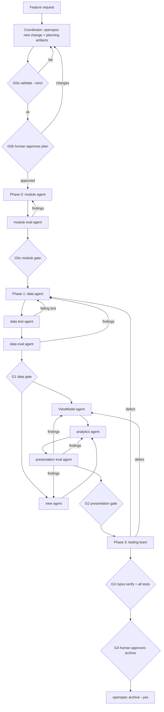

# Proposal: OpenSpec-driven multi-agent feature orchestrator

| | |
|---|---|
| Repository | `BaseApplication` (`:app`, `:core:data`, `:core:presentation`, `core/dependencies`, `:demo:*`) |
| Status | Design proposal, not implemented |
| OpenSpec version assumed | **v1.15.0** (latest release, 2026-10-24), verified against `Fission-AI/OpenSpec` `main` docs (`README.md`, `docs/cli.md`, `docs/commands.md`, `docs/customization.md`, `docs/concepts.md`, `docs/supported-tools.md`, `docs/agent-contract.md`, `docs/writing-specs.md`) |
| Wiki baseline | `openwiki/` as generated on 2026-10-26 (`quickstart.md`, `core-data/*`, `core-presentation/*`, `core-dependencies/*`) |

---

## 0. Implementation status (v1 scaffolding, 2026-10-26)

This section supersedes conflicting details in the rest of the document and in the appendix drafts.

**Verified in this repository**
- OpenSpec **1.15.0** is installed and initialized with the **`core` profile**: commands `/opsx:propose`, `/opsx:explore`, `/opsx:apply`, `/opsx:update`, `/opsx:sync`,
  `/opsx:archive` (`.claude/commands/opsx/`). The installed skills are `openspec-propose`, `openspec-explore`, `openspec-apply-change`, `openspec-update-change`,
  `openspec-sync-specs` and `openspec-archive-change` (`.claude/skills/`).
- `/opsx:verify` is **not installed** (it's expanded-profile only). The gates therefore don't depend on it. Mechanical checks plus the judged rubric replace it. If you enable the expanded
  profile later (`openspec config profile` → `openspec update`), eval agents may use it as extra input.
- A probe change confirmed that `openspec validate --strict` accepts a `.orchestrator/` folder inside a change, role-tagged task lines, and `x-` keys in `.openspec.yaml`.
  `openspec new change` already writes `schema:` and `created:`, so agents must **append** `x-` keys only; redeclaring `schema:` makes `status` fail with "Map keys must be unique".

**Implemented files**

| File | Purpose |
|---|---|
| `openspec/config.yaml` | Project context, artifact rules, apply/archive guidance (§3.4) |
| `docs/orchestrator/allowlist.yaml` | Allowlist v1 (§7.1) |
| `scripts/orchestrator/eval-mechanical.py` | Mechanical gate checks `preflight`, `G0a`, `G0c`, `G1`, `G2`, `G3` (§7.3); standard-library Python; dry-run against `demo/*` reports exactly its known issues |
| `scripts/orchestrator/guard-paths.sh` | PreToolUse guard (§10.4), active only while `.claude/orchestrator-active` exists |
| `docs/orchestrator/hooks.settings.json` | Hook registration snippet. **Not installed**: merge it into `.claude/settings.json` yourself (installing persistent hooks needs your explicit approval) |
| `.claude/agents/feature-*.md` (11) | Role definitions (supersede Appendix A). Phase 0 is a module team: `feature-module` builds, `feature-module-eval` reviews |
| `.claude/skills/{wiki-context,eval-mechanical,allowlist-derive}/SKILL.md` | Shared routines (§10.3) |
| `.claude/workflows/openspec-feature.js` | Orchestration (supersedes Appendix B). Stages `plan` → human creates `.orchestrator/plan-approved` → `implement` → human creates `.orchestrator/archive-approved` → `archive` |

**Design adjustments made while implementing**
- **Role leases:** hooks can't see which subagent is running, so per-role path enforcement is done after the fact by the eval agents (ownership in §6.1, TR-3, AN-4). The hook only
  enforces the global read-only zones and the archive approval.
- **Phase 0 is a team** (module agent + module eval), like the data team. The module agent builds and wires the modules; the read-only module eval runs the
  mechanical G0c checks (M-1…M-5) and then the judged rules M-6…M-10 against `openwiki/core-dependencies`. Its findings go back to the module agent for up to 3 rounds;
  a finding owned by `coordinator` (the spec asks for something the wiki forbids) stops the run.
- **Approvals** are marker files: `openspec/changes/<id>/.orchestrator/plan-approved` and `.orchestrator/archive-approved`.
- **Prerequisites P1/P2 are deferred** (owner: human). `preflight` reports them as `PRE-P1`/`PRE-P2`, and the workflow stops unless it's run with `allowMissingPrerequisites: true`.
  With them missing:
  - the data and testing agents use the documented "construct the impl directly" test pattern (MockK + `runTest`, no Hilt or Robolectric);
  - ViewModels are still written as `@HiltViewModel`, which compiles but **fails at runtime** when opened through Navigation3 until P1 lands;
  - the Hilt registration test is skipped and reported.

**How to run**
```text
Workflow openspec-feature  args: {"feature": "orders", "stage": "plan", "request": "<feature request>", "allowMissingPrerequisites": true}
# review: openspec show add-orders-feature ; then: touch openspec/changes/add-orders-feature/.orchestrator/plan-approved
Workflow openspec-feature  args: {"feature": "orders", "stage": "implement", "allowMissingPrerequisites": true, "baseRef": "<git sha before implement>"}
# review the feature; then: touch openspec/changes/add-orders-feature/.orchestrator/archive-approved
Workflow openspec-feature  args: {"feature": "orders", "stage": "archive", "allowMissingPrerequisites": true}
```

---

## 1. Executive summary

A developer describes a feature (for example "orders: list + detail + filter sheet backed by `/orders` endpoints"). A **coordinator** turns that request into an
**OpenSpec change** (`openspec/changes/add-<feature>-feature/`) containing a proposal, capability spec deltas (requirements and WHEN/THEN scenarios), a design
with the inter-team contracts, and a `tasks.md` partitioned per agent. After `openspec validate --strict` and **human approval of the plan**, the coordinator
drives four phases of specialized agents. Each agent implements only its own tagged tasks, guided by `openspec instructions apply --change <id> --json`,
and every file, test and finding is traceable to a requirement/scenario and a wiki section:

| Phase | Team | Output |
|---|---|---|
| 0 | Module team (module agent → module eval) | `:<feature>:data` + `:<feature>:presentation` Gradle modules, wired into `settings.gradle.kts` and `:app`, reviewed against `openwiki/core-dependencies` |
| 1 | Data team (data → data test → data eval) | Retrofit API, DTOs/models, `I<Feature>Manager`/`<Feature>ManagerImpl`, Hilt modules, scenario-mapped unit tests |
| 2 | Presentation team (ViewModel ∥ view → analytics → presentation eval) | Contract, ViewModel, UI models, screens, Navigation3 destinations/entries/graph, Hilt navigation module, analytics views/events and tracking |
| 3 | Testing team | Feature-level integration ("end-to-end") tests on the JVM, then `openspec archive` |

Two rules make "strictly follow the wiki" enforceable rather than aspirational: (1) **read-only zones** (`core/**`, `core/dependencies/**`, `openwiki/**`,
`openspec/specs/**`) guarded by Claude Code hooks, and (2) **eval agents** that combine mechanical checks (build, `openspec validate --strict`, an import/dependency
**allowlist** derived from the wiki, Detekt) with an LLM-judged rubric in which every rule cites a wiki page.

**Before the first run**, three human-approved prerequisites are required (§2). The most important is a small core fix so Navigation3 can create Hilt ViewModels.
Without it, no feature ViewModel can receive its manager or `IAnalyticsManager`.

**Recommended implementation:** a Claude Code **Workflow script** for the deterministic phase/gate orchestration, project **subagent definitions** for each role, a
handful of **skills** (wiki loading, eval checks), and **PreToolUse hooks** for the guardrails (§10).

---

## 2. Prerequisites

### 2.1 OpenSpec installation (requires human approval)

| Step | Command / result |
|---|---|
| Install CLI | `brew install openspec`, or `curl -fsSL https://raw.githubusercontent.com/Fission-AI/OpenSpec/main/scripts/binary/install.sh \| sh`, or `npm install -g @fission-ai/openspec@latest` (Node ≥ 20.19.0). Pin **1.15.0** in the team README. |
| Initialize | `openspec init --tools claude --profile custom` (non-interactive), then `openspec config profile` to enable the **expanded workflow** (`/opsx:new`, `/opsx:continue`, `/opsx:ff`, `/opsx:verify`, `/opsx:bulk-archive`, `/opsx:onboard`) and `openspec update` to apply it. `/opsx:verify` is used by the eval gates. |
| Generated files (per `docs/cli.md` "What it creates" and `docs/supported-tools.md`) | `openspec/specs/`, `openspec/changes/`, `openspec/config.yaml`; Claude Code skills in `.claude/skills/openspec-*/SKILL.md`; Claude Code commands in `.claude/commands/opsx/<id>.md` (invoked as `/opsx:<id>`). |
| Telemetry | Optional opt-out: `openspec config set telemetry.enabled false` or `OPENSPEC_TELEMETRY=0`. |
| `AGENTS.md` | v1.15 **does not create or edit `AGENTS.md`** (`docs/supported-tools.md`: "No `AGENTS.md` is created or edited"; older versions used marker blocks). The existing `<!-- OPENWIKI:START -->…<!-- OPENWIKI:END -->` block is untouched. Add, by hand, a short `## Feature orchestration` section **outside** the OpenWiki markers pointing to `openspec/config.yaml` and this document. |
| Verify after init | `openspec --version` (expect 1.15.0); `ls .claude/commands/opsx .claude/skills`. Record the **exact skill folder names** (`openspec-*`) in §10, because agents invoke those skills by name. **Not verified** here because OpenSpec isn't installed yet. |

### 2.2 Build and core prerequisites (ranked; each requires human approval)

These are the only changes this design asks for outside a feature module. Agents never make them on their own (§4, read-only zones).

| # | Change | Why | Where | Blocking? |
|---|---|---|---|---|
| **P1** | Make Navigation3 entries create ViewModels with a Hilt factory: have `NavigationGraphViewModelStoreOwner` also implement `HasDefaultViewModelProviderFactory`, returning `HiltViewModelFactory(activity, activity.defaultViewModelProviderFactory)` (or use `hiltViewModel(viewModelStoreOwner = …)` in `NavigationGraphFactoryImpl.register`). | Today `register()` calls `viewModel(modelClass)` under an owner with no factory, so `@HiltViewModel` classes with constructor parameters can't be created (`openwiki/core-presentation/navigation3.md` → *Gotchas*; `base-architecture.md` → *Gotchas*). Every feature ViewModel needs its manager and `IAnalyticsManager`. | `core/presentation/.../navigation3/model/entry/decorators/viewModel/*`, `factory/NavigationGraphFactoryImpl.kt` | **Yes** (Phase 2 can't pass without it) |
| **P2** | In `FeatureDataPlugin` and `FeaturePresentationPlugin`: call `configureTests()` and add `kspTest(hilt-compiler)`. | Feature unit tests need Robolectric resources/`--add-opens` and Hilt test codegen (`openwiki/core-dependencies/dependency-visibility.md` → *Unit-test visibility*, *Gaps and fixes* 4–5). | `core/dependencies/.../plugins/Feature*Plugin.kt` | **Yes** (Phases 1 and 3) |
| **P3** | Share `BaseTest`: move `core/data/src/test/.../BaseTest.kt` to `core/data/src/testFixtures/...` (Kotlin test fixtures are already enabled via `android.experimental.enableTestFixturesKotlinSupport`). | Feature modules receive `testFixtures(project(":core:data"))` but get no shared base class (`core-dependencies/plugin-feature-data.md` → *Gotchas*). | `core/data` | No. Without it, test agents copy the documented `BaseTest` pattern into each module (allowed, see rubric D-T3). |
| P4 | Add Compose UI test artifacts (`ui-test-junit4`, `ui-test-manifest`) to the catalog and `FeaturePresentationPlugin`. | Enables tier-2 screen tests (`core-presentation/testing.md`, `core-dependencies/recipes.md` §8). | `core/dependencies` | No (tier 2 is optional) |
| P5 | Fix core bugs that features may hit: Checkbox/Toggle default `onValueChange`, date-field error display, `CurrencyType.Symbol` in `AmountFieldComponent`. | Removes the need for view-agent workarounds (`core-presentation/form-fields.md`). | `core/presentation` | No (workaround rules V-K1…K5 exist) |
| P6 | Wire bottom-nav `onTabSelected` and implement `MainActivity` session hooks. | App-level gaps (`core-presentation/app-and-activity.md`). | `core/presentation`, `app` | No (features that need them are blocked at planning, §3.5) |

After approving P1–P3, regenerate the wiki (the OpenWiki workflow) so agents read the updated facts, and re-derive the allowlist (§7.1).

---

## 3. Architecture

### 3.1 Roles

- **Coordinator** (one per run): owns the OpenSpec change. It authors planning artifacts, runs every gate, hands out task "leases", routes failures, asks the human for approvals,
  and archives. It writes **no** Kotlin.
- **Team agents**: implement only tasks tagged with their role in `tasks.md` and check them off.
- **Eval agents**: read-only reviewers. They write verdict files, never code.
- **Human**: approves the plan (G0), any spec scope change, prerequisites, and the archive (G4).

### 3.2 OpenSpec lifecycle mapping

**Change granularity: one OpenSpec change per feature** (`add-<feature>-feature`, kebab-case as required by `openspec new change`), with **four capabilities**:
`<feature>-module`, `<feature>-data`, `<feature>-presentation`, `<feature>-analytics`.
Justification: one proposal/approval per feature; cross-team contracts live in a single `design.md`; `tasks.md` gives one progress view; a single `openspec archive`
merges all capability specs atomically. One-change-per-team was rejected because it splits the contract, needs four approvals and four archives, and OpenSpec has no
cross-change dependency mechanism. Team scoping is achieved with **task sections + role tags** instead.

```
openspec/
├── config.yaml                                  # project context + rules (§3.4)
├── specs/                                       # truth after archive: <feature>-module/, <feature>-data/, ...
└── changes/
    └── add-orders-feature/
        ├── .openspec.yaml                       # schema: spec-driven, x-feature: orders, x-run-id: ...
        ├── proposal.md
        ├── design.md                            # includes the handoff contracts (§6)
        ├── tasks.md                             # sections 0–4, role tags (§3.3)
        ├── specs/
        │   ├── orders-module/spec.md
        │   ├── orders-data/spec.md
        │   ├── orders-presentation/spec.md
        │   └── orders-analytics/spec.md
        └── .orchestrator/                       # run state (not an OpenSpec artifact)
            ├── leases.json
            ├── verdicts/{module-eval,data-eval,presentation-eval,testing}-<n>.json
            └── handoff/data-api-surface.json
```
`x-` keys in `.openspec.yaml` are explicitly ignored by OpenSpec and keep `validate --strict` green (`docs/cli.md` → *Keep your own metadata*).
The `.orchestrator/` folder sits inside the change folder so it's archived with it. If the installed version rejects unknown folders under a change, move it
to `docs/orchestrator/runs/<change-id>/` (to be verified in the pilot).

**Stage mapping:**

| Stage | Trigger | Who | Gate |
|---|---|---|---|
| Explore (optional) | `/opsx:explore <feature idea>` | Human + coordinator | none |
| Scaffold | `openspec new change add-<feature>-feature --description "<one line>" --json` | Coordinator | none |
| Plan artifacts | `openspec status --change <id> --json` → for each `ready` artifact: `openspec instructions <artifact> --change <id> --json`, then write it. (Interactive equivalent: `/opsx:ff <id>` or `/opsx:continue`.) | Coordinator | — |
| Validate plan | `openspec validate <id> --strict --json` (exit 0 required) | Coordinator | **G0a** |
| Approve plan | Human reviews `openspec show <id>` / `openspec view` | Human | **G0b** (no code before this) |
| Implement | Per agent: `openspec instructions apply --change <id> --json`, then implement its own tagged tasks and check them off in `tasks.md`. (Interactive equivalent: `/opsx:apply <id>`.) | Phase agents | G1…G3 per phase |
| Revise plan | `/opsx:update <id>` (or edit artifacts) + re-validate | Coordinator only | Human approval if scope changes (§3.6) |
| Verify | `/opsx:verify <id>` (expanded profile) + mechanical checks | Eval agents / testing team | G1, G2, G3 |
| Archive | `openspec archive <id> --yes` (merges deltas into `openspec/specs/`, moves the change to `changes/archive/YYYY-MM-DD-<id>/`) | Coordinator, after human OK | **G4** |
| Lint archives (CI, optional) | `openspec validate --archived` (fails if an archived change has unchecked tasks) | CI | — |

### 3.3 Phases, sequencing and gates



| Gate | Entry | Exit (all required) |
|---|---|---|
| G0a | Planning artifacts written | `openspec validate <id> --strict` exit 0; `openspec status --change <id> --json` → `isPlanningComplete: true`; every task has a role tag and a `Req:` reference (§3.5) |
| G0b | G0a | Human approval recorded in `.orchestrator/leases.json` (`"planApprovedBy"`) |
| G0c | Section 0 tasks checked | `./gradlew :<feature>:data:assembleDebug :<feature>:presentation:assembleDebug :app:assembleDebug` succeeds; mechanical M-1…M-5 pass; module-eval verdict `PASS` (judged M-6…M-10 against `openwiki/core-dependencies`) |
| G1 | Section 1 tasks checked | `:<feature>:data:testDebugUnitTest` green; every `<feature>-data` scenario has ≥1 test; data-eval verdict `PASS` |
| G2 | Section 2 tasks checked | `:<feature>:presentation:compileDebugKotlin` + `:app:assembleDebug` green; presentation-eval verdict `PASS` |
| G3 | Section 3 tasks checked | all feature unit/integration tests green; `/opsx:verify` reports 0 CRITICAL; `openspec validate <id> --strict` still green |
| G4 | G3 | Human approval → `openspec archive <id> --yes` |

**Parallelism:** Phases are sequential. Inside Phase 2, the ViewModel agent and the view agent run **in parallel** because the contract (state/event/effect types and
UI models) is fixed in `design.md` §"Presentation contract" during planning and they own disjoint files (§5). The analytics agent runs **after** both because it adds calls to the
ViewModel (sequential edit lease, §5). The data test agent starts after the data agent's first pass (it needs the real interfaces), then the two loop.

### 3.4 Project context (`openspec/config.yaml`)

`context` is injected into every artifact and every apply/archive instruction; `rules` apply per artifact; `operations.apply.guidance` is advisory
(`docs/customization.md`). Draft:

```yaml
schema: spec-driven
context: |
  Android app, Kotlin 2.4, Jetpack Compose, Hilt, Navigation3, single-activity (BaseActivity).
  Source of truth for HOW to build: openwiki/ (read openwiki/quickstart.md first, then the pages listed in tasks).
  Data layer rules: openwiki/core-data/*.md. Presentation rules: openwiki/core-presentation/*.md. Build rules: openwiki/core-dependencies/*.md.
  Feature layout: :<feature>:data (plugin feature.data, namespace com.<feature>.data) and
  :<feature>:presentation (plugin feature.presentation, namespace com.<feature>.presentation).
  Only technology documented in the wiki and already exposed by the convention plugins may be used. No new Gradle dependencies.
  Read-only: core/**, core/dependencies/**, openwiki/**, openspec/specs/**.
  Results: ApiResult (data) and UiResult (presentation). Navigation: com.core.presentation.navigation3 only (never ...navigation legacy).
  Known core limitations and mandatory workarounds: docs/orchestrator/proposal.md §4 constraint table.
rules:
  proposal:
    - Include a "Platform dependencies" section (permissions, activity results, session, bottom-nav tab, forms, paging) and mark each as supported or blocked.
    - Include "Out of scope" and the analytics views/events list.
  specs:
    - One observable behavior per requirement with SHALL/MUST; WHEN/THEN scenarios that a JVM test can assert.
    - Capabilities are exactly <feature>-module, <feature>-data, <feature>-presentation, <feature>-analytics.
  design:
    - Contain the sections "Data API surface", "Presentation contract", "Navigation", "Analytics map", "Cache policy", "Test plan", each in the template format.
  tasks:
    - Every task starts with a role tag [module|data|data-test|viewmodel|view|analytics|testing] and ends with "Req: <capability>/<requirement>" (and "Scn: <scenario>" for tests).
    - Sections: 0 Module, 1 Data, 2 Presentation, 3 Testing. Never mix roles in one task.
operations:
  apply:
    guidance:
      - Implement only tasks carrying your role tag; leave other tasks unchecked.
      - Before writing code, read the wiki pages referenced by the task; cite them in your summary.
      - If a task is impossible without leaving your owned paths or adding a dependency, stop and report a SPEC-CHANGE request.
  archive:
    guidance:
      - Archive only after the human approves; use --yes.
```

**Keeping it in sync:** the context points to wiki **paths**, not copied facts, so a regenerated wiki is picked up automatically. The allowlist (§7.1) is the only
derived artifact. Regenerate it whenever `openwiki/.last-update.json` changes (a pre-run check in the Workflow compares its timestamp with `allowlist.yaml`'s
`source_wiki_update`).

### 3.5 Traceability

- **Task → requirement:** each task line ends with `Req: <capability>/<Requirement title>` (titles are unique within a capability). Test tasks also carry
  `Scn: <Scenario title>`.
- **Code → task:** each new file's KDoc header contains `@see openspec add-<feature>-feature task <n.m>`. KDoc on public classes is already required by Detekt
  (`core-dependencies/code-quality.md`, `UndocumentedPublicClass`), so this costs nothing extra.
- **Test → scenario:** test function names follow the scenario (`` `WHEN filter applied THEN list shows only matching orders` ``), plus a KDoc line `Scn: <capability>/<scenario>`.
- **Mechanical check (TR-1):** a script lists every scenario (`openspec show <id> --json --deltas-only`) and fails the gate if a scenario of the phase's capability has no
  test referencing it, or if any new `.kt` file lacks a task reference.
- **Platform dependencies:** if the request needs permissions, activity results, session UI or a working bottom-nav tab, the coordinator marks the requirement
  `BLOCKED by P6/core` in `proposal.md` and the human decides at G0b (descope, or approve a core prerequisite first).

### 3.6 Spec changes during implementation

1. Any agent that finds the spec wrong, ambiguous or unimplementable within its constraints **stops** and writes `.orchestrator/requests/spec-change-<n>.md`
   (task id, requirement, problem, evidence, proposed delta).
2. The coordinator evaluates it. For a **clarification without scope change** (for example a field name), it updates `design.md`/spec delta via `/opsx:update <id>` or a direct edit,
   runs `openspec validate <id> --strict`, and notes it in the run log. For a **scope change** (new/removed requirement or behavior), it pauses the run and asks the human (re-approval of G0b).
3. Affected unchecked tasks are rewritten. Already-checked tasks that are invalidated are **unchecked** with a note, and their owner re-runs.
4. No agent may "fix" a spec by implementing something different and noting it afterwards. The eval rubric treats untraceable behavior as a FAIL (rule TR-2).

---

## 4. Constraints and how they are handled

| # | Constraint (wiki source) | Owner | Handling |
|---|---|---|---|
| 1 | Feature presentation can't see core/data types (`core-dependencies/dependency-visibility.md`) | Module agent | `:<feature>:presentation` gets `implementation(project(":<feature>:data"))`. Rubric M-3. |
| 2 | Default namespace `com.base.application` (`core-dependencies/config.md`) | Module agent | `android { namespace = "com.<feature>.data" }` / `"com.<feature>.presentation"`. Rubric M-2. |
| 3 | Hilt/Navigation3 reachability (`core-dependencies/plugin-app.md`) | Module agent | `app/build.gradle.kts`: `implementation(project(":<feature>:presentation"))` (data comes transitively at runtime). Rubric M-4. |
| 4 | Analytics lives in `:core:data` (`core-data/analytics.md`) | Analytics agent; checked by **presentation eval** | Event/view classes extending `BaseFirebaseTrackEvent`/`BaseFirebaseTrackView` live in `com.<feature>.presentation.analytics` (visible through the data dependency). Tracking calls `analyticsManager.trackView/trackEvent(AnalyticsFramework.FIREBASE, …)` are added to the ViewModel. Governed by `core-data/analytics.md` (types, FIREBASE pairing rule) + `core-presentation/base-architecture.md` (where calls go). `initialize()` isn't the feature's job (app-level, flagged). |
| 5 | Navigation3 ViewModel factory; `loadInitData()` not called (`core-presentation/navigation3.md`) | Human (P1); ViewModel and view agents | P1 is **blocking**. After P1: ViewModels are `@HiltViewModel` with `@Inject constructor(...)`. The **view agent** calls `LaunchedEffect(Unit) { viewModel.loadInitData() }` in every `Render`. Rubric V-N3. ViewModels must not read subclass properties in `setInitialState()` (rubric VM-4). |
| 6 | Known component bugs (`core-presentation/form-fields.md`, `components-layout.md`, `forms.md`) | View agent; checked by presentation eval | Rules V-K1…K5 (§7.2): explicit `onValueChange` for Checkbox/Toggle; date fields need a separate error text from state; no `CurrencyType.Symbol` in `AmountFieldComponent`; no `PagingComponent`/`ContainerComponent` (commented out); `Validators.Required` first. |
| 7 | Test infrastructure gaps (`core-dependencies/dependency-visibility.md`, `core-presentation/testing.md`) | Human (P2–P4); testing team | "End-to-end" is defined as **JVM feature-integration tests** (§4.1). Device/UI E2E is out of scope until P4 plus an instrumented setup exist. |
| 8 | App-level limitations: session hooks `TODO()`, `BaseActivity` not a `FragmentActivity` (no permissions or activity results), bottom-nav tabs not wired (`core-presentation/app-and-activity.md`, `core-data/permission.md`) | Coordinator at planning | Flagged in `proposal.md` → *Platform dependencies*. Requirements that depend on them are `BLOCKED` (human decides at G0b). A feature graph may implement `INavigationGraphBottomNavBar` only with a note that tab taps are inert until P6. |
| 9 | Read-only zones | All; enforced by hooks | `core/**`, `core/dependencies/**`, `openwiki/**`, `openspec/specs/**` blocked for Edit/Write. The module agent may additionally touch `settings.gradle.kts` and `app/build.gradle.kts`. Escalation: write `.orchestrator/requests/core-change-<n>.md`; the coordinator pauses and asks the human. |

### 4.1 What "end-to-end" means in this repo

There's no instrumented-test infrastructure and no Compose UI test artifacts. A true on-device E2E isn't possible without new dependencies. The testing team delivers:

- **Tier 1 (mandatory): feature-integration tests** in `:<feature>:presentation/src/test`, `@HiltAndroidTest` + Robolectric (requires P2), wiring the **real** ViewModel → real
  `I<Feature>Manager` → real cache scope → a **fake API service** bound with `@TestInstallIn(replaces = [<Feature>NetworkModule::class])`, which is the documented pattern from
  `DownloadNetworkModuleTest` (`core-data/testing.md`). `ISecurityManager` is replaced with an identity mock if `DISK_CACHE` is used (as in `CacheManagerTest`). The tests assert
  `viewState` transitions, effects, `INavigationGraphManager.backStack` changes, and `IAnalyticsManager` calls (MockK `@BindValue`). They also include a **registration test**: the
  feature graph and its entries are present in `INavigationGraphFactory.navigationGraphsWithDestinations`.
- **Tier 2 (only if P4 is approved):** Robolectric Compose UI tests of the screens inside `Theme { }`, driving them through the entry `Render`.
- **Out of scope:** network against a real backend, device tests, screenshot tests. `MockWebServer` isn't in the catalog, so it isn't allowed.

---

## 5. Agent roster

Common to all implementation agents: they load `openwiki/quickstart.md` plus the pages listed below with the `wiki-context` skill (§10), run
`openspec instructions apply --change <id> --json` to get the context/guidance and their tasks, implement only tasks with their tag, check them off, and finish with
a summary listing tasks done, files, wiki citations and open issues. Forbidden for all: edits outside owned paths, new Gradle dependencies, editing `openspec/specs/**`,
deleting or skipping tests, checking tasks they don't own, and touching other features.

| Agent | Purpose | OpenSpec interaction | Inputs (wiki) | Outputs (owned paths) | Tools | Done when |
|---|---|---|---|---|---|---|
| **Coordinator** | Plan, gate, route, archive | `new change`, `status`, `instructions <artifact>`, `validate --strict`, `/opsx:update`, `/opsx:verify`, `archive --yes` | `quickstart.md`, all `recipes.md`, `dependency-visibility.md` | `openspec/changes/<id>/**` (planning artifacts, `.orchestrator/**`) | Read, Grep, Glob, Write/Edit (change folder only), Bash (openspec, gradle read-only tasks), Agent, AskUserQuestion | G4 archived, or run escalated |
| **Module (0.1)** | Create and wire modules | `instructions apply`; checks off `[module]` tasks; owns fixes for module-eval findings | `core-dependencies/recipes.md` §1–2, `plugin-feature-data.md`, `plugin-feature-presentation.md`, `config.md`, `dependency-visibility.md` | `<feature>/data/{build.gradle.kts,.gitignore,consumer-rules.pro,proguard-rules.pro,src/main/AndroidManifest.xml}`, same for `presentation`, `settings.gradle.kts` (append includes), `app/build.gradle.kts` (append dependency) | Read, Write, Edit, Bash (gradle) | G0c |
| **Module eval (0.2)** | Strict `core-dependencies` wiki compliance of Phase 0 | `show --json --deltas-only`; mechanical G0c + judged review | `core-dependencies/recipes.md` §1–2, `plugin-feature-*.md`, `config.md`, `dependency-visibility.md`, `overview.md`, `version-catalog.md`, rubric M-*/TR-2 | `.orchestrator/verdicts/module-eval-<n>.json` | Read, Grep, Glob, Bash (read-only gradle, git diff, check scripts) | verdict written |
| **Data (1.1)** | API, DTOs, models, manager, repository, DI | `[data]` tasks; owns fixes for failing tests and data-eval findings | `core-data/overview.md`, `network.md`, `cache.md`, `environment.md`, `security.md` (if needed), `recipes.md` §1–2, `core-dependencies/plugin-feature-data.md` | `<feature>/data/src/main/java/com/<feature>/data/**` | Read, Write, Edit, Grep, Bash (gradle compile/test) | its tasks checked; data module compiles; zero open findings assigned to it |
| **Data test (1.2)** | Scenario-mapped unit tests | `[data-test]` tasks | `core-data/testing.md`, the pages of the code under test | `<feature>/data/src/test/**` | Read, Write, Edit, Bash (gradle test) | every `<feature>-data` scenario covered; failures reported with attribution |
| **Data eval (1.3)** | Strict wiki compliance of Phase 1 | runs `/opsx:verify` (scoped) + checks | `core-data/*`, allowlist, rubric D-*/TR-* | `.orchestrator/verdicts/data-eval-<n>.json` | Read, Grep, Glob, Bash (read-only gradle, check scripts) | verdict written |
| **ViewModel (2.1)** | Contract, ViewModel, UI models/mappers | `[viewmodel]` tasks | `core-presentation/base-architecture.md`, `coroutines.md`, `forms.md` (if forms), `core-dependencies/dependency-visibility.md` | `.../presentation/viewModel/**`, `.../presentation/model/ui/**` | Read, Write, Edit, Bash (compile) | compiles against the data API surface; contract matches `design.md` |
| **View (2.2)** | Screens, destinations, entries, graph, Hilt navigation module | `[view]` tasks | `core-presentation/navigation3.md`, `app-and-activity.md`, `theme.md`, `theme-tokens.md`, `components-*.md`, `form-fields.md`, `ui-utils.md`, `recipes.md` | `.../presentation/view/**`, `.../presentation/navigation/**`, `.../presentation/model/destination/**`, `.../presentation/di/**` | Read, Write, Edit, Bash (compile) | compiles; registration matches `design.md` → *Navigation* |
| **Analytics (2.3)** | Views, events and tracking calls | `[analytics]` tasks; sequential edit lease on ViewModel files | `core-data/analytics.md`, `core-presentation/base-architecture.md` | `.../presentation/analytics/**` + **lease**: insert-only edits in `.../viewModel/*ViewModel.kt` (tracking calls and the constructor parameter) | Read, Write, Edit, Bash (compile) | every event/view in `design.md` → *Analytics map* exists and is called |
| **Presentation eval (2.4)** | Strict wiki compliance of Phase 2 (incl. analytics) | `/opsx:verify` (scoped) + checks | `core-presentation/*`, `core-data/analytics.md`, allowlist, rubric VM-*/V-*/AN-*/TR-* | `.orchestrator/verdicts/presentation-eval-<n>.json` | Read, Grep, Glob, Bash (read-only) | verdict written |
| **Testing team (3)** | Feature-integration tests + final verify | `[testing]` tasks; runs `/opsx:verify <id>` | `core-data/testing.md`, `core-presentation/testing.md`, `navigation3.md`, `analytics.md` | `<feature>/presentation/src/test/**` (and `<feature>/data/src/test/**` only for shared fakes under `.../fake/`) | Read, Write, Edit, Bash (gradle test) | G3 |

The testing team is **one agent** in v1. Splitting it (integration vs. UI) only pays off once P4 enables tier 2.

---

## 6. File ownership map and handoff artifacts

### 6.1 Ownership (`<f>` = feature, base = `<f>/<module>/src/main/java/com/<f>/<module>/`)

| Path | Owner | Others |
|---|---|---|
| `settings.gradle.kts`, `app/build.gradle.kts` | module | append-only, Phase 0 only |
| `<f>/data/build.gradle.kts`, `<f>/presentation/build.gradle.kts`, manifests, `.pro`, `.gitignore` | module | module eval reads only |
| `data/api/**`, `data/model/**`, `data/manager/**`, `data/repository/**`, `data/di/**` | data | — |
| `<f>/data/src/test/**` | data-test | testing may add `fake/**` |
| `presentation/viewModel/**`, `presentation/model/ui/**` | viewmodel | analytics: insert-only lease after viewmodel is done |
| `presentation/view/**`, `presentation/navigation/**`, `presentation/model/destination/**`, `presentation/di/**` | view | — |
| `presentation/analytics/**` | analytics | — |
| `<f>/presentation/src/test/**` | testing | — |
| `openspec/changes/<id>/**` (except `tasks.md` checkboxes) | coordinator | agents tick only their own checkboxes |
| `.orchestrator/verdicts/**` | eval agents | — |

The package layout follows `demo/presentation` (`viewModel/`, `view/`, `navigation/`, `model/`, `di/`) and core/data (`api/`, `di/`, `manager/`, `model/`, `repository/`).
`.orchestrator/leases.json` records which role currently holds which path globs. The PreToolUse hook (§10.4) enforces it.

### 6.2 Handoff artifacts

All handoffs live in `design.md` (an OpenSpec artifact, versioned with the change) except the generated API surface:

| From → To | Artifact | Content |
|---|---|---|
| Coordinator → all | `design.md` → *Data API surface* (planned) | interfaces, method signatures, model fields, the Hilt bindings presentation may inject |
| Data → Presentation | `.orchestrator/handoff/data-api-surface.json` (generated after G1 from the real code by the data eval agent) | actual public types; the presentation eval diffs it against the planned surface |
| Coordinator → ViewModel ∥ View | `design.md` → *Presentation contract* | `UiState`/`Event`/`Effect` types, UI model fields, which events each screen emits |
| Coordinator → View | `design.md` → *Navigation* | destinations (object/data class + args), entry type (screen/dialog/bottom sheet), graph (launcher? bottom-nav?), effect → navigation mapping |
| Coordinator → Analytics | `design.md` → *Analytics map* | view/event class names, Firebase keys/params, the ViewModel hook (which event/state transition triggers it) |
| Coordinator → Testing | `design.md` → *Test plan* | scenario → test class mapping, fakes, Hilt replacements |
| Eval → owners | `verdicts/*.json` | §7.4 |

`data-api-surface.json` schema:
```json
{
  "feature": "orders",
  "managers": [{"interface": "com.orders.data.manager.IOrdersManager",
                "methods": [{"name": "getOrders", "suspend": true, "params": [{"name": "status", "type": "OrderStatus?"}],
                             "returns": "ApiResult<List<Order>>"}]}],
  "models": [{"type": "com.orders.data.model.Order", "fields": [{"name": "id", "type": "String"}]}],
  "hiltBindings": [{"type": "IOrdersManager", "component": "SingletonComponent", "scope": "Singleton", "module": "com.orders.data.di.OrdersModule"}]
}
```

---

## 7. Eval design

### 7.1 Allowlist (`docs/orchestrator/allowlist.yaml`)

**Derivation (repeatable):** (1) read `openwiki/core-dependencies/dependency-visibility.md` (*Compile-time visibility*) and `version-catalog.md` → the libraries visible per module type;
(2) map each library to its Kotlin package roots; (3) read the "Type reference"/"Usage" sections of `core-data/*` and `core-presentation/*` → permitted base classes,
annotations and APIs; (4) add the "forbidden" list from the *Gotchas* sections; (5) stamp `source_wiki_update` from `openwiki/.last-update.json`. The derivation is a
skill (`allowlist-derive`) run by the coordinator when the stamp is stale; a human reviews the diff.

Draft (v1):
```yaml
source_wiki_update: "2026-10-26"
data:                         # :<feature>:data main
  imports_allowed: [ "com.core.data.", "com.<feature>.data.", "javax.inject.", "dagger.", "kotlinx.serialization.",
                     "kotlinx.coroutines.", "retrofit2.", "okhttp3.", "kotlin.", "java.", "android." ]
  base_types: [ IAnalyticsManager, ICacheManager, ISecurityManager, IEnvironmentManager, RetrofitFactory, ApiResult,
                ImmortalCacheConfig, TimeToLiveCacheConfig, CacheScope ]
  annotations: [ "@Module", "@InstallIn(SingletonComponent::class)", "@Provides", "@Singleton", "@Inject", "@Serializable",
                 "@GET", "@POST", "@PUT", "@DELETE", "@Path", "@Query", "@Body", "@Header", "@HeaderMap", "@Url" ]
presentation:                 # :<feature>:presentation main
  imports_allowed: [ "com.core.presentation.", "com.core.data.analytics.", "com.core.data.network.model.ApiResult",
                     "com.core.data.network.utils.", "com.<feature>.presentation.", "com.<feature>.data.",
                     "androidx.compose.foundation.", "androidx.compose.runtime.", "androidx.compose.ui.",
                     "androidx.compose.material3.", "androidx.lifecycle.", "androidx.navigation3.", "androidx.hilt.",
                     "dagger.", "javax.inject.", "kotlinx.serialization.", "kotlinx.coroutines.", "kotlin.", "java." ]
  forbidden_imports: [ "com.core.presentation.navigation.", "androidx.navigation.compose.", "androidx.navigation.ui.",
                       "com.core.presentation.ui.components.container.", "com.core.presentation.ui.components.list.PagingComponent" ]
  base_types: [ BaseViewModel, IBaseContract, UiResult, INavigationDestination, INavigationEntry, INavigationEntryDialog,
                INavigationEntryBottomSheet, INavigationGraph, INavigationGraphLauncher, INavigationGraphBottomNavBar,
                INavigationGraphManager, BaseFirebaseTrackView, BaseFirebaseTrackEvent ]
  hilt_components: [ "SingletonComponent", "ActivityRetainedComponent" ]
tests:
  imports_allowed: [ "org.junit.", "io.mockk.", "org.robolectric.", "dagger.hilt.android.testing.", "kotlinx.coroutines.test.",
                     "androidx.test." ]   # androidx.test only if transitively present; verify in pilot
  forbidden: [ "okhttp3.mockwebserver.", "com.google.truth." ]
gradle:
  feature_build_file_may_contain: [ "plugins { alias(coreLibs.plugins.feature.data|feature.presentation) }",
                                    "android { namespace = ... }", "implementation(project(\":<feature>:data\"))" ]
  no_new_external_dependencies: true
```

### 7.2 Rubric

Every rule: **ID · check type (M = mechanical, J = LLM-judged) · source**. Severity CRITICAL (fails the gate) unless marked W (warning).

**Module (module eval, G0c)**
- M-1 · M · feature build files apply only `coreLibs.plugins.feature.data` / `feature.presentation` (`core-dependencies/plugin-feature-*.md`)
- M-2 · M · unique `namespace = "com.<f>.data"` / `"com.<f>.presentation"` (`core-dependencies/config.md` → *Gotchas*)
- M-3 · M · presentation depends on `project(":<f>:data")` (`dependency-visibility.md` → *Gaps and fixes* 1)
- M-4 · M · `app/build.gradle.kts` depends on `:<f>:presentation`, and both modules are included in `settings.gradle.kts` (`core-dependencies/recipes.md` §1–2)
- M-5 · M · no external dependency added anywhere (dependency diff of `:app:dependencies --configuration debugRuntimeClasspath` before/after, minus project modules)
- M-6 · J · build files have exactly the recipe shape (`plugins { alias(...) }`, `android { namespace }`, `dependencies {}`); SDK levels, Java/Kotlin targets, build features and test options come from the convention plugin and are never set in the feature (`core-dependencies/recipes.md` §1–2, `config.md`, `plugin-feature-*.md`)
- M-7 · J · visibility edges are exactly `:app` → `:<f>:presentation` and `:<f>:presentation` → `:<f>:data`, both `implementation` (never `api`); no `:app` → `:<f>:data`, no data → presentation edge (`dependency-visibility.md` → *Gaps and fixes* 1, 3; `recipes.md` §1 step 4)
- M-8 · J · `settings.gradle.kts` and `app/build.gradle.kts` edits are append-only: existing includes and dependencies (including `:demo:*`) are untouched and keep their order (§6.1; `recipes.md` §2 step 5 applies only when replacing the demo)
- M-9 · J · module files match the demo shape (empty manifest, `.gitignore`, `.pro` files) and nothing else changed: no Kotlin sources, and no edits under `core/**`, `gradle/**` or `demo/**` (`recipes.md` §1–2; read-only zones §4)
- M-10 · J (W) · wiki gotchas that need a core change (PRE-P2: no `kspTest`/Robolectric; the Compose BoM gap) are reported with a citation, never worked around in the feature build files (`plugin-feature-data.md`, `plugin-feature-presentation.md`, `version-catalog.md` → *Gotchas*)

**Data (data eval)**
- D-1 · M · imports ⊆ `allowlist.data.imports_allowed`
- D-2 · J · API services are Retrofit `suspend` functions returning `ApiResult<T>` and are provided via `RetrofitFactory.create().build(kClass, environment = env.environment, interceptors)` in a `@Singleton` provider (`core-data/network.md` → *Declaring a feature API service*)
- D-3 · J · managers follow `I<Feature>Manager` + `<Feature>ManagerImpl`, provided in a `@Module @InstallIn(SingletonComponent::class)` object with `@Singleton @Provides` (`core-data/overview.md` → *Architecture conventions*)
- D-4 · J · all public results are `ApiResult`; `NoContent` is compared with `is` (`core-data/network.md` → *Gotchas*)
- D-5 · J · DTOs are `@Serializable`; cached values are `@Serializable` classes, with lists wrapped (`core-data/cache.md` → *Gotchas*)
- D-6 · J · cache usage matches `design.md` → *Cache policy*; `repositoryPattern` is used only with non-suspend sources, otherwise the manual pattern from `core-data/recipes.md` §2
- D-7 · J · no use of `CipherType.RSA` without a key (`core-data/security.md` → *Gotchas*, shared alias)
- D-8 · M · no new Detekt findings in the feature module compared with an empty module: `./gradlew :<f>:data:detekt` on a disposable worktree (W only, because the strict config also flags documented patterns; `core-dependencies/code-quality.md`)
- D-T1 · M · every `<f>-data` scenario has ≥1 test with `Scn:` (§3.5)
- D-T2 · J · tests use the documented patterns (`@HiltAndroidTest`, `@UninstallModules` + `@BindValue`, `@TestInstallIn`, MockK) (`core-data/testing.md` → *Replacing dependencies*)
- D-T3 · J · without P3, a local `BaseTest` copy is identical in behavior to `core-data/testing.md` → *BaseTest*
- D-T4 · M · no test was deleted, `@Ignore`d or weakened between iterations (git diff of `src/test`)

**ViewModel (presentation eval)**
- VM-1 · M · imports ⊆ allowlist; no forbidden imports
- VM-2 · J · `<Feature>Contract` with `ViewState`/`ViewEvent`/`ViewEffect`; ViewModel extends `BaseViewModel<…>`, is `@HiltViewModel`, state is changed only through `setState` (`core-presentation/base-architecture.md`)
- VM-3 · J · data calls use `withUseCaseScope`/`withUseCaseScopeLazily`, and blocks don't throw (`core-presentation/coroutines.md` → *Exception caveat*)
- VM-4 · J · `setInitialState()` returns constants or constructor-derived values only (`base-architecture.md` → *Gotchas*)
- VM-5 · J · the contract equals `design.md` → *Presentation contract*

**View (presentation eval)**
- V-1 · M · no hard-coded colours (`Color(0x…)`, `Color.Red`, …) or `MaterialTheme.colorScheme`; colours come from `LocalPalette`, spacing from `LocalDimensions`, text from `LocalTypographies` (`core-presentation/theme.md`, `theme-tokens.md`)
- V-2 · J · UI uses design-system components where one exists (`components-*.md`, `form-fields.md`)
- V-N1 · J · destinations are `@Serializable` `data object`/`data class` extending navigation3 `INavigationDestination` (`navigation3.md`)
- V-N2 · J · entries extend `INavigationEntry`/`INavigationEntryDialog`/`INavigationEntryBottomSheet` with `@Inject constructor(override val navigator: dagger.Lazy<INavigationGraphManager>)`; the graph and entry set are bound with the same `@ClassKey` in an `ActivityRetainedComponent` module (`navigation3.md` → *Feature registration*)
- V-N3 · M · every `Render` calls `viewModel.loadInitData()` in a `LaunchedEffect` and collects `effect` in exactly one place (`base-architecture.md`, `navigation3.md`)
- V-N4 · J · a destination class is used by exactly one entry; the launcher graph only if the spec says so, with an `object` first entry (`navigation3.md` → *Gotchas*)
- V-K1 · M · every `CheckboxComponent`/`ToggleComponent` call passes `onValueChange` (`form-fields.md`)
- V-K2 · J · date fields show validation errors through separate UI (`form-fields.md`)
- V-K3 · M · `AmountFieldComponent` isn't used with `CurrencyType.Symbol` (`form-fields.md`)
- V-K4 · M · no reference to `PagingComponent`/`ContainerComponent`/list `Loading`/`Error` (`components-layout.md`)
- V-K5 · J · `Validators.Required` comes first in every `TextFieldState` validator list (`forms.md` → *Crash gotcha*)
- V-I1 · J · screens in bottom-nav graphs use `nestedScroll(LocalBottomNavBarScrollConnection.current)` + `bottomNavBarPadding()`; edge-to-edge insets are handled (`components-navigation.md`, `app-and-activity.md`)

**Analytics (presentation eval)**
- AN-1 · J · views extend `BaseFirebaseTrackView`, events extend `BaseFirebaseTrackEvent`, and every call uses `AnalyticsFramework.FIREBASE` with these types (`core-data/analytics.md` → *Gotchas*)
- AN-2 · J · bundle values are `bundleOf`-compatible (`analytics.md` → *Type reference*)
- AN-3 · M · every entry of `design.md` → *Analytics map* has a class and a call site; no extra events
- AN-4 · M · analytics edits to the ViewModel are insert-only (diff contains no deletions outside the constructor line)

**Traceability (all evals)**
- TR-1 · M · scenario coverage and file → task references (§3.5)
- TR-2 · J · no behavior implemented without a requirement (compare public API and UI flows to the spec; for the module eval, the build files against `<f>-module`)
- TR-3 · M · `openspec validate <id> --strict` exit 0; only owned task checkboxes changed by each role (git diff of `tasks.md`)

### 7.3 Mechanical vs. judged

| Mechanical (script/skill `eval-mechanical`, deterministic, runs first) | Judged (eval agent) |
|---|---|
| Gradle assemble/compile/test, module build-file checks (M-1…M-4), `openspec validate --strict --json`, `openspec status --json`, import scan vs. allowlist, forbidden-symbol grep (V-1, V-K1, V-K3, V-K4), dependency diff (M-5), scenario coverage (TR-1), diff-shape checks (D-T4, AN-4, TR-3), Detekt delta (W) | architecture conformance (D-2…D-7, VM-2…VM-5, V-2, V-N1/N2/N4, V-K2/K5, AN-1/AN-2, TR-2), using the wiki section cited by each rule, `/opsx:verify` output (completeness/correctness/coherence) as input |

The judged pass only runs if the mechanical pass has no CRITICAL findings, which saves tokens.

### 7.4 Verdict format and routing

```json
{
  "gate": "G1", "iteration": 2, "verdict": "FAIL",
  "findings": [{
    "rule": "D-2", "severity": "CRITICAL",
    "wiki": "openwiki/core-data/network.md#declaring-a-feature-api-service",
    "requirement": "orders-data/Fetch order list",
    "location": "orders/data/src/main/java/com/orders/data/di/OrdersNetworkModule.kt:18",
    "evidence": "Retrofit.Builder() created directly instead of RetrofitFactory",
    "owner": "data", "fix_hint": "Inject RetrofitFactory + IEnvironmentManager and call create().build(...)"
  }]
}
```
The coordinator routes each finding to `owner`. **Max iterations:** 3 eval rounds per gate. After that, it escalates to the human with all verdicts.

---

## 8. Fix loops and termination

| Loop | Rule | Limit | Escalation |
|---|---|---|---|
| Data test failure | The test agent reports `{test, scenario, failure, attribution}`. Attribution is **code** (default) → the data agent fixes production code until that test passes; **test** (the test contradicts the spec/wiki) → only if the **data eval** agent rules so, then the test agent fixes the test; **spec** → §3.6 | 3 fix attempts per failing test, 8 per phase | Human with the failure log and diffs |
| Eval failure (any phase) | Findings routed to the owner; owner fixes; eval re-runs only failed rules + TR-* | 3 rounds per gate | Human |
| Compile failure | The owner of the file in the error fixes it; a cross-owner error (contract mismatch) goes back to the coordinator, which fixes `design.md` and re-dispatches | 3 per phase | Human |
| Testing-team defect | Attributed to the data or presentation owner by the failing layer; the owner fixes; the testing team re-runs | 3 per defect | Human |
| Spec change request | §3.6 | — | Human if scope changes |

**Progress preservation:** checked boxes in `tasks.md` are the durable state (`/opsx:apply` resumes from them). Each gate passing creates a git commit (`chore(openspec): <id> G1 passed`)
on a feature branch `feature/<id>`, so a failed later phase never loses earlier work. On escalation, the run stops with the change active (not archived) and the latest verdicts in `.orchestrator/`.

---

## 9. Verification commands

```bash
# Planning (G0a)
openspec validate add-<f>-feature --strict --json        # exit 0 required
openspec status --change add-<f>-feature --json           # isPlanningComplete: true
openspec show add-<f>-feature --json --deltas-only       # scenario list for TR-1

# Agent context
openspec instructions apply --change add-<f>-feature --json

# Module (G0c, run by the module eval)
python3 -I scripts/orchestrator/eval-mechanical.py --change add-<f>-feature --feature <f> --gate G0c --gradle   # M-1…M-5 + assemble
git diff <base-ref> -- settings.gradle.kts app/build.gradle.kts <f>/ core/ demo/ gradle/                         # input to judged M-6…M-10
./gradlew :<f>:data:assembleDebug :<f>:presentation:assembleDebug :app:assembleDebug
./gradlew :app:dependencies --configuration debugRuntimeClasspath > .orchestrator/deps-after.txt   # diff with deps-before.txt (M-5)

# Data (G1)
./gradlew :<f>:data:compileDebugKotlin :<f>:data:testDebugUnitTest
git worktree add /tmp/detekt-<id> HEAD && (cd /tmp/detekt-<id> && ./gradlew :<f>:data:detekt); git worktree remove --force /tmp/detekt-<id>   # Detekt autoCorrect REWRITES files: run it in a throwaway worktree of the committed gate state and keep only the report

# Presentation (G2)
./gradlew :<f>:presentation:compileDebugKotlin :app:assembleDebug

# Testing (G3)
./gradlew :<f>:data:testDebugUnitTest :<f>:presentation:testDebugUnitTest
/opsx:verify add-<f>-feature        # expanded profile; 0 CRITICAL required

# Archive (G4, after human approval)
openspec archive add-<f>-feature --yes
openspec validate --archived       # optional CI lint
```
Detekt note: `configureDetekt` sets `autoCorrect = true` (`core-dependencies/code-quality.md`), so run it in a disposable worktree. Its findings are warnings here because the
existing code base already violates several strict rules.

---

## 10. Implementation mapping to Claude Code

### 10.1 Recommendation: Workflow script + subagents

| Option | Pros | Cons |
|---|---|---|
| **A. Workflow script (recommended)** drives phases deterministically; each step is an `agent()` call with a role subagent; gates are code | deterministic order, retries and limits in code; resumable; parallel ViewModel ∥ view via `parallel()`; per-agent context stays small | needs a human pause for G0b/G4 (run in two segments: plan → approval → implement) |
| B. Coordinator subagent orchestrating via the Agent tool | flexible and conversational | non-deterministic gate enforcement; context grows with every phase; harder to resume |

Cost/runtime estimate per feature (pilot sizing, to be measured): ~11–15 agent invocations on the happy path (coordinator plan, module, module-eval, data, data-test, data-eval,
ViewModel ∥ view, analytics, presentation-eval, testing, verify), plus fix loops. Use high-reasoning models for planning and evaluation, and faster models for well-scoped code tasks.
OpenSpec itself recommends high-reasoning models for planning and implementation.

### 10.2 Subagents (`.claude/agents/*.md`)

| File | `model` | `tools` |
|---|---|---|
| `feature-coordinator.md` | opus | Read, Grep, Glob, Write, Edit, Bash, Agent, AskUserQuestion |
| `feature-module.md` | sonnet | Read, Write, Edit, Bash |
| `feature-module-eval.md` | opus | Read, Grep, Glob, Bash |
| `feature-data.md` | sonnet | Read, Grep, Glob, Write, Edit, Bash |
| `feature-data-test.md` | sonnet | Read, Grep, Glob, Write, Edit, Bash |
| `feature-data-eval.md` | opus | Read, Grep, Glob, Bash |
| `feature-viewmodel.md` | sonnet | Read, Grep, Glob, Write, Edit, Bash |
| `feature-view.md` | sonnet | Read, Grep, Glob, Write, Edit, Bash |
| `feature-analytics.md` | sonnet | Read, Grep, Glob, Write, Edit, Bash |
| `feature-presentation-eval.md` | opus | Read, Grep, Glob, Bash |
| `feature-testing.md` | sonnet | Read, Grep, Glob, Write, Edit, Bash |

Drafts are in Appendix A.

### 10.3 Skills (`.claude/skills/`)

| Skill | Purpose |
|---|---|
| `wiki-context` | Given a role, loads `openwiki/quickstart.md` + the role's page list (§5) with `openwiki_read`/Read, and returns the "Gotchas" sections first |
| `allowlist-derive` | Regenerates `docs/orchestrator/allowlist.yaml` (§7.1) and stamps `source_wiki_update` |
| `eval-mechanical` | Runs the mechanical checks of §7.3 for a gate and emits partial verdict JSON |
| `openspec-*` (installed by OpenSpec) | Apply/verify/archive workflows. The exact skill names are recorded after `openspec init` (§2.1); the workflow calls the CLI directly so it doesn't depend on them |

### 10.4 Hooks (`.claude/settings.json`)

- **PreToolUse `Edit|Write|NotebookEdit`** → `scripts/orchestrator/guard-paths.sh`: denies paths under `core/`, `openwiki/`, `openspec/specs/`, and `core/dependencies/gradle/libs.versions.toml`.
  When `.orchestrator/leases.json` exists, it also denies paths outside the current lease holder's globs. The hook reads the lease for the running role from the env var `ORCH_ROLE`,
  set by the workflow per agent. Whether hooks can see the subagent identity directly is **to be verified**; the env var is the fallback.
- **PreToolUse `Bash`** → denies `openspec archive` unless `.orchestrator/leases.json` has `"archiveApprovedBy"`; denies `git push`, and denies `./gradlew detekt` outside a worktree.
- **PostToolUse `Write`** → warns if a new `.kt` file has no `@see openspec … task` reference (TR-1 early feedback).

### 10.5 Worktrees

One git worktree per feature run (`feature/<id>` branch) isolates runs from each other and from the developer's working tree (which currently contains unrelated local edits).
Within a run, agents share the worktree: ownership is disjoint (§6.1), so parallel ViewModel ∥ view needs no per-agent worktrees. Detekt runs in a throwaway worktree (§9).

---

## 11. Risks and mitigations

| Risk | Mitigation |
|---|---|
| Wiki drift (code changes, wiki stale) | Allowlist stamp check before each run; the OpenWiki daily workflow; agents verify cited APIs with Grep before using them (prompt rule) |
| Spec drift during implementation | §3.6 protocol; TR-2; `/opsx:verify` coherence dimension at G3 |
| Hallucinated APIs | Compile gates per phase; import allowlist; `data-api-surface.json` diff; eval citations required |
| Flaky tests (Robolectric, timing) | `UnconfinedTestDispatcher`/`runTest` pattern from `BaseTest`; one automatic re-run before a failure counts; flaky tests flagged W, not fixed by weakening |
| OpenSpec version changes (command names, file layout) | Pin 1.15.0; the workflow uses the documented CLI JSON contract (`docs/agent-contract.md`) rather than slash commands; `openspec update` only with a pilot re-run |
| Core prerequisites not approved | P1/P2 are blocking: the workflow refuses to start Phase 1/2 when a pre-flight check fails (`grep HasDefaultViewModelProviderFactory` in the decorator; `configureTests()` in the feature plugins) |
| Token cost | Mechanical checks before judged ones; per-role wiki page lists; resumable workflow; Haiku-class models could later run the mechanical-summary steps |
| Agents editing outside ownership | Hooks + leases; TR-3 diff check |

---

## 12. Rollout plan

1. **Approve and land P1–P3**, install OpenSpec, write `openspec/config.yaml`, the subagents, skills and hooks (one PR).
2. **Pilot feature:** `orders` (Appendix C), without forms, paging or bottom-nav (to avoid known gaps), with one list, one detail and one bottom-sheet filter.
3. **Metrics** (per run, in `.orchestrator/metrics.json`): gate pass rate on first try; iterations per loop; eval findings by rule ID and category; spec-change requests (count and scope); tokens and wall time per phase; human interventions.
4. **Iterate:** after the pilot, tighten rules that produced false positives, add mechanical checks for frequent judged findings, and consider a **custom OpenSpec schema** (`openspec schema fork spec-driven`) with a dedicated `contracts` artifact if `design.md` gets overloaded.
5. **Second feature** with a form (exercising V-K rules) and the expanded P4 tier 2 if approved.

---

## 13. Ambiguities in the requested team definition and decisions taken

| Item | Ambiguity / conflict | Decision |
|---|---|---|
| Numbering | The data eval agent was numbered "2.3" | Renumbered **1.3** |
| Module agent scope | Who edits `settings.gradle.kts` / `app/build.gradle.kts` | Module agent, append-only, Phase 0 only |
| Module team | Phase 0 was a single agent checked only mechanically | Module team: the module agent builds, the module eval (0.2) enforces `openwiki/core-dependencies` (M-6…M-10) before Phase 1 starts |
| Analytics placement | Requested in presentation, but the APIs live in `:core:data` | Classes and calls live in `:<f>:presentation`; governed by `core-data/analytics.md`; checked by the presentation eval |
| Analytics vs. ViewModel ownership | Both need the ViewModel file | ViewModel agent owns it; analytics gets a sequential insert-only lease (AN-4) |
| "DI" for the view agent | Ambiguous between ViewModel DI and navigation DI | View agent owns the Hilt **navigation** module; ViewModel injection is via `@HiltViewModel` (needs P1) |
| Fix ownership | "Data agent must fix to make the test pass" could encourage gaming tests | The data agent fixes production code; a test changes only on an eval ruling; deleting or weakening tests is forbidden (D-T4) |
| "Strictly the wiki" | The wiki documents bugs and workarounds too | Rules follow wiki *recommendations*; documented bugs become explicit rules (V-K*) |
| End-to-end | No device/UI test infrastructure | JVM feature-integration tests (§4.1); UI tier only after P4 |
| Test team size | "Team" vs. single responsibility | One agent in v1 |
| Presentation testing | Not assigned to a presentation agent | ViewModel unit tests are part of the testing team's tier 1 (feature-integration through the ViewModel) |
| Core changes | Requests implicitly need P1/P2 | Human-approved prerequisites; agents never edit core |
| OpenSpec command set | "Triggered through OpenSpec commands" | Slash commands for interactive use; the workflow uses the CLI (`new change`, `status`, `instructions`, `validate`, `archive`) plus `/opsx:verify`, all verified in the v1.15 docs |

---

## Appendix A: Draft agent definitions

> Frontmatter fields follow Claude Code subagent files (`name`, `description`, `tools`, `model`). Prompts are condensed. Each agent also receives the role's task list
> from `openspec instructions apply --change <id> --json` at runtime.

```markdown
---
name: feature-coordinator
description: Plans and coordinates an OpenSpec feature change across module, data, presentation and testing agents. Use to start or resume a feature run.
tools: Read, Grep, Glob, Write, Edit, Bash, Agent, AskUserQuestion
model: opus
---
You own one OpenSpec change `add-<feature>-feature`. You never write Kotlin.
1. Read openwiki/quickstart.md, docs/orchestrator/proposal.md §3–§8, openspec/config.yaml.
2. Plan: `openspec new change <id> --json`; loop `openspec status --change <id> --json` and `openspec instructions <artifact> --change <id> --json`;
   write proposal.md, specs/<feature>-{module,data,presentation,analytics}/spec.md, design.md (all required sections), tasks.md (role tags + Req:/Scn:).
3. Gate G0a: `openspec validate <id> --strict --json` must exit 0. Then ask the human to approve (G0b). Record the approval in .orchestrator/leases.json.
4. Never edit core/**, core/dependencies/**, openwiki/**, openspec/specs/**. Route spec-change and core-change requests per proposal §3.6/§4.
5. Archive only after explicit human approval: `openspec archive <id> --yes`.
```

```markdown
---
name: feature-module
description: Creates and wires the :<feature>:data and :<feature>:presentation Gradle modules for an OpenSpec change.
tools: Read, Write, Edit, Bash
model: sonnet
---
Implement only tasks tagged [module]. Follow openwiki/core-dependencies/recipes.md §1–2 exactly.
Create <feature>/data and <feature>/presentation with build.gradle.kts applying coreLibs.plugins.feature.data / feature.presentation,
android { namespace = "com.<feature>.data|presentation" }, an empty src/main/AndroidManifest.xml, .gitignore, consumer-rules.pro, proguard-rules.pro (as in demo/*).
Presentation: implementation(project(":<feature>:data")). Append include(...) lines to settings.gradle.kts and implementation(project(":<feature>:presentation")) to app/build.gradle.kts.
Never add external dependencies. Verify with ./gradlew :<feature>:data:assembleDebug :<feature>:presentation:assembleDebug :app:assembleDebug. Check off your tasks.
Fix module-eval findings in your owned paths only.
```

```markdown
---
name: feature-module-eval
description: Read-only evaluator for gate G0c. Verifies the module agent followed the core-dependencies wiki.
tools: Read, Grep, Glob, Bash
model: opus
---
Run eval-mechanical --gate G0c --gradle; stop on CRITICAL. Then judge M-6…M-10 and TR-2 against openwiki/core-dependencies (recipes §1–2, plugin-feature-*, config,
dependency-visibility, version-catalog), citing a wiki section per finding. Write .orchestrator/verdicts/module-eval-<n>.json (PASS only with zero CRITICAL).
```

```markdown
---
name: feature-data
description: Implements the data layer (Retrofit API, DTOs, models, manager, repository, Hilt modules) of a feature module and fixes data test failures.
tools: Read, Grep, Glob, Write, Edit, Bash
model: sonnet
---
Implement only [data] tasks; write only under <feature>/data/src/main/java/com/<feature>/data/{api,model,manager,repository,di}.
Rules (cite the wiki section in your summary): openwiki/core-data/network.md (suspend fun ... : ApiResult<T>; RetrofitFactory provider),
overview.md (I<Feature>Manager + <Feature>ManagerImpl, @Module @InstallIn(SingletonComponent::class) object, @Singleton @Provides),
cache.md (@Serializable values, wrap lists; follow design.md "Cache policy"), recipes.md §1–2.
Only imports in docs/orchestrator/allowlist.yaml `data`. Add `@see openspec <id> task <n.m>` KDoc to each new file.
When the coordinator routes a failing test to you: change production code until that test passes; never edit tests.
If a task needs anything outside these rules, stop and write .orchestrator/requests/spec-change-<n>.md.
```

```markdown
---
name: feature-data-test
description: Writes and runs scenario-mapped unit tests for a feature data module following the core-data testing wiki.
tools: Read, Grep, Glob, Write, Edit, Bash
model: sonnet
---
Implement only [data-test] tasks; write only under <feature>/data/src/test.
Follow openwiki/core-data/testing.md: BaseTest pattern (Robolectric + HiltTestApplication + HiltAndroidRule), @HiltAndroidTest,
@UninstallModules + @BindValue mocks or @TestInstallIn replacements, MockK, test { } helper. One or more tests per `<feature>-data` scenario;
name tests after the scenario and add KDoc `Scn: <capability>/<scenario>`.
Run ./gradlew :<feature>:data:testDebugUnitTest. For each failure, report {test, scenario, failure output, attribution: code|test|spec} to the coordinator.
Never weaken, @Ignore or delete a test; change a test only if the data eval rules attribution=test.
```

```markdown
---
name: feature-data-eval
description: Read-only evaluator that verifies the feature data team strictly followed the core-data wiki and OpenSpec change.
tools: Read, Grep, Glob, Bash
model: opus
---
You never edit source. Run the eval-mechanical skill for gate G1, then judge rules D-*, D-T*, TR-* from docs/orchestrator/proposal.md §7.2,
using `/opsx:verify <id>` output and the cited wiki sections. Every finding must include rule, severity, wiki anchor, requirement, file:line, evidence, owner.
Generate .orchestrator/handoff/data-api-surface.json from the real public API. Write .orchestrator/verdicts/data-eval-<n>.json (PASS only with zero CRITICAL).
Also rule on disputed test attributions (code vs test vs spec).
```

```markdown
---
name: feature-viewmodel
description: Implements the feature contract, @HiltViewModel ViewModel and UI models in the feature presentation module.
tools: Read, Grep, Glob, Write, Edit, Bash
model: sonnet
---
Implement only [viewmodel] tasks; write only under .../presentation/{viewModel,model/ui}.
Follow openwiki/core-presentation/base-architecture.md and coroutines.md: <Feature>Contract (ViewState/ViewEvent/ViewEffect), BaseViewModel,
setState only, setInitialState returns constants, withUseCaseScope / withUseCaseScopeLazily with non-throwing blocks, UiResult mapping.
Inject managers from .orchestrator/handoff/data-api-surface.json only. The contract must equal design.md "Presentation contract".
Leave analytics calls to the analytics agent. Verify with ./gradlew :<feature>:presentation:compileDebugKotlin.
```

```markdown
---
name: feature-view
description: Implements Compose screens, Navigation3 destinations, entries, graph and the Hilt navigation module for a feature.
tools: Read, Grep, Glob, Write, Edit, Bash
model: sonnet
---
Implement only [view] tasks; write only under .../presentation/{view,navigation,model/destination,di}.
Follow openwiki/core-presentation/navigation3.md (destinations: @Serializable, INavigationDestination from navigation3; entries with
@Inject constructor(override val navigator: dagger.Lazy<INavigationGraphManager>); graph + entry Set bound with the same @ClassKey in an
@InstallIn(ActivityRetainedComponent::class) module), theme.md/theme-tokens.md (only LocalPalette/LocalDimensions/LocalTypographies), components-*.md, form-fields.md.
Every Render: collect viewState with collectAsStateWithLifecycle, call LaunchedEffect(Unit){ viewModel.loadInitData() }, collect effect once.
Mandatory workarounds: V-K1..K5 in proposal §7.2. Never import com.core.presentation.navigation.* (legacy).
```

```markdown
---
name: feature-analytics
description: Adds analytics views/events and tracking calls for a feature using IAnalyticsManager.
tools: Read, Grep, Glob, Write, Edit, Bash
model: sonnet
---
Implement only [analytics] tasks. Create classes under .../presentation/analytics extending BaseFirebaseTrackView / BaseFirebaseTrackEvent
(openwiki/core-data/analytics.md). With the ViewModel lease: insert-only edits to add `private val analyticsManager: IAnalyticsManager` to the
constructor and `analyticsManager.trackView/trackEvent(AnalyticsFramework.FIREBASE, ...)` at the hooks in design.md "Analytics map". Do not change other logic.
Values must be bundleOf-compatible. Every map entry must exist exactly once.
```

```markdown
---
name: feature-presentation-eval
description: Read-only evaluator for the feature presentation team (ViewModel, view, navigation, analytics) against the core-presentation wiki and the OpenSpec change.
tools: Read, Grep, Glob, Bash
model: opus
---
You never edit source. Run eval-mechanical for gate G2, then judge VM-*, V-*, AN-*, TR-* (proposal §7.2) with wiki citations and `/opsx:verify <id>` input.
Diff the injected types against .orchestrator/handoff/data-api-surface.json. Write .orchestrator/verdicts/presentation-eval-<n>.json with owner per finding.
```

```markdown
---
name: feature-testing
description: Writes and runs JVM feature-integration tests across data and presentation for an OpenSpec change, then runs the final verification.
tools: Read, Grep, Glob, Write, Edit, Bash
model: sonnet
---
Implement only [testing] tasks under <feature>/presentation/src/test (shared fakes may go under <feature>/data/src/test/.../fake).
Tier 1 (proposal §4.1): @HiltAndroidTest + Robolectric; real ViewModel → real manager → fake API via @TestInstallIn(replaces = [<Feature>NetworkModule::class]);
@BindValue mocks for IAnalyticsManager (verify calls) and, if DISK_CACHE, an identity ISecurityManager. Assert viewState, effects, INavigationGraphManager.backStack,
and that the feature graph and entries are registered. One test per presentation/analytics scenario (Scn: KDoc).
Run all feature tests and `/opsx:verify <id>`; report defects with the failing layer so the coordinator can route them.
```

## Appendix B: Draft orchestration (Workflow script outline)

```js
export const meta = {
  name: 'openspec-feature',
  description: 'OpenSpec-driven feature delivery: plan, module, data, presentation, testing, archive',
  phases: [{ title: 'Plan' }, { title: 'Module' }, { title: 'Data' }, { title: 'Presentation' }, { title: 'Testing' }],
}
const id = `add-${args.feature}-feature`
// Pre-flight: OpenSpec 1.15.x present, P1/P2 landed, allowlist fresh, clean worktree on feature/<id>
phase('Plan')
await agent(`Plan change ${id} from: ${args.request}. Run openspec new change, status, instructions, write artifacts, then openspec validate ${id} --strict --json.`,
            { label: 'coordinator:plan', agentType: 'feature-coordinator' })
// STOP: workflow returns; human runs `openspec show ${id}`, approves; workflow is resumed with args.approved = true
phase('Module')
await agent(`Implement [module] tasks of ${id}.`, { agentType: 'feature-module' })
for (let i = 0; i < 3; i++) {                       // module team: eval → module fixes
  const v = await agent(`Evaluate G0c for ${id}.`, { agentType: 'feature-module-eval', schema: VERDICT })
  if (v.verdict === 'PASS') break
  await agent(`Fix G0c findings: ${v.findings}`, { agentType: 'feature-module' })
}
phase('Data')
for (let i = 0; i < 3; i++) {
  await agent(`Implement/fix [data] tasks of ${id}. Findings: ${dataFindings}`, { agentType: 'feature-data' })
  await testLoop()                                  // feature-data-test ↔ feature-data, max 3/test, 8/phase
  const v = await agent(`Evaluate G1 for ${id}.`, { agentType: 'feature-data-eval', schema: VERDICT })
  if (v.verdict === 'PASS') break; dataFindings = v.findings
}
phase('Presentation')
await parallel([
  () => agent(`Implement [viewmodel] tasks of ${id}.`, { agentType: 'feature-viewmodel' }),
  () => agent(`Implement [view] tasks of ${id}.`, { agentType: 'feature-view' }),
])
await agent(`Implement [analytics] tasks of ${id}.`, { agentType: 'feature-analytics' })   // ViewModel lease
await evalLoop('feature-presentation-eval', 'G2', 3)
phase('Testing')
await agent(`Implement [testing] tasks of ${id}; run all feature tests and /opsx:verify ${id}.`, { agentType: 'feature-testing' })
await gate('G3')
// STOP: human approves archive → `openspec archive ${id} --yes`
```

## Appendix C: OpenSpec templates and a filled-in example

> The built-in `spec-driven` templates of the installed version are the base (`openspec templates --json` shows their paths; the docs show two proposal styles,
> *Intent/Scope/Approach* and *Why/What Changes/Impact*). The sections below are additions required by `config.yaml` rules.

### C.1 `proposal.md` template
```markdown
# Proposal: Add <Feature> feature
## Why
## What Changes
- New modules :<feature>:data, :<feature>:presentation
- Capabilities: <feature>-module, <feature>-data, <feature>-presentation, <feature>-analytics
## Impact
- settings.gradle.kts, app/build.gradle.kts (append-only)
## Platform dependencies
| Need | Status |
|---|---|
| Runtime permissions | not needed / BLOCKED (BaseActivity not FragmentActivity) |
| Activity results | not needed / BLOCKED |
| Session UI | not needed / BLOCKED (MainActivity TODO) |
| Bottom-nav tab | no / yes (taps inert until P6) |
| Forms | no / yes (V-K rules apply) |
| Paging | no / yes (withUseCaseScopePaging + collectAsLazyPagingItems; PagingComponent unavailable) |
## Out of scope
## Analytics
| Type | Class | Firebase key | Params |
```

### C.2 `tasks.md` template
```markdown
## 0. Module
- [ ] 0.1 [module] Create :<f>:data with feature.data plugin and namespace com.<f>.data — Req: <f>-module/Feature modules
## 1. Data
- [ ] 1.1 [data] ... — Req: <f>-data/<Requirement>
- [ ] 1.2 [data-test] ... — Req: <f>-data/<Requirement> Scn: <Scenario>
## 2. Presentation
- [ ] 2.1 [viewmodel] ... — Req: <f>-presentation/<Requirement>
- [ ] 2.2 [view] ... — Req: <f>-presentation/<Requirement>
- [ ] 2.3 [analytics] ... — Req: <f>-analytics/<Requirement>
## 3. Testing
- [ ] 3.1 [testing] ... — Req: <f>-presentation/<Requirement> Scn: <Scenario>
```

### C.3 Spec delta template
```markdown
## Purpose
<One sentence for a brand-new capability.>
## ADDED Requirements
### Requirement: <Title>
The system SHALL <one observable behavior>.
#### Scenario: <Title>
- **WHEN** <trigger>
- **THEN** <observable outcome>
```

### C.4 Filled-in example: `add-orders-feature`

**proposal.md**
```markdown
# Proposal: Add Orders feature
## Why
Users need to see their orders, open an order's details and filter the list by status.
## What Changes
- New modules :orders:data (com.orders.data) and :orders:presentation (com.orders.presentation)
- Capabilities: orders-module, orders-data, orders-presentation, orders-analytics
## Impact
settings.gradle.kts and app/build.gradle.kts gain the new modules. No core changes (P1, P2 already landed).
## Platform dependencies
| Need | Status |
|---|---|
| Permissions / activity results / session UI | not needed |
| Bottom-nav tab | no |
| Forms | no |
| Paging | no (≤ 100 orders per request) |
## Out of scope
Creating or cancelling orders; offline mode beyond the in-memory cache; push notifications.
## Analytics
| Type | Class | Firebase key | Params |
|---|---|---|---|
| View | OrdersListView | screen_view | screen_name=orders_list |
| View | OrderDetailView | screen_view | screen_name=order_detail |
| Event | OrderSelectedEvent | order_selected | order_id |
| Event | OrdersFilterAppliedEvent | orders_filter_applied | status |
```

**specs/orders-module/spec.md**
```markdown
## Purpose
Package the Orders feature as independent data and presentation modules.
## ADDED Requirements
### Requirement: Feature modules
The build SHALL contain :orders:data using the feature.data plugin and :orders:presentation using the feature.presentation plugin, each with its own namespace.
#### Scenario: Debug build
- **WHEN** `./gradlew :app:assembleDebug` runs
- **THEN** both modules compile and :app depends on :orders:presentation, which depends on :orders:data
```

**specs/orders-data/spec.md**
```markdown
## Purpose
Fetch and cache orders from the backend.
## ADDED Requirements
### Requirement: Fetch order list
The system SHALL fetch orders from `GET orders?status={status}` and return them as `ApiResult<List<Order>>`.
#### Scenario: Successful fetch
- **WHEN** the API returns 200 with two orders
- **THEN** the manager returns Success with two orders mapped from the DTOs
#### Scenario: HTTP error
- **WHEN** the API returns 500 with body "boom"
- **THEN** the manager returns Error(500, "boom")
#### Scenario: Empty response
- **WHEN** the API returns 204
- **THEN** the manager returns NoContent
### Requirement: Cache order list
The system SHALL cache the unfiltered order list in MEMORY_CACHE for 5 minutes.
#### Scenario: Cached second call
- **WHEN** the list is requested twice within 5 minutes without forceRefresh
- **THEN** the API is called once
#### Scenario: Forced refresh
- **WHEN** the list is requested with forceRefresh = true
- **THEN** the API is called again and the cache is updated
### Requirement: Fetch order detail
The system SHALL fetch one order from `GET orders/{id}` and return `ApiResult<OrderDetail>`.
#### Scenario: Detail found
- **WHEN** the API returns 200 for id "42"
- **THEN** the manager returns Success with the order 42 detail
```

**specs/orders-presentation/spec.md**
```markdown
## Purpose
Show orders, their details, and a status filter.
## ADDED Requirements
### Requirement: Orders list screen
The app SHALL show a list of orders with id, date, total and status, loading on open.
#### Scenario: List loads
- **WHEN** the list screen opens and the manager returns two orders
- **THEN** the state contains two order UI models and isLoading is false
#### Scenario: Load error
- **WHEN** the manager returns Error
- **THEN** the state exposes an error message and a retry event reloads
### Requirement: Order detail navigation
The app SHALL open the detail screen when an order is tapped.
#### Scenario: Tap order
- **WHEN** the user taps order "42"
- **THEN** OrderDetailDestination("42") is pushed on the back stack
### Requirement: Status filter
The app SHALL offer a bottom-sheet filter by status that refreshes the list.
#### Scenario: Apply filter
- **WHEN** the user selects status DELIVERED and applies
- **THEN** the sheet closes and the list shows only DELIVERED orders
```

**specs/orders-analytics/spec.md**
```markdown
## Purpose
Measure usage of the Orders feature.
## ADDED Requirements
### Requirement: Screen views
The app SHALL track a screen view for the orders list and the order detail when each screen loads.
#### Scenario: List view tracked
- **WHEN** the list screen loads
- **THEN** IAnalyticsManager.trackView(FIREBASE, OrdersListView) is called once
### Requirement: Order events
The app SHALL track order_selected with order_id when an order is tapped, and orders_filter_applied with status when a filter is applied.
#### Scenario: Order selected tracked
- **WHEN** the user taps order "42"
- **THEN** trackEvent(FIREBASE, OrderSelectedEvent("42")) is called
```

**design.md (excerpt)**
```markdown
## Data API surface
- interface IOrdersManager { suspend fun getOrders(status: OrderStatus?, forceRefresh: Boolean = false): ApiResult<List<Order>>; suspend fun getOrder(id: String): ApiResult<OrderDetail> }
- models: Order(id, createdAt, total, currency, status), OrderDetail(order, items: List<OrderItem>), enum OrderStatus { PENDING, SHIPPED, DELIVERED, CANCELLED }
- DTOs (@Serializable): OrderDto, OrdersDto(items: List<OrderDto>), OrderDetailDto
- DI: OrdersNetworkModule (@Singleton OrdersApiService via RetrofitFactory + IEnvironmentManager), OrdersModule (@Singleton IOrdersManager = OrdersManagerImpl(api, cacheManager))
## Cache policy
getOrders(null): MEMORY_CACHE, TimeToLiveCacheConfig(key = "orders_all", duration = 5.minutes, bypassCache = forceRefresh); filtered calls are not cached; detail not cached.
Manual pattern (core-data/recipes.md §2), because the source is a suspend Retrofit call.
## Presentation contract
OrdersContract.UiState(isLoading, orders: List<OrderUi>, error: String?, selectedStatus: OrderStatus?)
Event: Retry, OrderClicked(id), FilterClicked, FilterApplied(status)
Effect: OpenDetail(id), OpenFilter
OrderDetailContract.UiState(isLoading, detail: OrderDetailUi?, error: String?)
## Navigation
graph OrdersNavGraph : INavigationGraph (not launcher, not bottom-nav)
OrdersListDestination (data object) → OrdersListEntry : INavigationEntry<OrdersListDestination, OrdersViewModel>
OrderDetailDestination(orderId: String) → OrderDetailEntry : INavigationEntry<OrderDetailDestination, OrderDetailViewModel>
OrdersFilterDestination (data object) → OrdersFilterSheetEntry : INavigationEntryBottomSheet<OrdersFilterDestination, OrdersViewModel> (shares OrdersViewModel)
Entry point for other features: goToDestination(OrdersListDestination)
## Analytics map
OrdersViewModel.loadInitData success → OrdersListView; OrderClicked → OrderSelectedEvent(id); FilterApplied → OrdersFilterAppliedEvent(status)
OrderDetailViewModel.loadInitData success → OrderDetailView
## Test plan
Data: OrdersManagerTest (fake OrdersApiService via @TestInstallIn replacing OrdersNetworkModule; identity ISecurityManager not needed for MEMORY_CACHE)
Integration: OrdersFeatureTest (real OrdersViewModel/OrdersManagerImpl/cache; fake API; @BindValue IAnalyticsManager; assert backStack via INavigationGraphManager)
```

**tasks.md (excerpt)**
```markdown
## 0. Module
- [ ] 0.1 [module] Create :orders:data (feature.data, namespace com.orders.data) — Req: orders-module/Feature modules
- [ ] 0.2 [module] Create :orders:presentation (feature.presentation, namespace com.orders.presentation, depends on :orders:data) — Req: orders-module/Feature modules
- [ ] 0.3 [module] Include both modules in settings.gradle.kts and add :orders:presentation to :app — Req: orders-module/Feature modules
## 1. Data
- [ ] 1.1 [data] OrdersApiService + DTOs — Req: orders-data/Fetch order list
- [ ] 1.2 [data] IOrdersManager/OrdersManagerImpl with cache policy — Req: orders-data/Cache order list
- [ ] 1.3 [data] getOrder detail — Req: orders-data/Fetch order detail
- [ ] 1.4 [data] OrdersNetworkModule + OrdersModule — Req: orders-data/Fetch order list
- [ ] 1.5 [data-test] Successful/HTTP error/empty fetch — Req: orders-data/Fetch order list Scn: Successful fetch, HTTP error, Empty response
- [ ] 1.6 [data-test] Cached second call / forced refresh — Req: orders-data/Cache order list Scn: Cached second call, Forced refresh
- [ ] 1.7 [data-test] Detail found — Req: orders-data/Fetch order detail Scn: Detail found
## 2. Presentation
- [ ] 2.1 [viewmodel] OrdersContract + OrdersViewModel + OrderUi mapper — Req: orders-presentation/Orders list screen
- [ ] 2.2 [viewmodel] OrderDetailContract + OrderDetailViewModel — Req: orders-presentation/Order detail navigation
- [ ] 2.3 [view] Destinations, entries (list, detail, filter sheet), OrdersNavGraph, OrdersNavigationModule — Req: orders-presentation/Order detail navigation
- [ ] 2.4 [view] OrdersListScreen, OrderDetailScreen, OrdersFilterSheet — Req: orders-presentation/Orders list screen, Status filter
- [ ] 2.5 [analytics] Views/events + tracking calls — Req: orders-analytics/Screen views, Order events
## 3. Testing
- [ ] 3.1 [testing] OrdersFeatureTest list/error/retry — Req: orders-presentation/Orders list screen Scn: List loads, Load error
- [ ] 3.2 [testing] Navigation to detail + registration — Req: orders-presentation/Order detail navigation Scn: Tap order
- [ ] 3.3 [testing] Filter flow — Req: orders-presentation/Status filter Scn: Apply filter
- [ ] 3.4 [testing] Analytics calls — Req: orders-analytics/Screen views, Order events Scn: List view tracked, Order selected tracked
```

## Appendix D: Allowlist

See §7.1 (draft `docs/orchestrator/allowlist.yaml`).

## Appendix E: Eval rubric

See §7.2 (rule IDs M-*, D-*, D-T*, VM-*, V-*, V-N*, V-K*, V-I1, AN-*, TR-*).

## Sources

- OpenSpec v1.15.0: `README.md`, `docs/cli.md` (Human vs Agent Commands, `init`, `update`, `new change`, `status`, `instructions`, `validate`, `archive`, metadata `x-` keys),
  `docs/commands.md` (`/opsx:*` core and expanded profiles, legacy `/openspec:*`), `docs/customization.md` (`openspec/config.yaml` `context`/`rules`/`operations`, schemas),
  `docs/concepts.md` (artifacts, delta sections), `docs/supported-tools.md` (Claude Code paths; no `AGENTS.md` edits), `docs/agent-contract.md` (JSON shapes, exit codes),
  `docs/writing-specs.md` (SHALL/MUST, observable requirements).
- Repository wiki: `openwiki/quickstart.md`; `openwiki/core-data/{overview,network,cache,analytics,security,testing,recipes,permission,activity-result}.md`;
  `openwiki/core-presentation/{overview,app-and-activity,base-architecture,coroutines,navigation3,theme,theme-tokens,components-*,forms,form-fields,testing,recipes}.md`;
  `openwiki/core-dependencies/{overview,config,dependency-visibility,plugin-feature-data,plugin-feature-presentation,plugin-app,version-catalog,code-quality,recipes}.md`.
- Reference feature: `demo/data`, `demo/presentation`.
