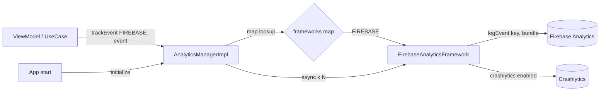

# Analytics (`com.core.data.analytics`)

## Purpose and when to use it

`IAnalyticsManager` is the single entry point for analytics. It holds a Hilt **multibound map**
`Map<AnalyticsFramework, IAnalyticsFramework<BaseAnalyticsView, BaseAnalyticsEvent>>`, and it:

- initializes every registered framework in parallel (`initialize()`),
- routes a screen view or an event to **one** framework chosen by the caller (`trackView` / `trackEvent`).

Today the only framework is Firebase (`AnalyticsFramework.FIREBASE` → `FirebaseAnalyticsFramework`), which logs to
Firebase Analytics and enables Crashlytics collection on `initialize()`.

Use it to track screens and user actions from view models or use cases. Don't call `Firebase.analytics` directly from features.
Go through the manager so frameworks can be swapped or mocked (the tests replace the whole framework module).

## Package layout

```
com/core/data/analytics/
├── di/
│   ├── AnalyticsFrameworkKey.kt          # @MapKey(AnalyticsFramework)
│   ├── AnalyticsFrameworkModule.kt       # @IntoMap bindings of each framework
│   └── AnalyticsModule.kt                # provides IAnalyticsManager from the map
├── frameworks/
│   ├── IAnalyticsFramework.kt            # framework contract (generic VIEW/EVENT)
│   └── firebase/
│       ├── FirebaseAnalyticsFramework.kt
│       └── model/
│           ├── BaseFirebaseTrackEvent.kt
│           └── BaseFirebaseTrackView.kt
├── manager/
│   ├── IAnalyticsManager.kt
│   └── AnalyticsManagerImpl.kt
└── model/
    ├── AnalyticsFramework.kt             # enum of framework identifiers
    ├── BaseAnalyticsEvent.kt             # marker interface
    └── BaseAnalyticsView.kt              # marker interface
```

## Dependency injection

| Module | Component | Provides | Scope / qualifiers |
|---|---|---|---|
| `AnalyticsFrameworkModule` (`object`) | `SingletonComponent` | `providesFirebaseAnalyticsFramework(): IAnalyticsFramework<BaseAnalyticsView, BaseAnalyticsEvent>`, an unchecked cast of `FirebaseAnalyticsFramework()` (`@Suppress("UNCHECKED_CAST")`) | `@Singleton @IntoMap @AnalyticsFrameworkKey(AnalyticsFramework.FIREBASE)` |
| `AnalyticsModule` (`object`) | `SingletonComponent` | `providesAnalyticsManager(frameworks: Map<@JvmSuppressWildcards AnalyticsFramework, @JvmSuppressWildcards IAnalyticsFramework<BaseAnalyticsView, BaseAnalyticsEvent>>): IAnalyticsManager = AnalyticsManagerImpl(frameworks)` | `@Singleton` |

`AnalyticsFrameworkKey` is `@MapKey annotation class AnalyticsFrameworkKey(val value: AnalyticsFramework)`.
The map value type must be written **exactly** as above, including both `@JvmSuppressWildcards`, or Dagger won't find the binding.

Feature injection:

```kotlin
@HiltViewModel
class HomeViewModel @Inject constructor(
    private val analyticsManager: IAnalyticsManager,
) : ViewModel()
```

## Type reference

### `model/AnalyticsFramework` (enum)
`com.core.data.analytics.model.AnalyticsFramework` has a single entry, `FIREBASE`. It's used as the map key and the routing selector.

### `model/BaseAnalyticsView`, `model/BaseAnalyticsEvent` (marker interfaces)
Empty public interfaces. Every view or event type passed to the manager must implement one of them. Framework-specific
base classes (such as the Firebase ones) implement them.

### `frameworks/IAnalyticsFramework<VIEW : BaseAnalyticsView, EVENT : BaseAnalyticsEvent>`

| Member | Semantics |
|---|---|
| `fun initialize(): ApiResult<Unit>` | Synchronous initialization. Return `ApiResult.Success(Unit)` or `ApiResult.Exception(e)`. |
| `fun trackView(view: VIEW)` | Log a screen view. Synchronous, no return. |
| `fun trackEvent(event: EVENT)` | Log an event. Synchronous, no return. |

`ApiResult` comes from the [network](network.md) package and is reused here as the generic result type.

### `frameworks/firebase/FirebaseAnalyticsFramework`
Public class, `IAnalyticsFramework<BaseFirebaseTrackView, BaseFirebaseTrackEvent>`, no constructor parameters.

- `initialize()` sets `Firebase.crashlytics.isCrashlyticsCollectionEnabled = true` and returns `Success(Unit)`. Any
  `Exception` (for example Firebase not initialized because `google-services.json` is missing) is caught and returned as `ApiResult.Exception`.
- `trackView(view)` calls `Firebase.analytics.logEvent(FirebaseAnalytics.Event.SCREEN_VIEW, bundleOf(*view.data.toList().toTypedArray()))`.
  The view's `data` map becomes the bundle, so put `FirebaseAnalytics.Param.SCREEN_NAME` (and optionally `SCREEN_CLASS`) in it.
- `trackEvent(event)` calls `Firebase.analytics.logEvent(event.key, bundleOf(*event.data.toList().toTypedArray()))`.
- Values in `data` must be types `bundleOf` accepts (String, Int, Long, Double, Boolean, arrays, Parcelable, and so on). Unsupported types throw `IllegalArgumentException` from `bundleOf`.

### `frameworks/firebase/model/BaseFirebaseTrackEvent`
`abstract class BaseFirebaseTrackEvent(val key: String, val data: Map<String, *>) : BaseAnalyticsEvent`.
`key` is the Firebase event name, and `data` holds the event params.

### `frameworks/firebase/model/BaseFirebaseTrackView`
`abstract class BaseFirebaseTrackView(val data: Map<String, *>) : BaseAnalyticsView`. `data` holds the `screen_view` params.

### `manager/IAnalyticsManager`

| Member | Semantics |
|---|---|
| `suspend fun initialize(): ApiResult<Unit>` | Initialize all frameworks. |
| `fun <VIEW : BaseAnalyticsView> trackView(framework: AnalyticsFramework, view: VIEW)` | Route a view to one framework. |
| `fun <EVENT : BaseAnalyticsEvent> trackEvent(framework: AnalyticsFramework, event: EVENT)` | Route an event to one framework. |

### `manager/AnalyticsManagerImpl`
Constructor: `AnalyticsManagerImpl(frameworks: Map<AnalyticsFramework, IAnalyticsFramework<BaseAnalyticsView, BaseAnalyticsEvent>>)`.

- `initialize()`: within `coroutineScope`, launches `async { framework.initialize() }` for every entry and runs `awaitAll()`.
  Because `initialize()` is non-suspending, the asyncs run on the caller's dispatcher. If **any** result is
  `ApiResult.Exception`, the **first one in map iteration order** is returned. Otherwise it returns `ApiResult.Success(Unit)`.
  `ApiResult.Error` / `NoContent` results are treated as success.
- `trackView` / `trackEvent`: `frameworks[framework]?.trackView(view)`. If the framework isn't registered, the call is a **silent no-op**.

## Data flow



## Usage examples

```kotlin
// Define tracking models in the feature (data or presentation module)
class HomeScreenView : BaseFirebaseTrackView(
    data = mapOf(FirebaseAnalytics.Param.SCREEN_NAME to "home"),
)

class LoginClickedEvent(method: String) : BaseFirebaseTrackEvent(
    key = "login_clicked",
    data = mapOf("method" to method),
)

// Track
analyticsManager.trackView(framework = AnalyticsFramework.FIREBASE, view = HomeScreenView())
analyticsManager.trackEvent(framework = AnalyticsFramework.FIREBASE, event = LoginClickedEvent("google"))

// Initialize once (e.g. from Application/start-up use case)
when (val result = analyticsManager.initialize()) {
    is ApiResult.Exception -> Log.w("Analytics", "init failed", result.exception)
    else -> Unit
}
```

## Extension guide: adding a new analytics framework

1. Add an enum entry to `AnalyticsFramework` (for example `MIXPANEL`).
2. Create framework-specific base models implementing `BaseAnalyticsView` / `BaseAnalyticsEvent`
   (follow `frameworks/firebase/model`).
3. Implement `IAnalyticsFramework<YourView, YourEvent>` under `frameworks/<name>/`. Return `ApiResult.Exception` from
   `initialize()` instead of throwing.
4. Bind it in `AnalyticsFrameworkModule` with the same shape as Firebase:
   ```kotlin
   @Suppress("UNCHECKED_CAST")
   @Singleton @Provides @IntoMap
   @AnalyticsFrameworkKey(AnalyticsFramework.MIXPANEL)
   fun providesMixpanelFramework(): IAnalyticsFramework<BaseAnalyticsView, BaseAnalyticsEvent> =
       MixpanelAnalyticsFramework() as IAnalyticsFramework<BaseAnalyticsView, BaseAnalyticsEvent>
   ```
5. Add the SDK dependency to `CoreDataPlugin` (core/dependencies) or the module's `build.gradle.kts`.
6. In tests, the whole `AnalyticsFrameworkModule` is replaced with `@TestInstallIn`, so add a mock binding for the new key to `AnalyticsFrameworkModuleTest`.

## Gotchas and constraints

- **Type mismatch crashes at runtime.** Because of the unchecked cast, the map claims every framework accepts any
  `BaseAnalyticsView`/`BaseAnalyticsEvent`. Passing a non-Firebase view to `AnalyticsFramework.FIREBASE` compiles but
  throws `ClassCastException` inside `FirebaseAnalyticsFramework`. Always pair `FIREBASE` with `BaseFirebaseTrack*` subclasses.
- **Unknown framework = silent no-op** in `trackView`/`trackEvent`.
- **Nothing in this repository calls `initialize()`** (no call sites in `app`, `core/presentation` or `demo`), so the app must call it, typically at start-up.
  Firebase itself needs a `google-services` configuration in the app module. None was found in this repo.
- `trackView`/`trackEvent` are not `suspend` and run on the calling thread.
- Dependencies come from `CoreDataPlugin`: Firebase BoM, `firebase-analytics`, `firebase-crashlytics` (all `implementation`,
  so feature modules can't see Firebase classes unless they add the dependency themselves. They can still use the `BaseFirebaseTrack*` classes).

## Testing

- `AnalyticsFrameworkModuleTest` (`@TestInstallIn(components = [SingletonComponent::class], replaces = [AnalyticsFrameworkModule::class])`)
  binds a `mockk(relaxed = true)` framework under `FIREBASE`.
- `AnalyticsManagerTest` (`@HiltAndroidTest`, extends `BaseTest`) injects the real `IAnalyticsManager` plus the map, and
  verifies: initialize success, initialize returning the framework's `Exception`, and delegation of `trackView` / `trackEvent`.
- `FirebaseAnalyticsEventTest` / `FirebaseAnalyticsViewTest` are test-only `BaseFirebaseTrack*` implementations (the view puts `SCREEN_NAME`).

## Related pages

- [Network](network.md): `ApiResult`.
- [Recipes](recipes.md): adding a framework and events.
- [Testing](testing.md)
