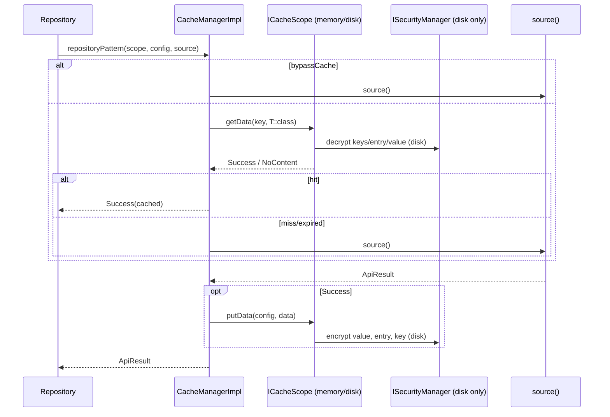

# Cache (`com.core.data.cache`)

## Purpose and when to use it

`ICacheManager` stores and retrieves serializable values in one of two **scopes**:

| `CacheScope` | Implementation | Storage | Survives process death | Encrypted |
|---|---|---|---|---|
| `MEMORY_CACHE` | `CacheMemoryScope` | `android.util.LruCache<String, CacheEntry>` | No | No |
| `DISK_CACHE` | `CacheDiskScope` | Preferences DataStore file named `"cache"` | Yes | Yes. Key, entry and value are each AES-encrypted via `ISecurityManager` |

Each write carries an `ICacheConfig` (key + lifetime). Reads return an `ApiResult<T>`: `Success` on a fresh hit and
`NoContent` on a miss or expiry. The `repositoryPattern` extension implements the usual "cache-then-source" read-through.

Use it for API responses, the session payload (see [session](session.md)) and any small, serializable state. Don't use it for
large binary data (the disk scope stores Base64 strings inside Preferences), or for data that needs querying (use Room in a feature module).

## Package layout

```
com/core/data/cache/
├── di/
│   ├── CacheModule.kt          # Json, both scopes (@IntoMap), ICacheManager
│   └── CacheScopeKey.kt        # @MapKey(CacheScope)
├── manager/
│   ├── ICacheManager.kt
│   └── CacheManagerImpl.kt
├── model/
│   ├── CacheEntry.kt           # @Serializable (value, duration, timestamp)
│   ├── CacheScope.kt           # enum MEMORY_CACHE, DISK_CACHE
│   └── config/
│       ├── ICacheConfig.kt
│       ├── ImmortalCacheConfig.kt
│       └── TimeToLiveCacheConfig.kt
├── scopes/
│   ├── ICacheScope.kt
│   ├── disk/CacheDiskScope.kt
│   └── memory/CacheMemoryScope.kt
└── utils/
    ├── DynamicLookupSerializer.kt
    └── Extensions.kt           # CacheEntry.hasExpired(), ICacheManager.repositoryPattern()
```

## Dependency injection

`CacheModule` (`object`, `@Module @InstallIn(SingletonComponent::class)`). Every provider is `@Singleton`:

| Provider | Returns | Notes |
|---|---|---|
| `providesJsonConfiguration()` | `kotlinx.serialization.json.Json` | `prettyPrint`, `ignoreUnknownKeys`, `useAlternativeNames`, `encodeDefaults`, `explicitNulls`, `coerceInputValues`, `allowStructuredMapKeys` = `true`. **This is the only unqualified `Json` binding in the graph**, so features injecting `Json` get this instance. |
| `providesCacheMemoryScope(@ApplicationContext context, json)` | `ICacheScope` | `@IntoMap @CacheScopeKey(CacheScope.MEMORY_CACHE)` |
| `providesCacheDiskScope(@ApplicationContext context, json, securityManager: ISecurityManager)` | `ICacheScope` | `@IntoMap @CacheScopeKey(CacheScope.DISK_CACHE)` |
| `providesCacheManager(caches: Map<@JvmSuppressWildcards CacheScope, @JvmSuppressWildcards ICacheScope>)` | `ICacheManager` | `CacheManagerImpl(caches)` |

`CacheScopeKey` is `@MapKey annotation class CacheScopeKey(val value: CacheScope)`.

```kotlin
class ProductsRepository @Inject constructor(
    private val api: ProductsApiService,
    private val cacheManager: ICacheManager,
)
```

## Type reference

### `model/CacheScope`
`enum class CacheScope { MEMORY_CACHE, DISK_CACHE }`. It's the map key and the selector for every manager call.

### `model/config/ICacheConfig`
```kotlin
interface ICacheConfig { val key: String; val bypassCache: Boolean }
```
- `key`: cache entry identifier (unique per scope).
- `bypassCache`: honoured **only** by `repositoryPattern`. When `true`, it skips the cache read and always calls the source, while still caching a success. `cacheData`/`getData` ignore it.

### `model/config/ImmortalCacheConfig`
`data class ImmortalCacheConfig(override val key: String, override val bypassCache: Boolean = false)`. Stored with `Duration.INFINITE`, so it never expires.

### `model/config/TimeToLiveCacheConfig`
`data class TimeToLiveCacheConfig(override val key: String, override val bypassCache: Boolean = false, internal val duration: kotlin.time.Duration)`.
`duration` is `internal`. Callers outside the module can set it in the constructor, but they can't read it back. A negative duration produces an
immediately expired entry (used in tests).

Any other `ICacheConfig` implementation is treated as infinite by both scopes (`else -> Duration.INFINITE`).

### `model/CacheEntry`
```kotlin
@InternalSerializationApi @Serializable
data class CacheEntry(val value: String, val duration: Duration) {
    val timestamp: Long = Calendar.getInstance().time.time   // epoch millis at construction
}
```
`value` is the JSON of the cached object (encrypted on disk). `timestamp` is a body property with an initializer: it's
serialized (`encodeDefaults = true`) and restored when decoding, so disk entries keep their original write time.
It's annotated with `@InternalSerializationApi`, so consumers need `@OptIn(InternalSerializationApi::class)`.

### `scopes/ICacheScope`

| Member | Semantics |
|---|---|
| `suspend fun putData(config: ICacheConfig, data: Any)` | Store/replace `data` under `config.key` with the config's lifetime. |
| `suspend fun <T : Any> getData(key: String, kClass: KClass<T>): ApiResult<T>` | `Success(T)` if present and not expired, else `NoContent`. |
| `suspend fun deleteData(key: String)` | Remove one key. |
| `suspend fun clearAll()` | Remove everything in this scope. |

### `scopes/memory/CacheMemoryScope`
Constructor: `(@ApplicationContext context: Context, json: Json)`. The class is `@OptIn(InternalSerializationApi::class)`.

- **Sizing:** `LruCache(activityManager.memoryClass * 1024 * 1024 / 8)`. `sizeOf` isn't overridden, so the limit is an
  **entry count** (each entry counts as 1), not bytes. In practice that's millions of entries, so it's effectively unbounded.
- `putData`: removes an existing entry for the key, computes the duration (Immortal → `INFINITE`, TTL → `config.duration`),
  encodes `data` with `json.encodeToString(DynamicLookupSerializer(), data)`, and stores `CacheEntry(json, duration)`.
- `getData`: `NoContent` on a miss or when `hasExpired()`. Otherwise it returns `Success(json.decodeFromString(kClass.serializer(), entry.value))`.
  Expired entries aren't evicted on read.
- `deleteData`: `cache.remove(key)`. `clearAll`: `cache.evictAll()`.

### `scopes/disk/CacheDiskScope`
Constructor: `(@param:ApplicationContext context: Context, json: Json, securityManager: ISecurityManager)`.
It uses a file-level `Context.dataStore by preferencesDataStore(name = "cache")` (constant `CACHE_FILENAME`).

**Write (`putData`):**
1. JSON-encodes `data` with `DynamicLookupSerializer`, then AES-encrypts it with `securityManager.encryptData(CipherType.AES, json, publicKey = null)`.
2. Wraps the result in a `CacheEntry` with the config's duration, JSON-encodes the entry and AES-encrypts it again.
3. AES-encrypts `config.key` and uses it as a `stringPreferencesKey`.
4. `dataStore.edit { remove(key) if present; put(encryptedKey, encryptedEntry) }`.
If any encryption returns a non-`Success` result, the write is **silently skipped** (`getOrNull() ?: return`).

**Read (`getData`):** reads the current preferences snapshot (`data.first()`), then **decrypts every stored key name** (inside
`runBlocking`) until one equals `key`. It decrypts the entry, decodes the `CacheEntry` and checks expiry, then decrypts and decodes the value with
`kClass.serializer()`. A missing key, failed decryption or expiry gives `NoContent`.

**Delete:** the same key scan, then `remove`. **clearAll:** `prefs.clear()`.

### `manager/ICacheManager` / `manager/CacheManagerImpl`
`CacheManagerImpl(caches: Map<CacheScope, ICacheScope>)`:

| Method | Behaviour |
|---|---|
| `suspend fun cacheData(scope: CacheScope, config: ICacheConfig, data: Any)` | `caches[scope]?.putData(...)`. Unknown scope = no-op. |
| `suspend fun <T : Any> getData(scope: CacheScope, key: String, kClass: KClass<T>): ApiResult<T>` | Delegates. Unknown scope → `ApiResult.Exception(NoSuchElementException("CacheScope <name> does not exist"))`. |
| `suspend fun deleteData(scope: CacheScope?, key: String)` | `scope == null` deletes the key from **all** scopes. |
| `suspend fun deleteScope(scope: CacheScope)` | `clearAll()` on that scope only. |
| `suspend fun clearAll()` | `clearAll()` on every scope. |

None of these switch dispatchers. The disk scope relies on DataStore's own IO dispatching, but its key scan does
`runBlocking` decryption on the calling thread, so call from `Dispatchers.IO`/`Default` for large caches.

### `utils/DynamicLookupSerializer`
`@ExperimentalSerializationApi class DynamicLookupSerializer : KSerializer<Any>`, used **only for encoding** values of static type `Any`.
- If the value `is ArrayList<*>`, it encodes as a list with a nested `DynamicLookupSerializer` for the elements.
- Otherwise it uses the contextual serializer from the `serializersModule` for `value::class`, or falls back to `value::class.serializer()` (requires `@Serializable`).
- `deserialize` throws `error("Unsupported")`. Decoding always uses the concrete `kClass.serializer()`.
- Its descriptor is the `ContextualSerializer(Any::class)` descriptor.

### `utils/Extensions.kt`
- `internal fun CacheEntry.hasExpired(): Boolean` returns `false` for infinite durations, otherwise `timestamp + duration.inWholeMilliseconds < now`.
- `suspend inline fun <reified T : Any> ICacheManager.repositoryPattern(scope: CacheScope, config: ICacheConfig, crossinline source: () -> ApiResult<T>): ApiResult<T>`:
  1. If `config.bypassCache`, it calls `source()` and, on `Success`, `cacheData(scope, config, data)`. It returns the source result.
  2. Otherwise it runs `getData(scope, config.key, T::class).getOrNull()`. On a hit it returns `ApiResult.Success(cached)`.
  3. On a miss (including expiry and `Exception`), it calls the source and caches on success. `Error`, `Exception` and `NoContent` are returned unchanged and **not** cached.

## Data flow



## Usage examples

```kotlin
@Serializable
data class ProductsDto(val items: List<ProductDto>)   // wrap lists in a @Serializable class

suspend fun getProducts(forceRefresh: Boolean): ApiResult<ProductsDto> =
    cacheManager.repositoryPattern(
        scope = CacheScope.DISK_CACHE,
        config = TimeToLiveCacheConfig(key = "products", bypassCache = forceRefresh, duration = 10.minutes),
    ) { productsResult }   // see the note about suspend calls below

// Direct use
cacheManager.cacheData(CacheScope.MEMORY_CACHE, ImmortalCacheConfig(key = "profile"), profileDto)
val profile: ApiResult<ProfileDto> = cacheManager.getData(CacheScope.MEMORY_CACHE, "profile", ProfileDto::class)
cacheManager.deleteData(scope = null, key = "profile")    // both scopes
```

**Calling suspend APIs inside `source`:** `source` is declared as a non-suspend `crossinline () -> ApiResult<T>`
that's invoked inside an internal `suspend { }` lambda. The existing tests only pass non-suspend lambdas. Whether a `suspend`
Retrofit call compiles directly inside `source` hasn't been verified in this repository. If the compiler rejects it,
make the network call first and pass the result in, or change the parameter type to `suspend () -> ApiResult<T>`.

## Extension guide: adding a cache scope

1. Add an entry to `CacheScope` (for example `ENCRYPTED_FILE_CACHE`).
2. Implement `ICacheScope` in `scopes/<name>/`. Reuse `CacheEntry`, `hasExpired()` and `DynamicLookupSerializer` for consistent semantics,
   and return `ApiResult.NoContent()` for misses.
3. Bind it in `CacheModule` with `@Singleton @Provides @IntoMap @CacheScopeKey(CacheScope.NEW)`, returning `ICacheScope`.
4. Add the scope to `CacheManagerTest`. That test iterates `CacheScope.entries`, so the new scope is exercised automatically.

## Gotchas and constraints

- **Serialization requirements.** Cached values must be `@Serializable` classes, `String`/primitives, or `ArrayList`s of
  those. Other `List` implementations (for example `listOf(x)` singletons), `Map`s and generic types can't be encoded through
  `DynamicLookupSerializer`'s `value::class.serializer()` lookup, and `getData(kClass = List::class)` can't be decoded because
  type arguments are erased. Wrap collections in a `@Serializable` DTO. Serialization exceptions propagate to the caller.
- **Disk keys are encrypted with a random IV.** AES/GCM with an AndroidKeyStore key generates a fresh IV per encryption,
  so the same logical key produces a different preference name on every write. `putData`'s "remove if present" check
  therefore never matches an earlier write, and re-writing a key can leave older entries behind. `getData`/`deleteData`
  act on the **first** matching key in the preferences map, which may be an older entry. Prefer `deleteData` before
  re-caching a disk key, or use `MEMORY_CACHE` for frequently updated data. This is inferred from the AES implementation.
  `CacheManagerTest` mocks `ISecurityManager` as identity, so it doesn't cover it.
- **Disk performance** is O(number of keys) decryptions per read or delete, with `runBlocking` inside.
- Encryption failures on disk writes are silently dropped.
- `MEMORY_CACHE` is per-process and cleared on process death. The session uses it on purpose.

## Testing

`CacheManagerTest` (`@HiltAndroidTest`, `@UninstallModules(SecurityModule::class)`, `@BindValue` mock `ISecurityManager` whose
AES encrypt/decrypt return their input) runs every scope through: cache and retrieve, delete in one scope vs. all scopes,
`deleteScope`, `clearAll`, TTL expiry with `(-1).seconds`, and `repositoryPattern` hit/miss/bypass counting.

## Related pages

- [Security](security.md): AES encryption used by the disk scope.
- [Session](session.md): stores `SessionData` in `MEMORY_CACHE`.
- [Network](network.md): `ApiResult` and its extensions (`getOrNull`, `onSuccess`).
- [Recipes](recipes.md)
- [Testing](testing.md)
