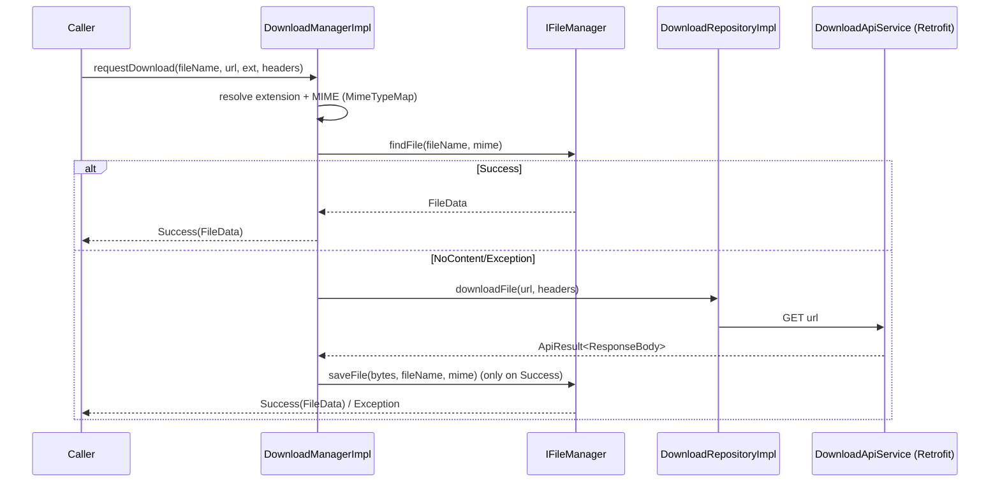

# Downloads (`com.core.data.download`)

## Purpose and when to use it

`IDownloadManager.requestDownload(fileName, url, extension, headers)` gives you a `FileData` (with a `FileProvider` content
`Uri`) for a remote file:

1. If a file with the same base name already exists locally (looked up through [`IFileManager.findFile`](file.md)), it returns that file and **doesn't download anything**.
2. Otherwise it GETs `url` through `DownloadApiService` and saves the bytes with `IFileManager.saveFile`.

Use it for PDFs, images and documents that should be opened or shared with other apps through a content URI.
Don't use it for large media that should go to shared storage, or for background downloads that must survive process death
(use `WorkManager`/`android.app.DownloadManager`). This implementation reads the whole body into memory.

## Package layout

```
com/core/data/download/
├── api/DownloadApiService.kt               # Retrofit service (fun interface)
├── di/
│   ├── DownloadModule.kt                   # manager + repository
│   └── DownloadNetworkModule.kt            # Retrofit service via RetrofitFactory
├── manager/
│   ├── IDownloadManager.kt
│   └── DownloadManagerImpl.kt
└── repository/
    ├── IDownloadRepository.kt              # fun interface
    └── DownloadRepositoryImpl.kt
```

## Dependency injection

| Module | Provider | Returns | Dependencies | Scope |
|---|---|---|---|---|
| `DownloadModule` | `providesDownloadManager` | `IDownloadManager` = `DownloadManagerImpl(repository, fileManager)` | `IDownloadRepository`, `IFileManager` | `@Singleton` |
| `DownloadModule` | `providesDownloadRepository` | `IDownloadRepository` = `DownloadRepositoryImpl(apiService)` | `DownloadApiService` | `@Singleton` |
| `DownloadNetworkModule` | `providesDownloadApiService` | `DownloadApiService` | `RetrofitFactory`, `IEnvironmentManager` | `@Singleton` |

Both modules are `object`s with `@InstallIn(SingletonComponent::class)`. `DownloadNetworkModule` builds the service with
`retrofitFactory.create().build(kClass = DownloadApiService::class.java, url = environmentManager.environment.apiUrl, interceptors = emptyList())`,
so it's the reference example for **declaring any new Retrofit service** (see [network](network.md)). The two modules are split so tests
can replace only the network part (`DownloadNetworkModuleTest`).

```kotlin
class InvoiceRepository @Inject constructor(private val downloadManager: IDownloadManager)
```

## Type reference

### `api/DownloadApiService`
```kotlin
fun interface DownloadApiService {
    @GET @Streaming
    suspend fun downloadFile(@Url url: String, @HeaderMap headers: Map<String, String>): ApiResult<ResponseBody>
}
```
- `@Url` makes `url` override the Retrofit base URL when it's absolute. Relative URLs resolve against the environment `apiUrl`.
- The `ApiResult<ResponseBody>` return type is handled by `NetworkResultCallAdapterFactory`. HTTP errors become `ApiResult.Error`,
  transport failures become `ApiResult.Exception`, and a 2xx with no body becomes `NoContent`.
- `@Streaming` avoids buffering in OkHttp, but see the `DownloadManagerImpl` notes below.

### `repository/IDownloadRepository` / `DownloadRepositoryImpl`
`fun interface IDownloadRepository { suspend fun downloadFile(url: String, headers: Map<String, String>): ApiResult<ResponseBody> }`.
`DownloadRepositoryImpl(apiService)` delegates directly to `apiService.downloadFile(url, headers)`.

### `manager/IDownloadManager`
```kotlin
suspend fun requestDownload(
    fileName: String,                       // base name, no extension; also the local lookup key
    url: String,
    extension: String = "pdf",              // fallback when the URL has no extension
    headers: Map<String, String> = emptyMap(),
): ApiResult<FileData>
```

### `manager/DownloadManagerImpl`
`class DownloadManagerImpl @Inject constructor(repository: IDownloadRepository, fileManager: IFileManager)`. It's provided by the
module, and `@Inject` isn't used by Hilt here.

Algorithm:
1. `fileExtension = MimeTypeMap.getFileExtensionFromUrl(url.toUri().toString())`, or `extension` when that's empty.
2. `fileMimeType = MimeTypeMap.getSingleton().getMimeTypeFromExtension(fileExtension)`, which may be `null`. `""` is passed downstream in that case.
3. `fileManager.findFile(fileName, mimeType)`. If that's `ApiResult.Success`, it returns it right away (cache hit).
4. Otherwise it runs `repository.downloadFile(url, headers).map { body -> fileManager.saveFile(body.byteStream().readBytes(), fileName, mimeType) }`.
   - `map` returns the `saveFile` result on success, propagates `Error`/`Exception`/`NoContent` unchanged, and converts any
     exception thrown while reading or saving into `ApiResult.Exception`.

Results the caller can receive:

| Result | When |
|---|---|
| `Success(FileData)` | The local file was found, or the download was saved. |
| `Error(httpCode, response)` | The server answered with a non-2xx code. |
| `Exception(t)` | Network failure, I/O failure, storage permission denied (`IllegalStateException("Permission denied")`), or directory creation failure. |
| `NoContent()` | 2xx with an empty body. |

## Data flow



## Usage example

```kotlin
when (val result = downloadManager.requestDownload(
    fileName = "invoice_$invoiceId",
    url = "https://cdn.example.com/invoices/$invoiceId.pdf",
    headers = mapOf("Authorization" to "Bearer $token"),
)) {
    is ApiResult.Success -> openPdf(result.data.uri)          // content:// via FileProvider
    is ApiResult.Error -> showError(result.httpCode)
    is ApiResult.Exception -> showError(result.exception)
    is ApiResult.NoContent -> showEmpty()
}
```

## Extension guide

- **Another download endpoint style** (for example POST with a body): add a method to `DownloadApiService` (it's a `fun interface`,
  so remove `fun` if you add a second abstract method) and a matching method in `IDownloadRepository`/`DownloadRepositoryImpl`.
- **Custom interceptors** (auth, progress): pass them via `interceptors = listOf(...)` in `DownloadNetworkModule`. `RetrofitBuilder`
  clones the shared `OkHttpClient` with them.
- **New feature API services** should copy `DownloadNetworkModule`: inject `RetrofitFactory` + `IEnvironmentManager` and
  call `create().build(...)`.

## Gotchas and constraints

- **The local cache hit ignores the URL.** Any existing file whose name without extension equals `fileName` (in the MIME type's
  directory) is returned, even if it came from another URL. Use unique file names per resource and version.
- **Whole file in memory:** `byteStream().readBytes()` loads the full body before writing it. The `ResponseBody` is
  not explicitly closed after reading.
- **The base URL is fixed when the singleton is created** (`environmentManager.environment.apiUrl` is read once). Later environment
  switches don't affect `DownloadApiService` unless the URL passed is absolute.
- **MIME → directory:** only `application/pdf` goes to `filesDir/documents/`. Everything else goes to `filesDir/` (see [file](file.md)).
- Storage permissions are requested by `FileManagerImpl` through the permission manager on API < 33. That requires a
  foreground `FragmentActivity` (see [permission](permission.md)).

## Testing

- `DownloadNetworkModuleTest` replaces `DownloadNetworkModule` (`@TestInstallIn`) with a `mockk()` `DownloadApiService`.
- `DownloadManagerTest` (`@HiltAndroidTest`, `BaseTest`) grants storage permissions through the Robolectric `shadowOf(Application)`,
  clears the `FileProvider` cache (`clearFileProviderCache()`), and covers: an existing file returned without downloading, download + save
  using the URL's extension, falling back to the provided extension, and download failure propagating without saving.

## Related pages

- [File storage](file.md)
- [Network](network.md)
- [Environment](environment.md)
- [Testing](testing.md)
- [Recipes](recipes.md)
