# Environment (`com.core.data.environment`)

## Purpose and when to use it

The environment package holds **which backend the app talks to**. `IEnvironmentManager.environment` is a mutable
property on a singleton. Network singletons read it once when they're created to choose:

- the Retrofit **base URL** (`environment.apiUrl`), and
- whether **SSL pinning** is enabled (only when `environment == Environment.PROD()`), see [network](network.md).

Use it to pick DEV/UAT/PROD at start-up (for example from build type or a debug menu) and to build API services.
Don't treat it as a runtime switch for already-created services (see *Gotchas*).

## Package layout

```
com/core/data/environment/
├── di/EnvironmentModule.kt
├── manager/
│   ├── IEnvironmentManager.kt
│   └── EnvironmentManagerImpl.kt
└── model/Environment.kt
```

## Dependency injection

`EnvironmentModule` (`object`, `@Module @InstallIn(SingletonComponent::class)`):
`@Singleton @Provides fun providesEnvironmentManager(): IEnvironmentManager = EnvironmentManagerImpl()`.

Consumers inside core/data: `NetworkModule.providesOkHttpClient` (SSL pinning decision) and `DownloadNetworkModule`
(base URL of `DownloadApiService`).

```kotlin
@Module @InstallIn(SingletonComponent::class)
object OrdersNetworkModule {
    @Singleton @Provides
    fun providesOrdersApi(factory: RetrofitFactory, env: IEnvironmentManager): OrdersApiService =
        factory.create().build(kClass = OrdersApiService::class.java, environment = env.environment, interceptors = emptyList())
}
```

## Type reference

### `model/Environment` (sealed class)
```kotlin
sealed class Environment(open val apiUrl: String) {
    data class DEV(override val apiUrl: String = "http://dev.api.example.com") : Environment(apiUrl)
    data class UAT(override val apiUrl: String = "http://uat.api.example.com") : Environment(apiUrl)
    data class PROD(override val apiUrl: String = "http://api.example.com") : Environment(apiUrl)
}
```
| Subtype | Default `apiUrl` | Meaning |
|---|---|---|
| `DEV` | `http://dev.api.example.com` | Development backend. This is the default. |
| `UAT` | `http://uat.api.example.com` | User-acceptance backend. |
| `PROD` | `http://api.example.com` | Production. It's the only one that enables SSL pinning. |

Each subtype is a `data class`, so equality compares `apiUrl`. Instances are created with `Environment.DEV()` and so on.
The default URLs are placeholders (`example.com`, plain `http`) and must be replaced for a real project. Retrofit requires
the base URL to end with `/` when service paths are relative.

### `manager/IEnvironmentManager`
`interface IEnvironmentManager { var environment: Environment }`. It's a read/write property with no observation (`Flow`) support.

### `manager/EnvironmentManagerImpl`
`class EnvironmentManagerImpl : IEnvironmentManager { override var environment: Environment = Environment.DEV() }`.
There's no persistence and no synchronization, so the value resets to `DEV` on every process start.

## How the environment is consumed

```mermaid
flowchart TD
    EM[IEnvironmentManager.environment] -->|== Environment.PROD&#40;&#41; ?| OK[NetworkModule.providesOkHttpClient]
    OK -->|yes| PIN[enableSSLPinning]
    OK -->|no| NOPIN[disableSSLPinning - trust all]
    EM -->|apiUrl| RB[RetrofitBuilder.build environment/url]
    RB --> SVC[API service singletons e.g. DownloadApiService]
```



- `RetrofitBuilder.build(kClass, environment: Environment, interceptors)` uses `environment.apiUrl` as `baseUrl`.
- `RetrofitBuilder.build(kClass, url: String, interceptors)` takes any URL. `DownloadNetworkModule` passes `environment.apiUrl`.

## Usage examples

```kotlin
// Early in Application.onCreate (before anything injects OkHttpClient / API services)
@HiltAndroidApp
class App : CoreApp() {
    @Inject lateinit var environmentManager: IEnvironmentManager
    override fun onCreate() {
        super.onCreate()   // Hilt field injection happens in super.onCreate()
        environmentManager.environment = if (BuildConfig.DEBUG) Environment.DEV() else Environment.PROD()
    }
}

// Custom URL for a subtype
environmentManager.environment = Environment.UAT(apiUrl = "https://uat2.api.example.com/")
```

## Extension guide: adding an environment

1. Add a subtype to the sealed class, for example `data class STAGING(override val apiUrl: String = "https://staging.api.example.com/") : Environment(apiUrl)`.
2. Check every `when (environment)` in feature code (the sealed class makes it exhaustive).
3. Decide on pinning: `NetworkModule` enables pinning **only** for `Environment.PROD()`. Adjust that condition if the
   new environment also needs it.
4. Add a test to `EnvironmentManagerTest` following the existing set/get tests.

## Gotchas and constraints

- **Read once:** `OkHttpClient`, `DownloadApiService` and any API service you provide as `@Singleton` capture the
  environment when they're first created. Changing `environment` afterwards doesn't rebuild them. Set the environment before the
  first injection of network types, or restart the process after switching (debug menus).
- **PROD pinning uses data-class equality:** `environment == Environment.PROD()` is `false` for
  `Environment.PROD(apiUrl = "<custom>")`, so a PROD environment with a non-default URL **runs without pinning and trusts all
  certificates**. Use `environment is Environment.PROD` if you change this logic.
- Not persisted, and not thread-safe (a plain `var`).

## Testing

`EnvironmentManagerTest` (`@HiltAndroidTest`, `BaseTest`) checks that the default is `Environment.DEV()` and that DEV, UAT and PROD
can be set and read back.

## Related pages

- [Network](network.md): `NetworkModule`, `RetrofitBuilder`, SSL pinning.
- [Downloads](download.md): `DownloadNetworkModule` uses `apiUrl`.
- [Recipes](recipes.md): switching environments.
