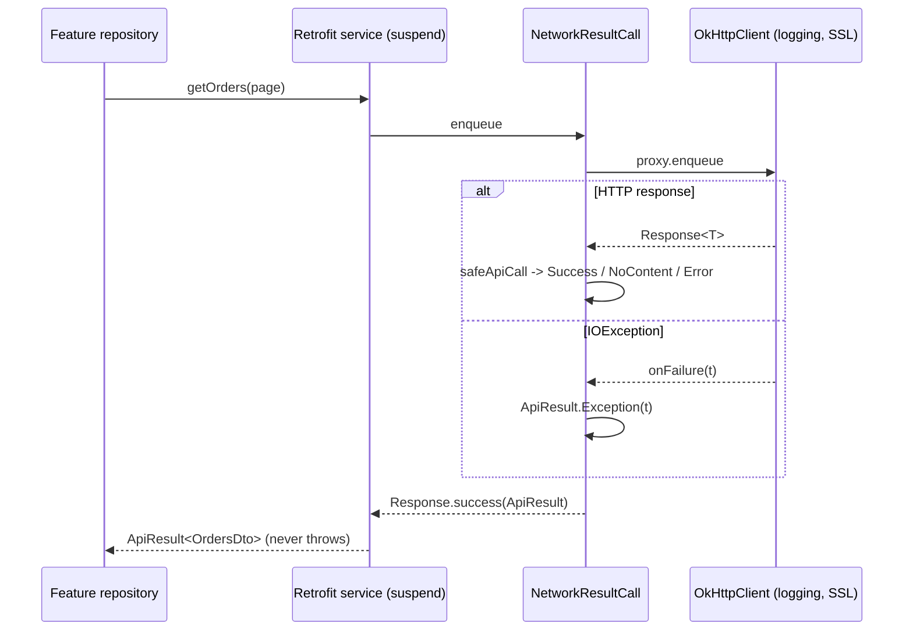

# Network (`com.core.data.network`)

## Purpose and when to use it

This package is the networking foundation and also defines **`ApiResult<T>`**, the result type returned by almost
every manager in core/data (cache, security, files, downloads, notifications, analytics) and consumed by
`core/presentation` (`CoroutinesUseCaseRunner`).

It provides:
- `ApiResult` + extension operators (`onSuccess`, `map`, `getOrNull`, and so on),
- a Retrofit `CallAdapter.Factory` so service methods can be declared as `suspend fun x(): ApiResult<Dto>` and **never throw**,
- `safeApiCall` for wrapping a `retrofit2.Response`,
- a singleton `OkHttpClient` / `Retrofit.Builder`, and `RetrofitFactory` for building feature API services with optional per-service interceptors,
- SSL pinning (PROD) vs. trust-all (DEV/UAT) configuration.

## Package layout

```
com/core/data/network/
├── adapter/
│   ├── NetworkResultCall.kt               # Call<T> -> Call<ApiResult<T>>
│   ├── NetworkResultCallAdapter.kt
│   └── NetworkResultCallAdapterFactory.kt
├── di/
│   ├── NetworkModule.kt                   # logging, trust manager, OkHttp, converter, Retrofit.Builder
│   ├── builder/RetrofitBuilder.kt         # @AssistedInject builder for services
│   └── factory/RetrofitFactory.kt         # @AssistedFactory
├── model/ApiResult.kt
├── ssl/
│   ├── NetworkTrustManager.kt
│   └── SSLPinning.kt                      # OkHttpClient.Builder.enable/disableSSLPinning
└── utils/
    ├── Extensions.kt                      # ApiResult operators
    └── SafeApiCall.kt
```

Resource: `src/main/res/xml/network_config.xml` (network security config). See *Gotchas*. It isn't referenced by any manifest in this repo.

## Dependency injection

`NetworkModule` (`object`, `@InstallIn(SingletonComponent::class)`). All providers are `@Singleton`:

| Provider | Returns | Details |
|---|---|---|
| `providesHttpLoggingInterceptor()` | `HttpLoggingInterceptor` | `level = BODY` (always, in every environment). |
| `providesNetworkTrustManager(@ApplicationContext context)` | `NetworkTrustManager` | |
| `providesOkHttpClient(httpLoggingInterceptor, environmentManager: IEnvironmentManager, networkTrustManager)` | `OkHttpClient` | `enableSSLPinning` if `environment == Environment.PROD()`, else `disableSSLPinning`. Adds the logging interceptor. Read/write/connect timeouts are `DEFAULT_TIMEOUT = 30L` seconds. |
| `providesConverterFactory()` | `retrofit2.Converter.Factory` | `Json { prettyPrint; ignoreUnknownKeys; useAlternativeNames; encodeDefaults; explicitNulls; coerceInputValues; allowStructuredMapKeys }` (all `true`) `.asConverterFactory("application/json")`. This `Json` is a private instance, not the injected `CacheModule` one. |
| `providesRetrofitBuilder(httpClient, converterFactory)` | `Retrofit.Builder` | `.client(httpClient).addCallAdapterFactory(NetworkResultCallAdapterFactory.create()).addConverterFactory(converterFactory)`. No base URL. |

Assisted injection:
- `RetrofitBuilder @AssistedInject constructor(retrofitBuilder: Retrofit.Builder, okHttpClient: OkHttpClient)`. It has no `@Assisted` parameters.
- `@AssistedFactory fun interface RetrofitFactory { fun create(): RetrofitBuilder }` is what features inject.

**Declaring a feature API service** (pattern from `DownloadNetworkModule`):

```kotlin
interface OrdersApiService {
    @GET("orders") suspend fun getOrders(@Query("page") page: Int): ApiResult<OrdersDto>
    @POST("orders") suspend fun createOrder(@Body body: CreateOrderDto): ApiResult<OrderDto>
    @DELETE("orders/{id}") suspend fun deleteOrder(@Path("id") id: String): ApiResult<Unit>
}

@Module
@InstallIn(SingletonComponent::class)
object OrdersNetworkModule {
    @Singleton
    @Provides
    fun providesOrdersApiService(
        retrofitFactory: RetrofitFactory,
        environmentManager: IEnvironmentManager,
    ): OrdersApiService = retrofitFactory
        .create()
        .build(
            kClass = OrdersApiService::class.java,
            environment = environmentManager.environment,   // or url = "https://other.host/"
            interceptors = emptyList(),                       // e.g. listOf(authInterceptor)
        )
}
```

DTOs must be `@Serializable` (kotlinx.serialization is an `api` dependency of core/data).

## Type reference

### `model/ApiResult<out T>` (sealed interface)

| Subtype | Fields | Produced when |
|---|---|---|
| `data class Success<out T>(val data: T)` | `data` | 2xx with a non-null body, or any successful local operation. |
| `data class Error<out T>(val httpCode: Int, val response: String?)` | HTTP status, raw error body string | Non-2xx HTTP response. |
| `data class Exception<out T>(val exception: Throwable)` | `exception` | Transport/IO/serialization failure, or a local failure in managers. |
| `class NoContent<out T>` | none | 2xx with a `null` body (for example 204), a cache miss, or a not-found file. **Not a data class**: two instances aren't `equals`, so test it with `is ApiResult.NoContent`. |

Exhaustive `when` example: see `CoroutinesUseCaseRunner.withUseCaseScopeLazily` in core/presentation, which maps each subtype to a `UiResult`.

### `utils/SafeApiCall.kt`
`fun <T : Any> safeApiCall(execute: () -> Response<T>): ApiResult<T>`
- `response.isSuccessful`: `Success(body)` if the body is non-null, else `NoContent()`.
- Not successful: `Error(httpCode = response.code(), response = response.errorBody()?.string())`.
- Any `Throwable` thrown by `execute` or while reading: `Exception(e)`.

It's non-suspend. The adapter uses it, and you can call it directly for `Call.execute()`-style code.

### `adapter/NetworkResultCallAdapterFactory`
`class NetworkResultCallAdapterFactory private constructor() : CallAdapter.Factory()`. Create it with `NetworkResultCallAdapterFactory.create()`.
`get(returnType, ...)` returns a `NetworkResultCallAdapter(resultType)` only if the raw type is `retrofit2.Call` **and** its type argument's raw type is
`ApiResult`. Otherwise it returns `null`, so Retrofit falls back to other adapters.
For `suspend fun f(): ApiResult<X>`, Retrofit internally models the return as `Call<ApiResult<X>>`, so the factory applies.

### `adapter/NetworkResultCallAdapter`
`class NetworkResultCallAdapter(resultType: Type) : CallAdapter<Type, Call<ApiResult<Type>>>`. `responseType()` returns `resultType`
(the body type the converter decodes), and `adapt(call)` returns `NetworkResultCall(call)`.

### `adapter/NetworkResultCall<T : Any>`
`class NetworkResultCall<T : Any>(proxy: Call<T>) : Call<ApiResult<T>>`.
- `enqueue(callback)`: enqueues the proxy. `onResponse` → `callback.onResponse(this, Response.success(safeApiCall { response }))`.
  `onFailure(t)` → `callback.onResponse(this, Response.success(ApiResult.Exception(t)))`. **`callback.onFailure` is never called**, so suspend service methods don't throw for HTTP or IO errors.
- `execute()` throws `NotImplementedError`. Synchronous execution of `Call<ApiResult<T>>` isn't supported.
- `clone()` wraps `proxy.clone()`. `request()`, `timeout()`, `isExecuted()`, `isCanceled()` and `cancel()` delegate to the proxy.

### `utils/Extensions.kt` (ApiResult operators)

| Function | Signature | Behaviour |
|---|---|---|
| `onSuccess` | `suspend fun <R, T> ApiResult<T>.onSuccess(execute: suspend (T) -> R): ApiResult<T>` | Runs on `Success`. Returns the **original** result. |
| `onNoContent` | `suspend fun <R, T> ApiResult<T>.onNoContent(execute: suspend () -> R): ApiResult<T>` | Runs on `NoContent`. |
| `onError` | `suspend fun <R, T> ApiResult<T>.onError(execute: suspend (httpCode: Int, response: String?) -> R): ApiResult<T>` | Runs on `Error`. |
| `onException` | `suspend fun <R, T> ApiResult<T>.onException(execute: suspend (exception: Throwable) -> R): ApiResult<T>` | Runs on `Exception`. |
| `map` | `suspend fun <R, T> ApiResult<T>.map(transform: suspend (value: T) -> ApiResult<R>): ApiResult<R>` | **Flat-map**: `transform` returns an `ApiResult`. On `Success` it calls `transform`, and a thrown `Throwable` becomes `Exception`. `Error`, `Exception` and `NoContent` are re-created with the new type parameter. Has the contract `callsInPlace(AT_MOST_ONCE)`. |
| `getOrElse` | `fun <R, T : R> ApiResult<T>.getOrElse(onFailure: () -> R): R` | `data` on success, else `onFailure()`. |
| `getOrNull` | `fun <T> ApiResult<T>.getOrNull(): T?` | `data` or `null`. |
| `getOrThrow` | `fun <T> ApiResult<T>.getOrThrow(onFailure: () -> Throwable): T` | `data`, or throws `onFailure()`. |

The `on*` functions are `suspend`, so chain them inside coroutines:
`api.getOrders(1).onSuccess { cache(it) }.onError { code, body -> log(code, body) }`.

### `di/builder/RetrofitBuilder`
- `fun <T : Any> build(kClass: Class<T>, environment: Environment, interceptors: List<Interceptor>): T` uses `baseUrl(environment.apiUrl)`.
- `fun <T> build(kClass: Class<T>, url: String, interceptors: List<Interceptor>): T` uses `baseUrl(url)`.
- When `interceptors` isn't empty, `applyCustomInterceptors` rebuilds the Retrofit with `okHttpClient.newBuilder().addInterceptor(each).build()`.
  The derived client shares the connection pool and keeps the logging interceptor first, with the custom interceptors added **after** it.
- Both overloads call `baseUrl(...)` on the **shared singleton `Retrofit.Builder`**, mutating it before `build()`.

### `di/factory/RetrofitFactory`
`@AssistedFactory fun interface RetrofitFactory { fun create(): RetrofitBuilder }`. Each `create()` returns a new `RetrofitBuilder` that wraps the singletons.

### `ssl/NetworkTrustManager`
`class NetworkTrustManager(context: Context)`. The context isn't used.
- `val whitelist = listOf<String>()`: hostnames accepted by the pinned hostname verifier. **It's empty.**
- `val secureTrustManager: X509TrustManager by lazy`: builds a `KeyStore` from `certificates = emptyMap<String, InputStream>()` (**no certificates**),
  initializes a `TrustManagerFactory` (algorithm from `KeyManagerFactory.getDefaultAlgorithm()`), and wraps it in a manager that delegates
  `checkClientTrusted`/`checkServerTrusted` and additionally calls `checkValidity()` on every server certificate.
- `val insecureTrustManager: X509TrustManager by lazy` accepts every chain and has no accepted issuers.

### `ssl/SSLPinning.kt`
- `fun OkHttpClient.Builder.disableSSLPinning(networkTrustManager): OkHttpClient.Builder` uses an `SSLContext("TLSv1.3")` with the **insecure** trust manager, and the hostname verifier always returns `true`.
- `fun OkHttpClient.Builder.enableSSLPinning(networkTrustManager): OkHttpClient.Builder` uses an `SSLContext("TLSv1.3")` with the secure trust manager.
  The hostname verifier re-checks the peer chain with `checkServerTrusted(..., "RSA")` and returns `whitelist.contains(hostname)`. Any exception returns `false`.

## Data flow



## Usage examples

```kotlin
class OrdersRepository @Inject constructor(
    private val api: OrdersApiService,
    private val cacheManager: ICacheManager,
) {
    suspend fun createAndFetch(body: CreateOrderDto): ApiResult<OrderDto> =
        api.createOrder(body)
            .onError { code, raw -> Timber.w("create failed $code $raw") }
            .map { created -> api.getOrder(created.id) }     // flat-map to the next call

    suspend fun orderIds(): List<String> = api.getOrders(page = 1).getOrNull()?.items?.map { it.id }.orEmpty()
}
```

## Extension guide

- **New service:** follow the module pattern above. One `@Module` per feature, `@Singleton` provider, `RetrofitFactory.create().build(...)`.
- **Auth/header interceptor:** pass it in `interceptors`. Don't add it to the shared `OkHttpClient`, which would affect all services including downloads.
- **Enable real pinning for PROD:** populate `certificates` (for example from `res/raw` via the currently unused `context`) and `whitelist`
  in `NetworkTrustManager`, or OkHttp's `CertificatePinner`. Until then, PROD requests fail (see below).
- **New result handling:** add operators to `utils/Extensions.kt` and tests to `ExtensionsTest`.

## Gotchas and constraints

- **PROD is currently unusable over TLS:** with pinning enabled, the trust store has no certificates and `whitelist` is empty, so
  `checkServerTrusted` fails and the hostname verifier returns `false` (`SSLPinningTest` asserts `verify(...) == false` in PROD).
- **DEV/UAT trust every certificate and hostname.** Never ship a non-PROD environment.
- **`network_config.xml` isn't wired up:** no `android:networkSecurityConfig` attribute references it, so its cleartext and
  debug trust-anchor settings have no effect unless an app manifest adds `android:networkSecurityConfig="@xml/network_config"`.
  Meanwhile the default environment URLs use `http://`, and cleartext is blocked by default on API 28+ without such a config.
- **Body-level logging always:** `HttpLoggingInterceptor.Level.BODY` logs headers (tokens) and bodies in every build, and it buffers
  whole bodies, which defeats `@Streaming` downloads.
- **Shared `Retrofit.Builder` mutation:** concurrent `RetrofitBuilder.build` calls on different threads can race on `baseUrl`.
  Services are normally built once inside Hilt providers, which is safe.
- `NoContent` has no `equals`, so compare with `is`.
- `Call<ApiResult<T>>.execute()` throws `NotImplementedError`. Use `suspend` service methods.

## Testing

- `NetworkTest` (`@HiltAndroidTest`) covers: logging level and timeouts, trust-all hostname verification outside PROD, insecure vs. secure
  trust managers, that the Retrofit builder uses the shared client, adapter selection and converter `ignoreUnknownKeys`,
  `RetrofitFactory` with and without interceptors (both overloads, URL resolution), `safeApiCall` (success, empty, error body, thrown),
  `NetworkResultCall` (success, HTTP error, transport failure), and the adapter factory's type filtering.
- `SSLPinningTest` (`@UninstallModules(EnvironmentModule::class)`, `@BindValue` PROD environment) checks that pinning rejects hosts.
- `ExtensionsTest` covers every `ApiResult` operator.
- Test helpers: `ImmediateCall`, `NetworkService`, `NetworkApiService`, `NetworkPayload`, `executeNetworkResultCall` (see [testing](testing.md)).

## Related pages

- [Environment](environment.md)
- [Downloads](download.md)
- [Cache](cache.md) (`repositoryPattern`)
- [Recipes](recipes.md)
- [Testing](testing.md)
