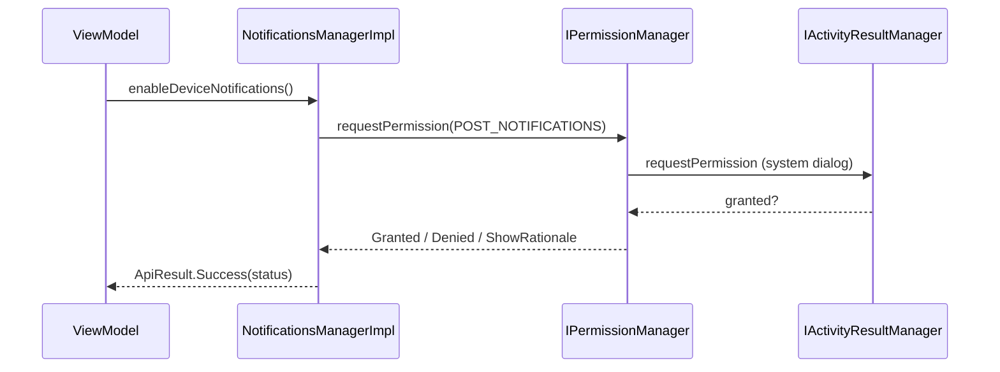

# Notifications (`com.core.data.notifications`)

## Purpose and when to use it

`INotificationsManager` covers the **device-level** side of notifications:

- ask the user for the Android 13+ `POST_NOTIFICATIONS` permission,
- check whether the app can post notifications,
- remove ("erase") a currently displayed notification by its **tag**.

> **There is no API to create channels, build or show notifications.** Features that need to post notifications must use
> `NotificationManagerCompat` / `NotificationCompat.Builder` themselves. To make a notification removable through
> `erasedNotificationFromStatusBar(id)`, post it with a **tag** equal to that `id`:
> `NotificationManagerCompat.from(ctx).notify(tag = id, id = numericId, notification)`.

## Package layout

```
com/core/data/notifications/
├── di/NotificationsModule.kt
└── manager/
    ├── INotificationsManager.kt
    └── NotificationsManagerImpl.kt
```

Manifest: core/data declares `<uses-permission android:name="android.permission.POST_NOTIFICATIONS" />`, which is merged into the app.

## Dependency injection

`NotificationsModule` (`object`, `@InstallIn(SingletonComponent::class)`):
`@Singleton @Provides fun providesNotificationsManager(@ApplicationContext context: Context, permissionManager: IPermissionManager): INotificationsManager = NotificationsManagerImpl(context, permissionManager)`.

```kotlin
@HiltViewModel
class SettingsViewModel @Inject constructor(private val notificationsManager: INotificationsManager) : ViewModel()
```

## Type reference

### `manager/INotificationsManager`

| Method | Returns | Semantics |
|---|---|---|
| `suspend fun enableDeviceNotifications(): ApiResult<PermissionStatus>` | Always `Success(status)` | Shows the system permission dialog for `POST_NOTIFICATIONS` and returns `Granted` / `Denied` / `ShowRationale`. |
| `suspend fun areDeviceNotificationsEnabled(): ApiResult<Boolean>` | Always `Success(bool)` | API 33+: whether `POST_NOTIFICATIONS` is granted. Below 33: always `true`. |
| `suspend fun erasedNotificationFromStatusBar(id: String)` | `Unit` | Cancels the first active notification whose `tag == id`. |

### `manager/NotificationsManagerImpl`
Constructor: `(context: Context, permissionManager: IPermissionManager)`.

- `enableDeviceNotifications()` is annotated `@RequiresApi(Build.VERSION_CODES.TIRAMISU)` **on the implementation only**. It delegates to
  `permissionManager.requestPermission(Manifest.permission.POST_NOTIFICATIONS)` and wraps the result in `ApiResult.Success`.
  The interface has no annotation, so lint won't warn callers. Guard calls with `Build.VERSION.SDK_INT >= 33`.
- `areDeviceNotificationsEnabled()` returns `permissionManager.hasPermission(POST_NOTIFICATIONS)` on API 33+ and `true` otherwise.
  It does **not** check `NotificationManagerCompat.areNotificationsEnabled()` or channel importance, so a user who disabled notifications in
  system settings on API < 33 is still reported as enabled.
- `erasedNotificationFromStatusBar(id)` gets `NotificationManager` from `context`, finds `activeNotifications.firstOrNull { it.tag == id }`,
  and if one is found calls `NotificationManagerCompat.from(context).cancel(id, it.id)`. If none matches, it's a no-op. It only sees this app's notifications
  (`getActiveNotifications` requires API 23, and minSdk is 26).

## Data flow



## Usage examples

```kotlin
suspend fun ensureNotifications(): Boolean {
    val enabled = notificationsManager.areDeviceNotificationsEnabled().getOrNull() == true
    if (enabled || Build.VERSION.SDK_INT < Build.VERSION_CODES.TIRAMISU) return enabled

    return when (notificationsManager.enableDeviceNotifications().getOrNull()) {
        PermissionStatus.Granted -> true
        PermissionStatus.ShowRationale -> { showRationaleDialog(); false }
        else -> false
    }
}

// After posting with NotificationManagerCompat.notify("order_123", 1, notification):
notificationsManager.erasedNotificationFromStatusBar(id = "order_123")
```

## Extension guide

To add a "show notification" capability, add a method to `INotificationsManager` (for example
`suspend fun showNotification(tag: String, channelId: String, title: String, body: String): ApiResult<Unit>`),
implement it in `NotificationsManagerImpl` with `NotificationCompat.Builder` + `NotificationManagerCompat.notify(tag, id, ...)`,
check `areDeviceNotificationsEnabled()` first, create channels (API 26+, which is minSdk), and extend `NotificationsManagerTest`.

## Gotchas and constraints

- Requesting the permission needs a foreground `FragmentActivity` (through `IActivityResultManager`). Without one, the request returns `Denied`.
- The method name is spelled `erasedNotificationFromStatusBar` (past tense). It matches by **tag**, not by numeric id.

## Testing

`NotificationsManagerTest` (`@HiltAndroidTest`, `@UninstallModules(PermissionModule::class)`, `@BindValue` mock `IPermissionManager`,
`@Config(sdk = [TIRAMISU])`) verifies that the request result is returned, that the enabled state mirrors the permission, the `true` default on
`S_V2` (API 32), and cancellation of the notification with the matching tag.

## Related pages

- [Permissions](permission.md)
- [Activity results](activity-result.md)
- [Recipes](recipes.md)
- [Testing](testing.md)
