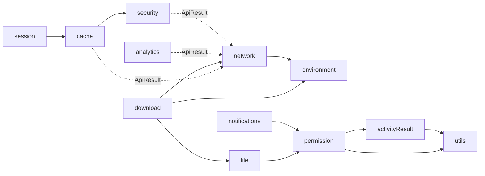

# core/data module overview

`:core:data` (namespace `com.core.data`, `core/data/build.gradle.kts`) is the shared **data and platform-services layer** of
the BaseApplication template. It doesn't contain feature business logic. It provides injectable managers that features compose:
networking, caching, encryption, session, permissions, activity results, files, downloads, analytics, notifications and environment selection.

## Package map

| Package (`com.core.data.*`) | Main entry point (inject this) | Responsibility | Page |
|---|---|---|---|
| `activityResult` | `IActivityResultManager` | Launch any `ActivityResultContract` from non-UI code and suspend for the result. | [activity-result](activity-result.md) |
| `analytics` | `IAnalyticsManager` | Route screen views and events to analytics frameworks (Firebase). | [analytics](analytics.md) |
| `cache` | `ICacheManager` | Memory (LruCache) and encrypted disk (DataStore) caches with TTL, plus `repositoryPattern`. | [cache](cache.md) |
| `download` | `IDownloadManager` | Download a URL into app storage (or reuse a local copy) as a `FileProvider` URI. | [download](download.md) |
| `environment` | `IEnvironmentManager` | DEV/UAT/PROD selection, API base URL and pinning decision. | [environment](environment.md) |
| `file` | `IFileManager` | Save and find files in `filesDir` and expose them via `FileProvider`. | [file](file.md) |
| `network` | `RetrofitFactory`, `ApiResult` | Retrofit/OkHttp graph, `ApiResult` call adapter and operators, SSL pinning. | [network](network.md) |
| `notifications` | `INotificationsManager` | `POST_NOTIFICATIONS` permission and dismissing notifications by tag. | [notifications](notifications.md) |
| `permission` | `IPermissionManager` | Check and request runtime permissions, mapped to `Granted`/`Denied`/`ShowRationale`. | [permission](permission.md) |
| `security` | `ISecurityManager` | AES (Keystore, GCM) and RSA (OAEP) encryption, with or without caller keys. | [security](security.md) |
| `session` | `ISessionManager` | Logged-in session state, inactivity timer (`Warning`/`TimeOut` commands). | [session](session.md) |
| `utils` | `ActivityProvider` (object) | Tracks the current `FragmentActivity` and application context. | [utils](utils.md) |

## Architecture conventions

1. **Interface + implementation.** Every capability has `manager/I<Name>Manager.kt` (public contract) and
   `manager/<Name>ManagerImpl.kt`. Features depend only on the interface. Download also has a `repository/` layer, and
   pluggable strategies live in `frameworks/` (analytics), `scopes/` (cache) and `cryptography/` (security).
2. **One Hilt module per package in `di/`.** All modules are Kotlin `object`s annotated
   `@Module @InstallIn(SingletonComponent::class)`, and every provider is `@Singleton @Provides`. Implementations are
   constructed manually inside the provider, so `@Inject` constructors on some impls aren't what Hilt uses.
   There are no qualifiers apart from `@ApplicationContext`.
3. **Multibinding maps** for pluggable strategies, each with its own `@MapKey` enum annotation:

   | Map | Key annotation / enum | Entries | Consumer |
   |---|---|---|---|
   | `Map<AnalyticsFramework, IAnalyticsFramework<BaseAnalyticsView, BaseAnalyticsEvent>>` | `@AnalyticsFrameworkKey` / `AnalyticsFramework` | `FIREBASE` | `AnalyticsManagerImpl` |
   | `Map<CacheScope, ICacheScope>` | `@CacheScopeKey` / `CacheScope` | `MEMORY_CACHE`, `DISK_CACHE` | `CacheManagerImpl` |
   | `Map<CipherType, ICryptographyType>` | `@CipherTypeKey` / `CipherType` | `RSA`, `AES` | `SecurityManagerImpl` |

   Injecting these maps requires `@JvmSuppressWildcards` on both key and value types.
4. **Assisted factory** for Retrofit services: `RetrofitFactory` (`@AssistedFactory`) → `RetrofitBuilder` (`@AssistedInject`).
5. **Results, not exceptions.** Public suspend APIs return `ApiResult<T>` (`Success`/`Error`/`Exception`/`NoContent`) from
   `network/model`. That includes non-network managers.
6. **Static activity access.** `ActivityProvider` is a Kotlin `object` that isn't injected. It must be initialized with the `Application`.

## Cross-package dependency graph

Hilt edges (provider parameters): `SessionModule(ICacheManager)`, `CacheModule(ISecurityManager, Json, Context)`,
`DownloadModule(IFileManager, IDownloadRepository)`, `DownloadNetworkModule(RetrofitFactory, IEnvironmentManager)`,
`NetworkModule(IEnvironmentManager)`, `FileModule(IPermissionManager)`, `NotificationsModule(IPermissionManager)`,
`PermissionModule(IActivityResultManager)`.

## Build setup

`core/data/build.gradle.kts` applies only `alias(coreLibs.plugins.core.data)`, sets `namespace = "com.core.data"` and
`testInstrumentationRunner = "com.core.data.DefaultTestRunner"`. That class doesn't exist in the module (there's no `androidTest` source set),
and the module declares no extra dependencies.

The plugin id `core.data` is registered in `core/dependencies/build.gradle.kts` (included build, `pluginManagement { includeBuild("core/dependencies") }`)
and implemented by `com.core.dependencies.plugins.CoreDataPlugin`:

**Plugins applied:** `android-library`, `kotlin-serializable`, `google-ksp`, `google-hilt`, `dokka`, `detekt`.

**Android config** (`utils/Extensions.kt`, `config/Config.kt`): `compileSdk 37`, `minSdk 26`, Java/JVM toolchain 21,
`testFixtures.enable = true`, release `isMinifyEnabled = true` with `proguard-android-optimize.txt` + `proguard-rules.pro`,
packaging excludes for `META-INF` license files, and `configureTests()` (`isIncludeAndroidResources = true` plus `--add-opens` JVM args for Robolectric).
Detekt has autoCorrect enabled, and reports go to `build/reports/detekt/core_data.html` at the root.

**Dependencies** (from the `coreLibs` catalog `core/dependencies/gradle/libs.versions.toml`):

| Configuration | Library | Notes |
|---|---|---|
| `api` | `kotlinx-serialization-json` (1.12.0) | Features can use `@Serializable`/`Json`. |
| `api` | `retrofit` (3.0.0) | Features declare Retrofit services. |
| `implementation` | `retrofit converter-kotlinx-serialization`, `okhttp logging-interceptor` (5.5.1) | |
| `implementation` | `androidx.datastore:datastore-preferences` (1.3.0) | Disk cache. |
| `implementation` | `hilt-android` (2.60.1); `ksp` `hilt-compiler` | |
| `implementation` | Firebase BoM (35.1.0), `firebase-analytics`, `firebase-crashlytics` | |
| `ksp` | `kotlin-metadata` | |
| `testFixturesApi` | bundle `test-unit` = `kotlinx-coroutines-test`, `robolectric` (4.17), `hilt-android-testing`, `mockk-android` (1.14.11) | |
| `kspTest` | `hilt-compiler` | |
| `detektPlugins` | `detekt-ktlint`, `detekt-library` | |

Kotlin is 2.4.21. AndroidX Activity/Fragment/Core/Lifecycle come in transitively (used by `ActivityProvider` and the activity result manager).

## How other modules consume core:data

- `CorePresentationPlugin` → `implementation(project(":core:data"))`. `core/presentation` uses:
  - `CoreApp : Application` calls `ActivityProvider.init(this)` in `onCreate`. **Apps must extend `CoreApp`** (or call `init` themselves).
  - `BaseActivity` injects `dagger.Lazy<ISessionManager>`, collects `commands` (`Warning` → `onSessionWarning()`, `TimeOut` → `onSessionTimeout()`,
    which by default calls `invalidateSession()`) and calls `restartSessionTimeout()` on user interaction.
  - `CoroutinesUseCaseRunner` maps `ApiResult` to `UiResult` and paging.
- `FeatureDataPlugin` → `api(project(":core:data"))` (so feature data modules re-export it) and `testImplementation(testFixtures(project(":core:data")))`.
  core/data has **no `src/testFixtures` sources**, so feature tests get only the test-unit bundle and not `BaseTest`, which lives in `src/test`.
- `:app` reaches core/data transitively through `core:presentation` and feature modules.

## Manifest and resources

`src/main/AndroidManifest.xml` (merged into the app):
- `WRITE_EXTERNAL_STORAGE` (`maxSdkVersion=32`, `tools:ignore="ScopedStorage"`), `READ_EXTERNAL_STORAGE` (`maxSdkVersion=32`), `POST_NOTIFICATIONS`.
- `<application android:requestLegacyExternalStorage="true">`.
- `androidx.core.content.FileProvider` with `authorities="${applicationId}"`, `exported=false`, `grantUriPermissions=true`, paths `@xml/provider_paths`.

`res/xml/provider_paths.xml` contains `<files-path name="files" path="/"/>` (the whole internal `filesDir`). See [file](file.md).

`res/xml/network_config.xml` is a network security config: cleartext permitted for `secure.example.com` and `cdn.example.com`
(including subdomains), with an empty trust-anchors block (a commented `@raw/prod_ca`), and debug overrides trusting user CAs. **It isn't referenced** by
`android:networkSecurityConfig` anywhere in the repo. See [network](network.md).

## ProGuard / R8

- `proguard-rules.pro` has only the default commented template (no active rules). It applies to this module's own release minification.
- `consumer-rules.pro` is empty, so the module ships **no consumer rules** to apps. Apps rely on the libraries' bundled rules
  (Retrofit, kotlinx.serialization, Hilt). If an app minifies and caches custom types through `DynamicLookupSerializer` (reflective `serializer()` lookup),
  verify that the `@Serializable` classes keep their generated serializers.

## Related pages

- [Quickstart](../quickstart.md)
- [Recipes](recipes.md)
- [Testing](testing.md)
- [Network](network.md)
- [ActivityProvider](utils.md)
