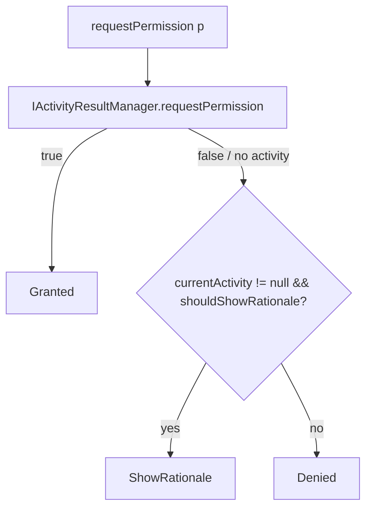

# Permissions (`com.core.data.permission`)

## Purpose and when to use it

`IPermissionManager` is the suspend-friendly way to check and request Android runtime permissions from any layer.
It reports a three-state `PermissionStatus` so the UI can tell "denied, ask again with rationale" apart from
"denied (first time or permanently)".

Core consumers: `FileManagerImpl` (storage permissions on API < 33) and `NotificationsManagerImpl` (`POST_NOTIFICATIONS`).
Every permission you request must also be declared in a manifest (core/data declares only the storage and notifications ones).

## Package layout

```
com/core/data/permission/
├── di/PermissionModule.kt
├── manager/
│   ├── IPermissionManager.kt
│   └── PermissionManagerImpl.kt
└── model/PermissionStatus.kt
```

## Dependency injection

`PermissionModule` (`object`, `@InstallIn(SingletonComponent::class)`):
`@Singleton @Provides fun providesPermissionManager(activityResultManager: IActivityResultManager): IPermissionManager = PermissionManagerImpl(activityResultManager)`.

```kotlin
class TakePhotoUseCase @Inject constructor(
    private val permissionManager: IPermissionManager,
    private val activityResultManager: IActivityResultManager,
)
```

## Type reference

### `model/PermissionStatus` (sealed class)

| Subtype | Meaning |
|---|---|
| `data object Granted` | Permission granted. |
| `data object Denied` | Not granted, and the system says no rationale should be shown (first denial on some versions, "don't ask again", policy-blocked, or no activity available). |
| `data object ShowRationale` | Not granted, and `shouldShowRequestPermissionRationale` is `true`. Explain why, then ask again. |

### `manager/IPermissionManager`
```kotlin
fun hasPermission(permission: String): Boolean
suspend fun requestPermission(permission: String): PermissionStatus
suspend fun requestPermissions(vararg permissions: String): Map<String, PermissionStatus>
```

### `manager/PermissionManagerImpl`
`class PermissionManagerImpl @Inject constructor(activityResultManager: IActivityResultManager)`.

- **`hasPermission(permission)`** returns `ActivityCompat.checkSelfPermission(ActivityProvider.applicationContext, permission) == PERMISSION_GRANTED`.
  It's synchronous, needs no activity, and doesn't show a UI. It requires `ActivityProvider.init` (otherwise `applicationContext` throws
  `UninitializedPropertyAccessException`).
- **`requestPermission(permission)`**:
  1. `activityResultManager.requestPermission(permission)` (the `RequestPermission` contract). It returns `false` when no activity is available.
  2. `true` → `Granted`.
  3. `false` → if `ActivityProvider.currentActivity` exists and `shouldShowRequestPermissionRationale(activity, permission)` returns `ShowRationale`, else `Denied`.
- **`requestPermissions(vararg permissions)`**:
  1. `activityResultManager.requestPermissions(*permissions)` (the `RequestMultiplePermissions` contract).
  2. If the result map isn't null, then for each requested permission (`associateWith`): `true` gives `Granted`. Otherwise it applies the same rationale check (`ShowRationale`/`Denied`).
  3. If the result is `null` (no activity available), it falls back to `hasPermission` for each: `Granted` or `Denied`, and never `ShowRationale`.
  The returned map always contains every requested permission, in request order.

The request methods suspend until the user answers the system dialog. Call them from the main dispatcher.

## Data flow



## Usage examples

```kotlin
suspend fun ensureCamera(): Boolean {
    if (permissionManager.hasPermission(Manifest.permission.CAMERA)) return true
    return when (permissionManager.requestPermission(Manifest.permission.CAMERA)) {
        PermissionStatus.Granted -> true
        PermissionStatus.ShowRationale -> { uiEvents.send(ShowCameraRationale); false }
        PermissionStatus.Denied -> { uiEvents.send(OpenAppSettingsPrompt); false }
    }
}

val statuses = permissionManager.requestPermissions(
    Manifest.permission.ACCESS_FINE_LOCATION,
    Manifest.permission.ACCESS_COARSE_LOCATION,
)
val anyLocation = statuses.values.any { it == PermissionStatus.Granted }
```

## Extension guide

- To add states (for example `PermanentlyDenied`), add a subtype to `PermissionStatus`. You need to persist "asked before" state,
  because Android doesn't expose permanent denial directly. Update every exhaustive `when` (`FileManagerImpl` compares only with `Granted`/`Denied`).
- Permission groups or helpers (for example "location") belong in feature code or as extension functions on `IPermissionManager`.

## Gotchas and constraints

- **No foreground `FragmentActivity` → `Denied`** for single requests (no dialog shown). Batch requests fall back to the current grant state.
- `Denied` is ambiguous: it covers both "never asked and denied once without rationale" and "don't ask again". Offer an
  app-settings deep link (`startActivityForResult(Intent(Settings.ACTION_APPLICATION_DETAILS_SETTINGS, ...))`).
- Remember to declare permissions in the feature/app manifest. Requesting an undeclared permission is denied immediately.

## Testing

`PermissionManagerTest` (`@HiltAndroidTest`, `@UninstallModules(ActivityResultModule::class)`, `@BindValue` mock `IActivityResultManager`)
covers `hasPermission` granted/denied (Robolectric grants), `requestPermission` → `Granted`/`Denied`/`ShowRationale` (using
`Robolectric.buildActivity` so `ActivityProvider` has a current activity), and `requestPermissions` → rationale, mixed granted/denied, and the
`null`-result fallback to current grants.

## Related pages

- [Activity results](activity-result.md)
- [ActivityProvider](utils.md)
- [File storage](file.md)
- [Notifications](notifications.md)
- [Recipes](recipes.md)
