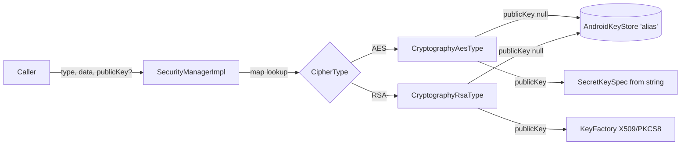

# Security (`com.core.data.security`)

## Purpose and when to use it

`ISecurityManager` encrypts and decrypts **strings** and returns Base64 strings wrapped in `ApiResult`. Two algorithms are registered:

| `CipherType` | Implementation | `publicKey == null` (device-bound) | `publicKey != null` (caller key) |
|---|---|---|---|
| `AES` | `CryptographyAesType` | AndroidKeyStore AES key, alias `"alias"`, AES/GCM/NoPadding, random 12-byte IV prepended | UTF-8 bytes of `publicKey` used as **both** AES key and GCM IV |
| `RSA` | `CryptographyRsaType` | AndroidKeyStore RSA key pair, alias `"alias"`, RSA/ECB/OAEPPadding | encrypt: `publicKey` = Base64 X.509 public key. decrypt: `publicKey` = Base64 **PKCS#8 private key** |

The [disk cache](cache.md) uses AES with `publicKey = null` for every key, entry and value.

## Package layout

```
com/core/data/security/
├── cryptography/
│   ├── ICryptographyType.kt
│   ├── aes/CryptographyAesType.kt
│   └── rsa/CryptographyRsaType.kt
├── di/
│   ├── CipherTypeKey.kt                # @MapKey(CipherType)
│   └── SecurityModule.kt
├── manager/
│   ├── ISecurityManager.kt
│   └── SecurityManagerImpl.kt
└── model/CipherType.kt                 # enum RSA, AES
```

## Dependency injection

`SecurityModule` (`object`, `@InstallIn(SingletonComponent::class)`). All providers are `@Singleton`:

| Provider | Binding |
|---|---|
| `providesCryptographyRsaType(): ICryptographyType = CryptographyRsaType()` | `@IntoMap @CipherTypeKey(CipherType.RSA)` |
| `providesCryptographyAesType(): ICryptographyType = CryptographyAesType()` | `@IntoMap @CipherTypeKey(CipherType.AES)` |
| `providesSecurityManager(cryptography: Map<@JvmSuppressWildcards CipherType, @JvmSuppressWildcards ICryptographyType>): ISecurityManager` | `SecurityManagerImpl(cryptography)` |

`CipherTypeKey` is `@MapKey annotation class CipherTypeKey(val value: CipherType)`.

```kotlin
class TokenStore @Inject constructor(private val securityManager: ISecurityManager)
```

## Type reference

### `model/CipherType`
`enum class CipherType { RSA, AES }`.

### `cryptography/ICryptographyType`
```kotlin
suspend fun encryptData(data: String, publicKey: String): ApiResult<String>
suspend fun encryptData(data: String): ApiResult<String>
suspend fun decryptData(data: String, publicKey: String): ApiResult<String>
suspend fun decryptData(data: String): ApiResult<String>
```
Each implementation returns `ApiResult.Success(base64OrPlainText)`. **Cryptographic exceptions aren't caught**
(`GeneralSecurityException`, `IllegalArgumentException` on bad Base64, `AEADBadTagException`, and so on), so they propagate to the caller.

### `cryptography/aes/CryptographyAesType`
File constants: `ANDROID_KEY_STORE = "AndroidKeyStore"`, `ALIAS = "alias"`, `ALGORITHM = AES`, `BLOCK_MODE = GCM`, `PADDING = NoPadding`,
`TRANSFORMATION = "AES/GCM/NoPadding"`, `IV_LENGTH_BYTES = 12`, `TAG_LENGTH_BYTES = 16` (128-bit tag).

- `private val cipher by lazy { Cipher.getInstance(TRANSFORMATION) }` is **one shared `Cipher`** per instance (and the instance is a singleton).
- `private val keyStore by lazy { KeyStore.getInstance("AndroidKeyStore").apply { load(null) } }`.
- `encryptData(data)`: `cipher.init(ENCRYPT_MODE, getKey())` (the Keystore generates a random IV), then returns `Base64.DEFAULT( iv[12] + ciphertext+tag )`.
  Because of the random IV, **the same input encrypts to a different output every time**.
- `decryptData(data)`: Base64-decodes, splits off the first 12 bytes as the IV, and runs `GCMParameterSpec(128, iv)` with the Keystore key, returning a UTF-8 string.
- `encryptData(data, publicKey)` / `decryptData(data, publicKey)`: `SecretKeySpec(publicKey.utf8, "AES")` and `GCMParameterSpec(128, publicKey.utf8)`, so the
  key bytes are also the IV. The key must be 16, 24 or 32 bytes. The output is plain `Base64(ciphertext+tag)` with no IV prefix, and it's deterministic.
- `getKey()`: `keyStore.getEntry("alias")` as `SecretKeyEntry`, or `createKey()`.
- `createKey()`: `KeyGenerator("AES", "AndroidKeyStore")` with `KeyGenParameterSpec(ALIAS, ENCRYPT|DECRYPT)`, GCM, NoPadding,
  `setUserAuthenticationRequired(false)`, `setRandomizedEncryptionRequired(true)`.

### `cryptography/rsa/CryptographyRsaType`
File constants: `ALIAS = "alias"`, `ALGORITHM = RSA`, `BLOCK_MODE = ECB`, `PADDING = OAEPPadding`, `DIGEST = SHA-256`,
`TRANSFORMATION = "RSA/ECB/OAEPPadding"`. Every operation uses `OAEPParameterSpec("SHA-256", "MGF1", MGF1ParameterSpec.SHA1, PSource.PSpecified.DEFAULT)`
(SHA-256 main digest with MGF1-SHA1, the combination supported by AndroidKeyStore).

- `encryptData(data, publicKey)`: `decodePublicKey` (trim, Base64 decode, `X509EncodedKeySpec`, `KeyFactory("RSA")`). It returns Base64 ciphertext.
- `encryptData(data)` uses the public key of the Keystore pair.
- `decryptData(data, publicKey)`: **`publicKey` must be a Base64 PKCS#8 private key** (`decodePrivateKey`). It returns plaintext.
- `decryptData(data)` uses the Keystore private key.
- `getKey()`: `keyStore.getEntry("alias")` as `PrivateKeyEntry` → `KeyPair(cert.publicKey, privateKey)`, or `createKey()`.
- `createKey()`: `KeyPairGenerator("RSA", "AndroidKeyStore")` with ECB, OAEP, `setDigests(SHA-256)`, no user auth, randomized encryption required.
  The key size is the platform default (2048).

### `manager/ISecurityManager`
```kotlin
suspend fun encryptData(type: CipherType, data: String, publicKey: String?): ApiResult<String>
suspend fun decryptData(type: CipherType, data: String, publicKey: String?): ApiResult<String>
```

### `manager/SecurityManagerImpl`
`SecurityManagerImpl(cryptography: Map<CipherType, ICryptographyType>)`:
- Unknown type → `ApiResult.Exception(NoSuchElementException("Cryptography <TYPE> does not exist"))`.
- `publicKey != null` → keyed overload. Otherwise → the device-bound overload. The result is returned as is.

## Data flow



## Usage examples

```kotlin
// Device-bound AES (local secrets)
val encrypted = securityManager.encryptData(CipherType.AES, data = refreshToken, publicKey = null).getOrNull()
val decrypted = encrypted?.let { securityManager.decryptData(CipherType.AES, it, null).getOrNull() }

// Encrypt for a backend public key (X.509 SubjectPublicKeyInfo, Base64)
val payload = securityManager.encryptData(CipherType.RSA, data = pin, publicKey = BACKEND_PUBLIC_KEY_B64)

// Crypto errors throw: guard untrusted input
val safe = runCatching { securityManager.decryptData(CipherType.AES, untrusted, null) }
    .getOrElse { ApiResult.Exception(it) }
```

## Extension guide: adding a cipher type

1. Add an entry to `CipherType` (for example `CHACHA20`).
2. Implement `ICryptographyType` in `cryptography/<name>/`. Return Base64 for ciphertext, and consider catching exceptions into `ApiResult.Exception`.
   **Use a distinct Keystore alias** (see below).
3. Bind it in `SecurityModule` with `@Singleton @Provides @IntoMap @CipherTypeKey(CipherType.CHACHA20)`.
4. Add round-trip tests to `SecurityManagerTest`. Use the caller-key overloads or a mocked `ICryptographyType`, because Robolectric has no AndroidKeyStore.

## Gotchas and constraints

- **AES and RSA share the Keystore alias `"alias"`.** `CryptographyAesType.getKey()` expects a `SecretKeyEntry` and
  `CryptographyRsaType.getKey()` expects a `PrivateKeyEntry`. If one type created the entry, the other's cast yields `null` and it
  **generates a new key under the same alias, replacing the existing one**. Using device-bound RSA (`publicKey = null`) therefore
  destroys the AES key that the disk cache depends on (existing disk-cache entries become undecryptable and read as `NoContent`), and vice versa.
  Avoid device-bound RSA, or give each type its own alias.
- **Caller-key AES reuses the key as the IV**, so the output is deterministic and the GCM IV is reused for a given key. Use it only for interoperability.
- **Not thread-safe:** each type holds one `Cipher` that `init`s per call. Concurrent calls on the singleton can interleave. Serialize heavy use
  (for example with a `Mutex`) if you encrypt from several coroutines in parallel.
- **Exceptions propagate.** Only the "unknown CipherType" path returns `ApiResult.Exception`.
- RSA/OAEP-SHA256 with a 2048-bit key encrypts at most 190 bytes of plaintext.
- Base64 uses `Base64.DEFAULT`, which inserts line breaks. Use the same flags when exchanging data with servers.

## Testing

`SecurityManagerTest` (`@HiltAndroidTest`, `BaseTest`) runs AES round-trips with the caller key `"0123456789abcdef"` and RSA round-trips with a
freshly generated JCA key pair (public X.509 for encrypt, PKCS#8 private for decrypt). Device-bound (no-key) paths are verified only through
a mocked `ICryptographyType` passed to `SecurityManagerImpl`. Base64 is provided on the JVM by the test shadow `android/util/Base64.kt`.

## Related pages

- [Cache](cache.md): the disk scope encrypts with AES. · [Testing](testing.md) · [Recipes](recipes.md)
