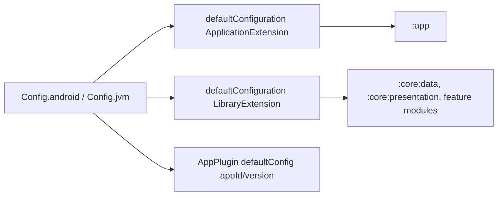

# Config: Android and JVM settings (`com.core.dependencies.config`)

## File layout

```
core/dependencies/src/main/java/com/core/dependencies/config/
├── Config.kt                 # object Config
└── model/
    ├── AndroidConfig.kt      # data class AndroidConfig
    └── JvmConfig.kt          # data class JvmConfig
```

## Types

```kotlin
data class AndroidConfig(
    val minSdkVersion: Int,
    val targetSdkVersion: Int,
    val compileSdkVersion: Int,
    val applicationId: String,
    val versionCode: Int,
    val versionName: String,
    val nameSpace: String,
)

data class JvmConfig(
    val javaVersion: org.gradle.api.JavaVersion,
    val kotlinJvm: org.jetbrains.kotlin.gradle.dsl.JvmTarget,
)

object Config {
    val android = AndroidConfig(
        minSdkVersion = 26,
        targetSdkVersion = 37,
        compileSdkVersion = 37,
        applicationId = "com.base.application",
        versionCode = 1,
        versionName = "1.0",
        nameSpace = "com.base.application",
    )
    val jvm = JvmConfig(
        javaVersion = JavaVersion.VERSION_21,
        kotlinJvm = JvmTarget.JVM_21,
    )
}
```

## Where each value is used

| Value | Read by | Effect |
|---|---|---|
| `compileSdkVersion = 37` | `defaultConfiguration(ApplicationExtension)` and `defaultConfiguration(LibraryExtension)` via `compileSdk { version = release(37) }` | Every Android module compiles against API 37. |
| `minSdkVersion = 26` | both `defaultConfiguration` overloads | Every module. Code may use APIs ≤ 26 without checks. |
| `targetSdkVersion = 37` | **only** `defaultConfiguration(ApplicationExtension)` | Only `:app` sets a target SDK (libraries don't need one). |
| `applicationId` | `AppPlugin` (`defaultConfig.applicationId`) | `com.base.application`, plus the `.debug` suffix in debug builds. |
| `versionCode = 1`, `versionName = "1.0"` | `AppPlugin` | App version, plus `versionNameSuffix = "-debug"` in debug. |
| `nameSpace` | both `defaultConfiguration` overloads (`defaultConfig { namespace = ... }`) | The **default namespace for every module**: `com.base.application`. `core/data` and `core/presentation` override it in their `build.gradle.kts`. `:app`, `:demo:data` and `:demo:presentation` **don't**, so all three use `com.base.application`. |
| `javaVersion = VERSION_21` | both `defaultConfiguration` overloads (`compileOptions.source/targetCompatibility`) | Java 21 bytecode and language level. |
| `kotlinJvm = JVM_21` | both overloads, via `kotlinExtension.jvmToolchain(kotlinJvm.target.toInt())` | Requires a JDK 21 toolchain (Gradle auto-provisioning or a local JDK 21). |

The included build itself uses Java 21 independently (`core/dependencies/build.gradle.kts` `java { sourceCompatibility = targetCompatibility = VERSION_21 }`).

## Data flow



## Gotchas and constraints

- **Duplicate namespaces:** because feature modules inherit `com.base.application`, `:demo:data`, `:demo:presentation` and `:app` share a namespace, and so they share an
  `R`/`BuildConfig` package. AGP reports duplicate namespaces (a warning or error depending on version) and resources may clash. **Always set `android { namespace = "..." }` in each
  new module** (see [recipes](recipes.md)).
- There's a single app version for all builds, with no flavors.
- Changing `minSdkVersion` affects permissions and API checks in core/data (for example `FileManagerImpl` and `NotificationsManagerImpl` branch on API 33).

## Extension guide

- **Bump an SDK or JVM version:** edit `Config.kt` only. All plugins read it. For a JVM bump, also update `core/dependencies/build.gradle.kts` (`java { ... }`) and make sure the AGP and Kotlin versions in the
  catalog support the new target.
- **New shared setting** (for example `buildToolsVersion`): add a field to the data class, set it in `Config`, and apply it in `defaultConfiguration`.

## Related pages

- [Build helper extensions](extensions.md)
- [Plugin: app](plugin-app.md)
- [Recipes](recipes.md)
- [Overview](overview.md)
