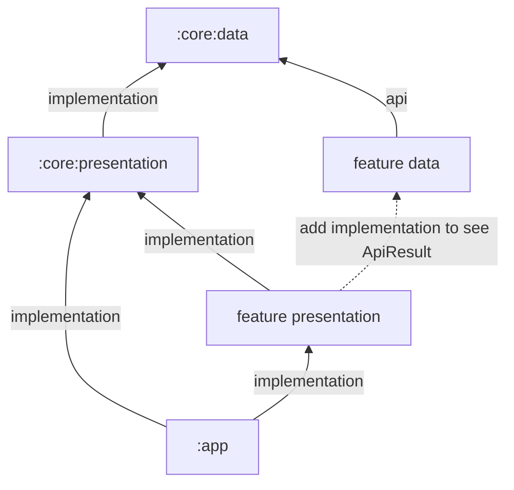

# Dependency visibility matrix

Use this page when you get **"Unresolved reference"** or **"Cannot access class … check your module classpath"** errors.

Rules: a module sees its own `api` and `implementation` dependencies, plus the **`api` dependencies of those** (transitively through `api` chains only).
An `implementation` dependency of a dependency is **not** visible at compile time (it's on the runtime classpath only). Unit tests (`src/test`) also see the module's own
test fixtures' `testFixturesApi` dependencies and anything added with `testImplementation`.

## What each plugin declares

| Plugin | `api` | `implementation` | Other |
|---|---|---|---|
| `core.data` | kotlinx-serialization-json, retrofit | datastore-preferences, hilt-android, retrofit converter-kotlinx-serialization, okhttp logging-interceptor, firebase BoM + analytics + crashlytics | `ksp`: kotlin-metadata, hilt-compiler. `testFixturesApi`: test-unit bundle. `kspTest`: hilt-compiler |
| `core.presentation` | kotlinx-serialization-json, compose foundation, ui-tooling-preview, material3, lifecycle-viewmodel-compose, navigation-ui-ktx, hilt-navigation-compose, navigation3-runtime, navigation3-ui, paging-compose, browser | **project(":core:data")**, kotlin-reflect, compose BoM (platform), hilt-android | `debugImplementation`: ui-tooling. `ksp`: kotlin-metadata, hilt-compiler. `testFixturesApi`: test-unit bundle. `kspTest`: hilt-compiler |
| `feature.data` | **project(":core:data")** | hilt-android | `ksp`: kotlin-metadata, hilt-compiler. `testImplementation`: `testFixtures(project(":core:data"))` |
| `feature.presentation` | none | **project(":core:presentation")**, hilt-android | `ksp`: kotlin-metadata, hilt-compiler. `testImplementation`: `testFixtures(project(":core:presentation"))` |
| `app` | none | **project(":core:presentation")**, hilt-android | `ksp`: kotlin-metadata, hilt-compiler. The app module also adds `implementation(project(":demo:presentation"))` |

Retrofit's own published dependencies include OkHttp, so `okhttp3.*` types (`OkHttpClient`, `Interceptor`, `ResponseBody`) are typically visible wherever retrofit is.

## Compile-time visibility (main source set)

| Visible in → | `:core:data` | `:core:presentation` | feature data | feature presentation | `:app` |
|---|---|---|---|---|---|
| core/data classes (`ApiResult`, `I*Manager`, `ActivityProvider`, …) | own | ✔ (implementation) | ✔ (api) | **✘** | **✘** |
| core/presentation classes (`BaseViewModel`, components, Navigation3 types, `Theme`) | ✘ | own | ✘ | ✔ | ✔ |
| kotlinx-serialization-json | ✔ | ✔ | ✔ (via core:data api) | ✔ (via core:presentation api) | ✔ |
| Retrofit / OkHttp | ✔ | ✔ | ✔ | **✘** | **✘** |
| okhttp logging-interceptor, converter, DataStore, Firebase | ✔ | ✘ | ✘ | ✘ | ✘ |
| Hilt runtime (`@HiltViewModel`, `@Module`, `dagger.*`) | ✔ | ✔ | ✔ | ✔ | ✔ |
| Compose foundation, Material3, ui-tooling-preview | ✘ | ✔ | ✘ | ✔ | ✔ |
| lifecycle-viewmodel-compose, hilt-navigation-compose | ✘ | ✔ | ✘ | ✔ | ✔ |
| Navigation Compose (navigation-ui-ktx), Navigation3 runtime/ui | ✘ | ✔ | ✘ | ✔ | ✔ |
| paging-compose (incl. paging runtime) | ✘ | ✔ | ✘ | ✔ | ✔ |
| androidx.browser (Custom Tabs) | ✘ | ✔ | ✘ | ✔ | ✔ |
| kotlin-reflect | ✘ | ✔ | ✘ | ✘ | ✘ |

## Unit-test (`src/test`) visibility

| Module type | Test libraries available | Hilt test code generation (`kspTest` hilt-compiler) | Robolectric JVM config (`configureTests`) | Shared base classes |
|---|---|---|---|---|
| `:core:data` | test-unit bundle (coroutines-test, robolectric, hilt-android-testing, mockk-android) via own test fixtures | ✔ | ✔ | `BaseTest` in its own `src/test` |
| `:core:presentation` | test-unit bundle | ✔ | **✘** | none (androidTest leftovers only) |
| feature data | test-unit bundle via `testFixtures(":core:data")` | **✘** | **✘** | **none**: core/data has no `src/testFixtures`, so `BaseTest` isn't shared |
| feature presentation | test-unit bundle via `testFixtures(":core:presentation")` | **✘** | **✘** | none |
| `:app` | **nothing** | ✘ | ✘ | none |

No module gets Compose UI test artifacts (`ui-test-junit4`, `ui-test-manifest`) or `androidTest` dependencies.

## Gaps and fixes

1. **Feature presentation modules can't see core/data types.** `core.presentation` depends on core:data with `implementation`, but its public API exposes core/data
   types: `CoroutinesUseCaseRunner` (implemented by `BaseViewModel`) takes and returns `ApiResult`. A feature ViewModel that calls `withUseCaseScopeLazily { useCase() }`
   needs `ApiResult` on its classpath. Fix (choose one):
   - in the feature presentation module: `implementation(project(":<feature>:data"))` (feature data `api`s core:data, so the types become visible), or
   - in `CorePresentationPlugin`: change `implementation(project(":core:data"))` to `api(...)`.
2. **`:app` can't see core/data** (for example to set `IEnvironmentManager.environment` in `App.onCreate`). Add `implementation(project(":core:data"))` to `app/build.gradle.kts`,
   or make core:presentation `api` core:data.
3. **`:app` doesn't depend on `:demo:data`** (only `:demo:presentation`). Hilt aggregates bindings from all modules on the app's runtime classpath, so data modules must be
   reachable from `:app`, either directly or through a presentation module that depends on them.
4. **Hilt tests in feature modules:** add `kspTest(coreLibs.google.hilt.compiler)` (helper `kspTest` exists in `Extensions.kt`) or `@HiltAndroidTest` classes won't get generated components.
5. **Robolectric tests outside core:data:** call `configureTests()` in the plugin (resources + `--add-opens`) or tests that touch Android resources or reflection may fail on JDK 21.
6. **Firebase/DataStore in features:** they're `implementation` in core:data. Add them in the feature module if you need the APIs directly.

## Data flow

## Related pages

- [Version catalog](version-catalog.md)
- [Plugin: core.data](plugin-core-data.md)
- [Plugin: core.presentation](plugin-core-presentation.md)
- [Plugin: feature.data](plugin-feature-data.md)
- [Plugin: feature.presentation](plugin-feature-presentation.md)
- [Plugin: app](plugin-app.md)
- [core-presentation overview](../core-presentation/overview.md)
- [core-data overview](../core-data/overview.md)
