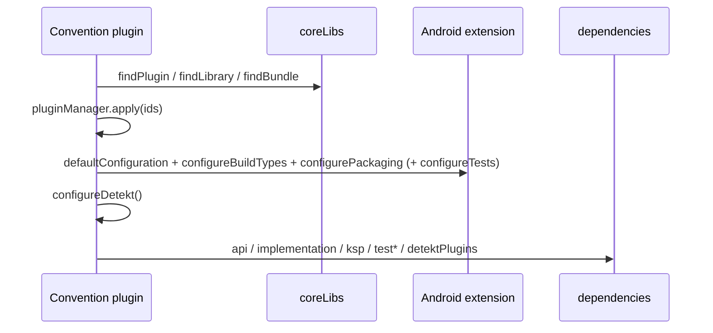

# Build helper extensions (`com.core.dependencies.utils/Extensions.kt`)

## File layout

```
core/dependencies/src/main/java/com/core/dependencies/utils/Extensions.kt
```

## Functions

### `val Project.coreLibs: VersionCatalog`
`extensions.getByType<VersionCatalogsExtension>().named("coreLibs")`. It gives typed-string access to the catalog inside plugin code:
`coreLibs.findPlugin("android-library").get().get().pluginId`, `coreLibs.findLibrary("google-hilt-android").get()`, `coreLibs.findBundle("test-unit").get()`.
It works because the root `settings.gradle.kts` creates the `coreLibs` catalog for the main build. Lookups are by **alias with dashes** (as written in the TOML), and a
missing alias throws `NoSuchElementException` from `Optional.get()` at configuration time.

### `fun Project.defaultConfiguration(extension: ApplicationExtension)` (`@Suppress("UnstableApiUsage")`)
On the given `ApplicationExtension`:
- `compileSdk { version = release(Config.android.compileSdkVersion) }` → 37
- `defaultConfig { minSdk = 26; targetSdk = 37; namespace = "com.base.application" }`
- `compileOptions { sourceCompatibility = targetCompatibility = JavaVersion.VERSION_21 }`
- `testFixtures { enable = true }`
- `kotlinExtension.jvmToolchain(21)` (from `Config.jvm.kotlinJvm.target.toInt()`)

Called by `AppPlugin`.

### `fun Project.defaultConfiguration(extension: LibraryExtension)` (`@Suppress("UnstableApiUsage")`)
The same as above **without `targetSdk`**. Called by `CoreDataPlugin`, `CorePresentationPlugin`, `FeatureDataPlugin` and `FeaturePresentationPlugin`.
Note: it sets `namespace` inside `defaultConfig { }`. Modules override it with `android { namespace = ... }` (`core/data`, `core/presentation`). Others keep `com.base.application`.

### `fun Project.configureDetekt()`
Creates `<root>/build/reports/detekt` (non-recursive `mkdir`, at configuration time), computes `reportFileName` (path without leading `:`, `:` → `_`), and configures
`DetektExtension` (`autoCorrect = true`, `parallel = true`, `source.setFrom(projectDir)`) and every `Detekt` task's reports (HTML on at
`<root>/build/reports/detekt/<name>.html`; checkstyle, SARIF and markdown off). Called by **all** five plugins. Details: [code-quality](code-quality.md).

### `fun CommonExtension.configureBuildTypes()`
```kotlin
buildTypes { getByName("release") { isMinifyEnabled = true; proguardFiles(getDefaultProguardFile("proguard-android-optimize.txt"), "proguard-rules.pro") } }
```
Called by all five plugins. Each module's own `proguard-rules.pro` is used (they currently contain only the commented template). `consumer-rules.pro` isn't referenced
by any plugin (`consumerProguardFiles` is never set), so library consumer rules are **not** shipped even if the file is filled in.

### `fun CommonExtension.configurePackaging()`
`packaging.resources.excludes += "/META-INF/{AL2.0,LGPL2.1}", "META-INF/LICENSE.md", "META-INF/LICENSE-notice.md"`. These avoid duplicate-file conflicts (for example from
MockK and JUnit 5 artifacts). Called by all five plugins.

### `fun CommonExtension.configureTests()`
`testOptions.unitTests { isIncludeAndroidResources = true; all { it.jvmArgs(--add-opens java.base/java.lang, java.base/java.util, java.base/java.io, java.base/java.net, java.base/java.security, java.base/java.text, java.base/jdk.internal.access, java.desktop/java.awt.font, jdk.compiler/com.sun.tools.javac.api =ALL-UNNAMED) } }`.
These are needed for Robolectric and MockK reflection on JDK 21 and for loading merged resources in JVM tests. **Only `CoreDataPlugin` calls it.**

### `DependencyHandler` shortcuts
Each calls `add(configurationName, dependencyNotation)` and returns `Dependency?`:

| Function | Configuration added |
|---|---|
| `ksp(dependencyNotation: Any)` | `ksp` |
| `kspTest(dependencyNotation: Any)` | `kspTest` |
| `implementation(dependencyNotation: Any)` | `implementation` |
| `api(dependencyNotation: Any)` | `api` |
| `testImplementation(dependencyNotation: Any)` | `testImplementation` |
| `testFixturesApi(dependencyNotation: Any)` | `testFixturesApi` |
| `debugApi(dependencyNotation: Any)` | **`debugImplementation`** (the name is misleading: it doesn't add `debugApi`) |
| `detektPlugins(dependencyNotation: Any)` | `detektPlugins` |

They exist because Gradle's generated type-safe accessors (`implementation(...)`, `ksp(...)`) are only available in build scripts and precompiled script plugins,
not in class-based `Plugin<Project>` implementations like these.

## Who calls what

| Function | app | core.data | core.presentation | feature.data | feature.presentation |
|---|---|---|---|---|---|
| `defaultConfiguration` | Application | Library | Library | Library | Library |
| `configureBuildTypes` | ✔ | ✔ | ✔ | ✔ | ✔ |
| `configurePackaging` | ✔ | ✔ | ✔ | ✔ | ✔ |
| `configureTests` | ✘ | ✔ | ✘ | ✘ | ✘ |
| `configureDetekt` | ✔ | ✔ | ✔ | ✔ | ✔ |
| `api` | | ✔ | ✔ | ✔ | |
| `testFixturesApi` / `kspTest` | | ✔ / ✔ | ✔ / ✔ | | |
| `testImplementation` | | | | ✔ | ✔ |
| `debugApi` | | | ✔ | | |

## Data flow (inside a plugin)



## Extension guide

- **New shared configuration:** add an extension on `CommonExtension` (applies to app and library) or `Project`, then call it from the plugins that need it.
- **New configuration shortcut:** `fun DependencyHandler.androidTestImplementation(dependencyNotation: Any): Dependency? = add("androidTestImplementation", dependencyNotation)`.
  Keep the function name equal to the configuration name (unlike `debugApi`).
- **Ship consumer rules:** in `defaultConfiguration(LibraryExtension)`, add `defaultConfig { consumerProguardFiles("consumer-rules.pro") }`.

## Related pages

- [Config](config.md)
- [Code quality](code-quality.md)
- [Plugins: app](plugin-app.md)
- [core.data](plugin-core-data.md)
- [core.presentation](plugin-core-presentation.md)
- [feature.data](plugin-feature-data.md)
- [feature.presentation](plugin-feature-presentation.md)
