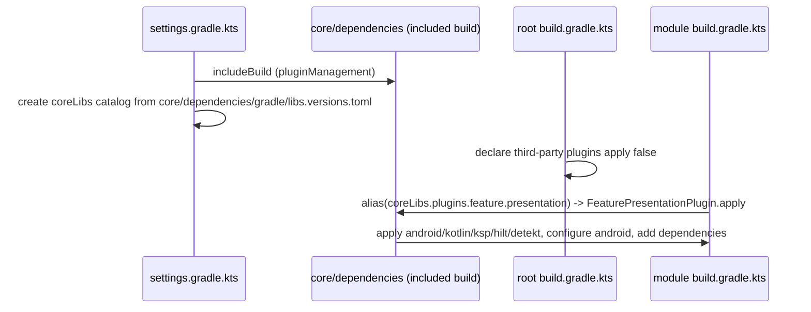

# core/dependencies overview (build logic)

`core/dependencies` is a **Gradle included build** (not a project in the main build) that contains:
- five **convention plugins** (Kotlin `Plugin<Project>` classes) that fully configure every Android module, and
- the **`coreLibs` version catalog** (`gradle/libs.versions.toml`) shared by the included build and the main build.

Every module's `build.gradle.kts` is essentially one line: `plugins { alias(coreLibs.plugins.<type>) }`.

## File layout

```
core/dependencies/
├── build.gradle.kts           # kotlin-dsl, Java 21, Kotlin 2.4 language, gradlePlugin registrations
├── settings.gradle.kts        # repositories + coreLibs catalog for the included build, rootProject.name = "core"
├── gradle/libs.versions.toml  # the catalog (see version-catalog.md)
├── .gitignore                 # "/build"
├── consumer-rules.pro         # empty, unused (leftover from an Android library template)
├── proguard-rules.pro         # default commented template, unused for this JVM build
└── src/main/java/com/core/dependencies/
    ├── config/{Config.kt, model/AndroidConfig.kt, model/JvmConfig.kt}
    ├── plugins/{AppPlugin.kt, CoreDataPlugin.kt, CorePresentationPlugin.kt, FeatureDataPlugin.kt, FeaturePresentationPlugin.kt}
    └── utils/Extensions.kt
```

## Plugins

| Plugin id | Catalog alias | Class | Used by | Page |
|---|---|---|---|---|
| `app` | `coreLibs.plugins.app` | `com.core.dependencies.plugins.AppPlugin` | `:app` | [plugin-app](plugin-app.md) |
| `core.data` | `coreLibs.plugins.core.data` | `CoreDataPlugin` | `:core:data` | [plugin-core-data](plugin-core-data.md) |
| `core.presentation` | `coreLibs.plugins.core.presentation` | `CorePresentationPlugin` | `:core:presentation` | [plugin-core-presentation](plugin-core-presentation.md) |
| `feature.data` | `coreLibs.plugins.feature.data` | `FeatureDataPlugin` | `:demo:data` (and new feature data modules) | [plugin-feature-data](plugin-feature-data.md) |
| `feature.presentation` | `coreLibs.plugins.feature.presentation` | `FeaturePresentationPlugin` | `:demo:presentation` (and new feature presentation modules) | [plugin-feature-presentation](plugin-feature-presentation.md) |

The catalog's `[plugins]` declares these ids with `version = "unspecified"` so modules can use `alias(...)`. The ids are resolved from the included build through `pluginManagement`.

## Included build: `core/dependencies/build.gradle.kts`

- `plugins { `kotlin-dsl` }`, `group = "com.core.dependencies"`.
- `java { sourceCompatibility = targetCompatibility = JavaVersion.VERSION_21 }`, `kotlin { compilerOptions { languageVersion = KotlinVersion.KOTLIN_2_4 } }`.
- `tasks.validatePlugins { enableStricterValidation = true; failOnWarning = true }`: plugin validation warnings fail the build.
- `tasks.test { excludes += "*" }`: all tests in the included build are excluded (there are none).
- `dependencies { compileOnly(coreLibs.android.gradle); compileOnly(coreLibs.kotlin.gradle); compileOnly(coreLibs.detekt.gradle) }`: AGP 9.4.1, Kotlin Gradle Plugin 2.4.21 and the
  Detekt Gradle plugin 2.0.0-alpha.6 APIs are compile-only. At runtime the versions come from the root `build.gradle.kts` plugin declarations.
- `gradlePlugin { plugins { register("app"/"coreData"/"corePresentation"/"featureData"/"featurePresentation") { id = ...; implementationClass = ... } } }` with the five ids above.

## Included build: `core/dependencies/settings.gradle.kts`

`dependencyResolutionManagement`: repositories `google()` (content restricted to `com.android.*`, `com.google.*`, `androidx.*`), `mavenCentral()`, `gradlePluginPortal()`.
`versionCatalogs { create("coreLibs") { from(files("gradle/libs.versions.toml")) } }`, `rootProject.name = "core"`.

## Main build consumption

**Root `settings.gradle.kts`:**
- `pluginManagement { includeBuild("core/dependencies"); repositories { google { content { com.android.*, com.google.*, androidx.* } }; mavenCentral(); gradlePluginPortal() } }`
- `dependencyResolutionManagement { repositoriesMode = FAIL_ON_PROJECT_REPOS; repositories { google(); mavenCentral() }; versionCatalogs { create("coreLibs") { from(files("core/dependencies/gradle/libs.versions.toml")) } } }`.
  **Modules can't declare their own repositories**, so add any new repository here.
- `rootProject.name = "BaseApplication"`, with `include(":app", ":core:data", ":core:presentation", ":demo:presentation", ":demo:data")`.

**Root `build.gradle.kts`** declares, with `apply false`, `android.application`, `android.library`, `kotlin.compose`, `kotlin.serializable`, `google.ksp`, `google.hilt`, `google.crashlytics`,
`dokka` and `detekt`. This puts the plugin artifacts (with versions) on the build classpath once so the convention plugins can apply them by id.
`google.crashlytics` is declared but **no convention plugin applies it**.

**`gradle.properties`:** `org.gradle.jvmargs=-Xmx2048m -Dfile.encoding=UTF-8`, `org.gradle.parallel=true`, `org.gradle.tooling.parallel=true`, `org.gradle.caching=true`,
`org.gradle.configureondemand=true`, `kotlin.parallel.tasks.in.project=true`, `kotlin.code.style=official`, `android.useAndroidX=true`,
`android.nonTransitiveRClass=true` (each module's `R` only contains its own resources, so reference core resources as `com.core.presentation.R.drawable.ic_close`),
`android.experimental.enableTestFixturesKotlinSupport=true` (required for Kotlin sources in `testFixtures`).

**Wrapper:** `gradle-9.8.2-bin.zip`.

**Module scripts:**

| Module | `build.gradle.kts` |
|---|---|
| `:app` | `alias(coreLibs.plugins.app)`, `android {}`, `implementation(project(":demo:presentation"))` |
| `:core:data` | `alias(coreLibs.plugins.core.data)`, `namespace = "com.core.data"`, `testInstrumentationRunner = "com.core.data.DefaultTestRunner"` (class doesn't exist) |
| `:core:presentation` | `alias(coreLibs.plugins.core.presentation)`, `namespace = "com.core.presentation"` |
| `:demo:data` | `alias(coreLibs.plugins.feature.data)`, empty `android {}` (**no namespace**) |
| `:demo:presentation` | `alias(coreLibs.plugins.feature.presentation)`, empty `android {}` (**no namespace**) |

## Module graph

<!-- openwiki: mermaid parse failed and this diagram was converted to a text fence so it does not break rendering. Fix the diagram source and restore the mermaid fence. Parser error: Heuristic: an unescaped angle bracket inside a label breaks rendering; rephrase the label. -->
```text
flowchart BT
    data[":core:data<br/>core.data"]
    pres[":core:presentation<br/>core.presentation"] -->|implementation| data
    ddata[":demo:data<br/>feature.data"] -->|api| data
    dpres[":demo:presentation<br/>feature.presentation"] -->|implementation| pres
    app[":app<br/>app"] -->|implementation| pres
    app -->|implementation| dpres
```
`:demo:data` isn't depended on by anything. See [dependency-visibility](dependency-visibility.md) for what each module can see.

## Plugin application flow



## Gotchas and constraints

- **The catalog is defined twice** (in each settings file) from the **same TOML**, so edit only `core/dependencies/gradle/libs.versions.toml`.
- `configureondemand=true` is a deprecated Gradle feature that can interact badly with included builds and configuration-time side effects (`configureDetekt` creates directories).
- Third-party plugin versions must be declared in the root `build.gradle.kts` (`apply false`) for the convention plugins' `pluginManager.apply(id)` to resolve them. A new
  plugin id needs both a catalog entry and a root declaration.
- `validatePlugins` with `failOnWarning` means plugin classes must stay valid (no undeclared task inputs if you add tasks).
- `consumer-rules.pro`/`proguard-rules.pro` in `core/dependencies` have no effect (it's a `kotlin-dsl` JVM project).
- No Google Services plugin (`com.google.gms.google-services`) is declared anywhere, although core/data uses Firebase, which needs `google-services.json` processing in `:app`.

## Related pages

- [Version catalog](version-catalog.md)
- [Dependency visibility](dependency-visibility.md)
- [Config](config.md)
- [Extensions](extensions.md)
- [Code quality](code-quality.md)
- [Recipes](recipes.md)
- [core-data overview](../core-data/overview.md)
- [core-presentation overview](../core-presentation/overview.md)
