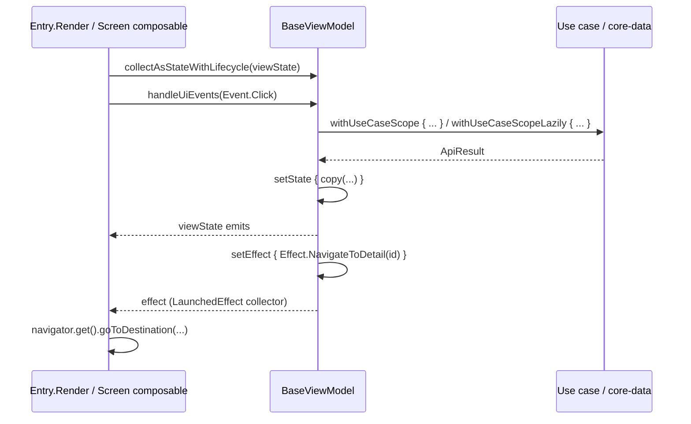

# Base screen architecture

## Purpose and when to use it

Every feature screen follows a small **MVI-style contract**:

| Piece | Type | Role |
|---|---|---|
| Contract | `IBaseContract.ViewState` / `ViewEvent` / `ViewEffect` | Marker interfaces for the screen's immutable state, the user intents, and one-off side effects. |
| ViewModel | `BaseViewModel<UiState, Event, Effect>` | Holds `viewState: StateFlow<UiState>`, receives events, emits effects, and runs use cases (`CoroutinesUseCaseRunner`). |
| UI | Composable rendered by an `INavigationEntry.Render` (Navigation3) | Collects state and effects, and sends events. |
| Async results | `UiResult<T>` | UI-facing result type mapped from core/data's `ApiResult`. |

## Package layout

```
com/core/presentation/base/
├── activity/BaseActivity.kt          # see app-and-activity.md
├── model/UiResult.kt
├── screen/BaseFlow.kt                # legacy Navigation Compose helper
├── utils/Extensions.kt               # UiResult.getOrElse / getOrNull
└── viewmodel/
    ├── BaseViewModel.kt
    └── IBaseContract.kt
```

## Type reference

### `base/viewmodel/IBaseContract`
```kotlin
interface IBaseContract {
    interface ViewState
    interface ViewEvent
    interface ViewEffect
}
```
Convention (from `demo/presentation/.../DemoContract.kt`): declare a `class XContract` with nested types that implement the markers.
Use `data class` for state, and `sealed interface` with `data object`/`data class` for events and effects.

### `base/viewmodel/BaseViewModel`
```kotlin
abstract class BaseViewModel<
    UiState : IBaseContract.ViewState,
    Event : IBaseContract.ViewEvent,
    Effect : IBaseContract.ViewEffect,
> : ViewModel(), CoroutinesUseCaseRunner
```

| Member | Visibility | Semantics |
|---|---|---|
| `final override val useCaseCoroutineScope = viewModelScope` | public | Scope used by the `CoroutinesUseCaseRunner` helpers (see [coroutines](coroutines.md)). |
| `val viewState: StateFlow<UiState>` | public | Backed by `MutableStateFlow(initialState)`. Collect with `collectAsStateWithLifecycle()`. |
| `val effect: Flow<Effect>` | public | `Channel<Effect>(CONFLATED).receiveAsFlow()`, a hot, **single-consumer** flow that keeps only the latest uncollected effect. |
| `abstract fun setInitialState(): UiState` | public | Initial state (evaluated lazily, but during construction, see *Gotchas*). |
| `abstract fun handleUiEvents(event: Event)` | public | Event handler. **The UI calls this directly** (the demo does `viewModel.handleUiEvents(event = it)`). |
| `abstract fun loadInitData()` | public | Initial load hook. Only the legacy `BaseFlow` calls it automatically (see below). |
| `protected fun setState(reducer: UiState.() -> UiState)` | protected | Atomic `MutableStateFlow.update(reducer)`. |
| `protected fun setEvent(event: Event)` | protected | `viewModelScope.launch { _event.emit(event) }` into a `MutableSharedFlow<Event>()` (no replay or buffer) collected in `init`, which calls `handleUiEvents`. It's only usable from inside the ViewModel (for example to re-dispatch). |
| `protected fun setEffect(builder: () -> Effect)` | protected | Evaluates `builder()` immediately, then `viewModelScope.launch { _effect.send(value) }`. |

`init { subscribeToEvents() }` launches the `_event` collector in `viewModelScope`.

### `base/model/UiResult<out T>` (sealed interface)

| Subtype | Fields | Notes |
|---|---|---|
| `data class Success<out T>(val data: T)` | `data` | |
| `data class Error<out T>(val message: String)` | user-facing `message` | Built by the `onError`/`onException` mappers of `withUseCaseScopeLazily`. |
| `class Loading<out T>` | | **Not a data class**, so check it with `is`. It's the default initial value of `withUseCaseScopeLazily`. |
| `class NoContent<out T>` | | **Not a data class.** Mapped from `ApiResult.NoContent`. |

### `base/utils/Extensions.kt`
- `fun <R, T : R> UiResult<T>.getOrElse(onFailure: () -> R): R` returns `data` for `Success`, else `onFailure()` (contract `callsInPlace(AT_MOST_ONCE)`).
- `fun <T> UiResult<T>.getOrNull(): T?`.

### `base/screen/BaseFlow` (legacy Navigation Compose only)
```kotlin
@Composable
inline fun <reified VIEWMODEL : BaseViewModel<*, *, *>> BaseFlow(
    navHostController: NavHostController,
    viewModelClass: Class<VIEWMODEL>,
    navigationGraph: INavigationGraph,                // com.core.presentation.navigation.model.graph (legacy)
    currentNavBackStackEntry: NavBackStackEntry,
    content: @Composable (BaseViewModel<*, *, *>) -> Unit,
)
```
1. `navGraph = remember(currentNavBackStackEntry) { navHostController.getBackStackEntry(navigationGraph) }`, the back-stack entry of the **graph** (route = graph object).
2. Builds `HiltViewModelFactory(LocalContext.current, navGraph.defaultViewModelProviderFactory)` and extras from `LocalViewModelStoreOwner`.
3. Creates `ViewModelProvider(navGraph.viewModelStore, factory, extras)` and gets the VM with key `viewModelClass.simpleName`. That makes it a
   **graph-scoped Hilt ViewModel** shared by every screen of the graph that uses the same class.
4. If the store didn't already contain that key, it calls `loadInitData()` once, right after creation.
5. Invokes `content(viewModel)`.

Only `navigation/model/utils/NavigationGraphBuilderExtensions.kt` (the legacy stack) uses it. Navigation3 entries **don't** go through `BaseFlow`.

## Data flow (Navigation3 screen)



## Full screen template (Navigation3)

```kotlin
// Contract
class ProfileContract {
    data class UiState(val isLoading: Boolean = false, val name: String = "", val error: String? = null) : IBaseContract.ViewState
    sealed interface Event : IBaseContract.ViewEvent {
        data object Refresh : Event
        data class EditClicked(val id: String) : Event
    }
    sealed interface Effect : IBaseContract.ViewEffect {
        data class OpenEditor(val id: String) : Effect
    }
}

// ViewModel
@HiltViewModel
class ProfileViewModel @Inject constructor(
    private val getProfile: GetProfileUseCase,
) : BaseViewModel<ProfileContract.UiState, ProfileContract.Event, ProfileContract.Effect>() {

    override fun setInitialState() = ProfileContract.UiState()

    override fun handleUiEvents(event: ProfileContract.Event) = when (event) {
        ProfileContract.Event.Refresh -> loadInitData()
        is ProfileContract.Event.EditClicked -> setEffect { ProfileContract.Effect.OpenEditor(event.id) }
    }

    override fun loadInitData() = withUseCaseScope(
        loadingUpdater = { loading -> setState { copy(isLoading = loading) } },
        onError = { e -> setState { copy(error = e.message) } },
        block = arrayOf(suspend {
            getProfile()
                .onSuccess { profile -> setState { copy(name = profile.name) } }
                .onError { _, body -> setState { copy(error = body) } }
        }),
    )
}

// Navigation3 entry (see navigation3.md for destination, graph and Hilt module)
class ProfileEntry @Inject constructor(
    override val navigator: Lazy<INavigationGraphManager>,
) : INavigationEntry<ProfileDestination, ProfileViewModel>() {

    @Composable
    override fun Render(params: ProfileDestination, viewModel: ProfileViewModel) {
        val state by viewModel.viewState.collectAsStateWithLifecycle()

        LaunchedEffect(Unit) { viewModel.loadInitData() }          // Navigation3 doesn't call it for you
        LaunchedEffect(Unit) {
            viewModel.effect.collect { effect ->
                when (effect) {
                    is ProfileContract.Effect.OpenEditor -> navigator.get().goToDestination(EditProfileDestination(effect.id))
                }
            }
        }

        ProfileScreen(state = state, onEvent = viewModel::handleUiEvents)
    }
}
```

`withUseCaseScope`'s `block` is a `vararg` that comes last, so pass a single block with `block = arrayOf(...)` or as a trailing positional argument after the named parameters.
See [coroutines](coroutines.md).

## Extension guide

- New screens: copy the template. Keep state immutable and update it only through `setState`.
- Shared state across screens of one graph: in Navigation3, ViewModels created inside a graph's entries share the graph's `ViewModelStore`
  (keyed by VM class). Use the same VM class in several entries of the same graph (see [navigation3](navigation3.md)).

## Gotchas and constraints

- **`setInitialState()` runs during `BaseViewModel` construction.** The `_viewState` initializer reads the lazy `initialState`, so
  `setInitialState()` executes **before the subclass's constructor body and property initializers**. Return constants or use constructor parameters only. Referencing
  subclass properties there yields `null`/default values.
- **`loadInitData()` isn't called by Navigation3.** Call it from `Render` (`LaunchedEffect(Unit)`) or the ViewModel's `init`. A
  `LaunchedEffect(Unit)` re-runs after the composable leaves and re-enters composition, so guard it if reloading isn't wanted.
- **`effect` is single-consumer and conflated.** Collect it in exactly one place. Effects emitted while nobody collects are dropped except the latest.
- `handleUiEvents` runs on the caller's thread (the main thread from Compose). Launch coroutines for work.
- `UiResult.Loading`/`NoContent` (and core-data `ApiResult.NoContent`) have no structural equality, so compare them with `is`.
- **Hilt ViewModels with dependencies in Navigation3 graphs:** entries are created with `viewModel(modelClass)` under a
  graph `ViewModelStoreOwner` that doesn't supply a Hilt factory (see [navigation3](navigation3.md#gotchas-and-constraints)).

## Related pages

- [Coroutines use case runner](coroutines.md)
- [Navigation 3](navigation3.md)
- [Legacy navigation](navigation-legacy.md)
- [Recipes](recipes.md)
- [core-data network (`ApiResult`)](../core-data/network.md)
