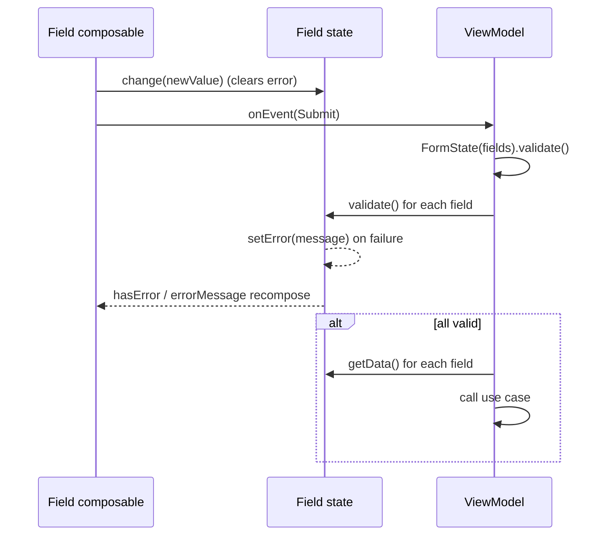

# Forms: state, validation and transforms

## Purpose and when to use it

Forms are built from **field state objects** that hold the value, the error state, validators and an optional transform. The field composables
([form-fields](form-fields.md)) render them, and `FormState` validates them together. They're plain classes backed by Compose `mutableStateOf`, so
keep them in the ViewModel (they survive recomposition and configuration changes but **not process death**) and read them from the UI.

## Package layout

```
ui/components/form/
├── FormState.kt
├── fields/
│   ├── BaseFieldState.kt
│   ├── input/{TextFieldState.kt, DateFieldFieldState.kt, RangeDateFieldFieldState.kt}
│   ├── select/SelectFieldState.kt
│   └── multiselect/MultiSelectFieldState.kt
├── utils/{Extensions.kt, Transform.kt}
└── validators/Validators.kt
```

## Type reference

### `FormState<T : BaseFieldState<*>>`
```kotlin
open class FormState<T : BaseFieldState<*>>(val fields: List<T>) {
    fun validate(): Boolean = fields.map { it.validate() }.all { it }
}
```
It validates **every** field (`map` first, so all fields get their errors set), then returns `true` only if all passed. Use `FormState<BaseFieldState<*>>` to mix field types.

### `BaseFieldState<T>` (`@Stable abstract class`)
| Member | Semantics |
|---|---|
| `val initial: T?` | Initial value. |
| `val transform: Transform<T>?` | Applied by `getData()`. |
| `val validators: List<Validators<T>>` | Run in order by `validate()`. |
| `abstract var value: T?` (`internal set`) | Current raw value. Only the module (the components) can assign it directly. Use `change()` from outside. |
| `var errorMessage: String?` / `var hasError: Boolean` | Compose state. |
| `fun setError(error: String)` / `fun clearError()` | Manual error control (for example server-side errors). |
| `abstract fun change(value: T)` | Sets the value **and clears the error**. |
| `abstract fun validate(): Boolean` | Runs the validators and sets the error. |
| `open fun getData(): T?` | `transform(value)` if both are non-null, else `value`. **Use this to read submit values.** |

### `TextFieldState`
`class TextFieldState(initial: String?, transform: Transform<String>, validators: List<Validators<String>>)`. `transform` is **required** (pass `Transform { it }` if you don't need one).
`validate()` runs validators in order and **stops at the first failure** (one error message at a time). Accepted validators:

| Validator | Passes when | Message |
|---|---|---|
| `Required(message)` | value non-null and non-empty | `message` |
| `MinSize(limit, message: (T) -> String)` | `length >= limit` | `message(value)` |
| `MaxSize(limit, message)` | `length <= limit` (also used by TextArea for the counter and Otp for the box count) | `message(value)` |
| `MinValue(limit: Double, message)` | numeric (`isNumeric()`) and `>= limit` | `message(value)` |
| `MaxValue(limit: Double, message)` | numeric and `<= limit` | `message(value)` |
| `Equal(reference: String, message)` | `value == reference` (`reference` is fixed at construction, so it isn't live) | `message(value)` |
| `Email(message)` | regex `^[A-Za-z](.*)([@])(.+)(\.)(.+)` (permissive) | `message` |
| `Phone(message)` | regex `^\d{9}$` (Spanish 9-digit format) | `message` |
| `Dni(message)` | `[0-9]{8}[A-Z]` with a valid mod-23 control letter, excluding `00000000T`, `00000001R`, `99999999R` | `message` |
| `Nie(message)` | `[XYZ][0-9]{7}[A-Z]` with the X→0/Y→1/Z→2 mod-23 control letter | `message` |
| `Passport(message)` | `[A-Z]{3}[0-9]{6}[A-Z]?` | `message` |
| `Regex(regex: String, message)` | full match | `message` |
| `Custom(message, function: (T) -> Boolean)` | `function(value)` (fails on `null`) | `message` |
| anything else (`MinDate`, `MaxDate`) | throws `Exception("... validator cannot be called on date state. Did you mean Validators.Custom?")` | |

> **Crash gotcha:** `MinSize`, `MaxSize`, `MinValue`, `MaxValue` and `Equal` call `message(value!!)` when they fail. If `value` is `null` (an untouched field with
> `initial = null`) this throws `NullPointerException`. Put `Required` **first** (validation stops at the first failure), or initialise with `""`.

### `DateFieldFieldState`
`class DateFieldFieldState(initial: Calendar?, transform: Transform<Calendar>, validators: List<Validators<Calendar>>)`. Accepts `Required`, `MinDate(limit, message)`
(passes if `value.after(limit)`, **exclusive**), `MaxDate(limit, message)` (`value.before(limit)`, exclusive) and `Custom`. Others throw. Stops at the first failure.
`MinDate`/`MaxDate` with a `null` value hit the same `value!!` NPE. The date picker also reads `MinDate`/`MaxDate` for its bounds.

### `RangeDateFieldFieldState`
`class RangeDateFieldFieldState(initial: Range<Calendar>?, transform: Transform<Range<Calendar>>, validators: List<Validators<Range<Calendar>>>)` (`android.util.Range`).
`MinDate` checks `value.lower.after(limit)`, and `MaxDate` checks `value.upper.before(limit)`. Otherwise it behaves like `DateFieldFieldState`.

### `SelectFieldState`
`class SelectFieldState(initial: Boolean, validators: List<Validators<Boolean>>)`, `transform = null`. Accepts `Required` (passes only if `true`, which suits "accept terms")
and `Custom`. Unlike text states, **all** validators run (`map` then `all`), so the last failing one sets the message.

### `MultiSelectFieldState<T : Any>`
`class MultiSelectFieldState<T : Any>(initial: List<T>, validators: List<Validators<MutableList<T>>>)`, `transform = null`.
- `value` is a `SnapshotStateList<T>` (a mutable, observable list). It's a plain property, not a `mutableStateOf`.
- `@JvmName("onItemSelected") fun change(value: T)` **toggles** membership of one item.
- `override fun change(value: MutableList<T>)` replaces the contents (clear + addAll).
- Accepts `MinSize`, `MaxSize`, `Required` (non-empty) and `Custom`. All run. `MaxSize` also sets the selection limit in multi-select components.
- The multi-select components use `T = SelectFieldState` (the selected item states). Map back to your domain values with your own `Map<SelectFieldState, Domain>`.

### `Validators<T>` (sealed interface)
```kotlin
sealed interface Validators<T> {
    class Required<T>(var message: String)
    class MinSize<T>(var limit: Int, val message: (value: T) -> String)
    class MaxSize<T>(val limit: Int, val message: (value: T) -> String)
    class MinValue<T>(var limit: Double, val message: (value: T) -> String)
    class MaxValue<T>(var limit: Double, val message: (value: T) -> String)
    class MinDate<T>(var limit: Calendar, val message: (value: T) -> String)
    class MaxDate<T>(var limit: Calendar, val message: (value: T) -> String)
    class Equal<T>(var reference: String, val message: (value: T) -> String)
    class Email<T>(var message: String)
    class Phone<T>(var message: String)
    class Dni<T>(var message: String)
    class Nie<T>(var message: String)
    class Passport<T>(var message: String)
    class Regex<T>(var regex: String, var message: String)
    data class Custom<T : Any>(var message: String, var function: (value: T) -> Boolean) {
        fun validateGeneric(value: Any?): Boolean   // unchecked cast, then function(it); null -> false
    }
}
```
All validators except `Custom` are plain classes (no structural equality).

### `utils/Transform<T>`
`fun interface Transform<T> { fun transform(value: T): T }`. It maps the stored value to the submitted value (for example trimming or upper-casing). It applies only in `getData()`,
**not** to what's displayed or validated.

### `utils/Extensions.kt`
`fun String.isNumeric(): Boolean` returns `toDoubleOrNull() != null`. Used by `MinValue`/`MaxValue`.

## Validation lifecycle



## Complete example

```kotlin
@HiltViewModel
class SignUpViewModel @Inject constructor(private val signUp: SignUpUseCase) :
    BaseViewModel<SignUpContract.UiState, SignUpContract.Event, SignUpContract.Effect>() {

    val name = TextFieldState(
        initial = "",
        transform = { it.trim() },
        validators = listOf(
            Validators.Required("Name is required"),
            Validators.MaxSize(40) { "Max 40 characters" },
        ),
    )
    val email = TextFieldState("", { it.trim().lowercase() }, listOf(Validators.Required("Required"), Validators.Email("Invalid email")))
    val birthDate = DateFieldFieldState(
        initial = null,
        transform = { it },
        validators = listOf(
            Validators.Required("Required"),
            Validators.MaxDate(Calendar.getInstance().apply { add(Calendar.YEAR, -18) }) { "You must be 18+" },
        ),
    )
    val terms = SelectFieldState(initial = false, validators = listOf(Validators.Required("Accept the terms")))

    private val form = FormState<BaseFieldState<*>>(listOf(name, email, birthDate, terms))

    override fun setInitialState() = SignUpContract.UiState()
    override fun loadInitData() = Unit

    override fun handleUiEvents(event: SignUpContract.Event) = when (event) {
        SignUpContract.Event.Submit -> if (form.validate()) {
            withUseCaseScope(
                loadingUpdater = { setState { copy(isLoading = it) } },
                block = arrayOf(suspend {
                    signUp(name.getData()!!, email.getData()!!, birthDate.getData()!!)
                        .onError { _, body -> email.setError(body ?: "Sign up failed") }   // server-side error on a field
                }),
            )
        } else Unit
    }
}
```
UI: `TextFieldComponent(state = viewModel.name, ...)`, `DateFieldComponent(state = viewModel.birthDate, ...)`,
`CheckboxComponent(state = viewModel.terms, ..., onValueChange = { viewModel.terms.change(it) })`. Pass `onValueChange` explicitly because of the Checkbox bug in [form-fields](form-fields.md).

Note that the field states are declared as **properties** and `setInitialState()` returns a constant. Don't reference these properties from `setInitialState()`
(see [base-architecture](base-architecture.md#gotchas-and-constraints)).

## Gotchas and constraints

- `TextFieldComponent` only **displays** errors when the value is non-blank, so empty `Required` fields fail silently in the UI ([form-fields](form-fields.md)).
- Date field components never display their state's errors.
- States aren't saveable, so process death resets the form.
- No built-in async validation. Use `setError` after server responses.

## Extension guide

- **New validator:** add a class to `Validators`, then handle it in the `when` of every state that should support it (`TextFieldState.validate()`, etc.). Unhandled validators throw at runtime.
- **New field state:** extend `BaseFieldState<T>`, back `value` with `mutableStateOf`, clear the error in `change`, and implement `validate` with the same `when` pattern.

## Related pages

- [Form field components](form-fields.md)
- [Base architecture](base-architecture.md)
- [Recipes](recipes.md)
