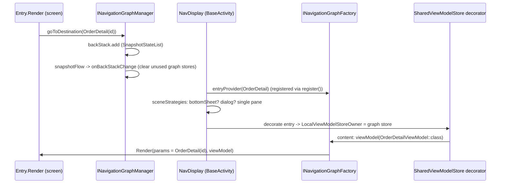

# Navigation 3 (`com.core.presentation.navigation3`)

## Purpose and when to use it

This is the **active** navigation system. `BaseActivity` renders `androidx.navigation3.ui.NavDisplay` over a back stack owned by
`INavigationGraphManager` (see [app-and-activity](app-and-activity.md)). Features plug in by contributing **graphs** and **entries** through Hilt.
Navigation is done by pushing destinations onto the back stack.

Don't use the legacy `com.core.presentation.navigation` package ([navigation-legacy](navigation-legacy.md)). Several type names are identical, so check your imports.

## Package layout

```
navigation3/
├── di/NavigationModule.kt
├── factory/{INavigationGraphFactory.kt, NavigationGraphFactoryImpl.kt (internal)}
├── listener/INavigationGraphListener.kt                (internal)
├── manager/{INavigationGraphManager.kt, NavigationGraphManagerImpl.kt (internal)}
└── model/
    ├── destination/INavigationDestination.kt
    ├── entry/
    │   ├── INavigationEntry.kt
    │   ├── type/{INavigationEntryDialog.kt, INavigationEntryBottomSheet.kt}
    │   ├── scenes/BottomSheetSceneStrategy.kt           (internal BottomSheetScene + BottomSheetSceneStrategy)
    │   └── decorators/viewModel/{NavigationGraphViewModelStoreOwner.kt (internal), SharedViewModelStoreNavEntryDecorator.kt (internal)}
    └── graph/
        ├── INavigationGraph.kt
        └── type/{INavigationGraphLauncher.kt, INavigationGraphBottomNavBar.kt}
```

## Core model

| Type | Kind | Contract |
|---|---|---|
| `INavigationDestination` | `abstract class : NavKey` | A route. Subclass it as a `@Serializable data object` (no args) or `@Serializable data class` (args are its fields). |
| `INavigationEntry<out DESTINATION : INavigationDestination, out VM : ViewModel>` | `abstract class` | Binds a destination type to a ViewModel type and UI. Requires `abstract val navigator: dagger.Lazy<INavigationGraphManager>` and `@Composable abstract fun Render(params: DESTINATION, viewModel: VM)`. |
| `INavigationEntryDialog<D, VM>` | `abstract class : INavigationEntry` | Adds `abstract val dialogProperties: DialogProperties`. Rendered by Navigation3's `DialogSceneStrategy` in a `Dialog`. |
| `INavigationEntryBottomSheet<D, VM>` | `abstract class : INavigationEntry` | Adds `abstract val modalBottomSheetProperties: ModalBottomSheetProperties` (`@ExperimentalMaterial3Api`). Rendered in a Material3 `ModalBottomSheet`. |
| `INavigationGraph` | `abstract class` | A group of entries (feature flow). It's the key for ViewModel sharing. |
| `INavigationGraphLauncher` | `abstract class : INavigationGraph` | Marks the **single** start graph. |
| `INavigationGraphBottomNavBar` | `@Immutable interface` | `order: Int`, `@DrawableRes icon: Int`, `label: String`, `notificationCount: StateFlow<Int>` (unused by the UI), `isFab: Boolean`. A graph implementing it gets a bottom-nav item, and the bar shows while one of its destinations is on top. |

`INavigationEntry` resolves its type arguments reflectively: `destination: KClass<out DESTINATION>` and `viewModel: KClass<out VM>` (both `by lazy`). It walks the
superclass chain to the first parameterized `INavigationEntry` supertype, so intermediate base classes work. It throws `NoSuchElementException("Generic type not found")` if
the arguments can't be resolved (for example when they're generic type parameters rather than concrete classes).

## Dependency injection

### Core module: `navigation3/di/NavigationModule`
`object NavigationModule`, `@InstallIn(ActivityRetainedComponent::class)`. All providers are `@ActivityRetainedScoped` (they survive rotation, one per activity "instance"):

| Provider | Returns |
|---|---|
| `providesNavigationGraphFactory(destinations: Map<Class<*>, @JvmSuppressWildcards Set<INavigationEntry<INavigationDestination, ViewModel>>>, graphs: Map<Class<*>, @JvmSuppressWildcards INavigationGraph>)` | `INavigationGraphFactory` (`NavigationGraphFactoryImpl`) |
| `provideNavigationScope()` | `CoroutineScope(SupervisorJob() + Dispatchers.Main.immediate)`, an **unqualified** `CoroutineScope` binding in this component |
| `providesNavigationGraphManager(scope, navigationGraphFactory)` | `INavigationGraphManager` (`NavigationGraphManagerImpl`) |

### Feature registration (pattern from `demo/presentation/.../di/DemoScreenModule.kt`)
Each feature graph contributes **two map entries under the same `@ClassKey`**: the graph instance and the **set** of its entries.

```kotlin
@Module
@InstallIn(ActivityRetainedComponent::class)
class OrdersNavigationModule {

    @Provides @IntoMap @ClassKey(OrdersNavGraph::class)
    fun providesOrdersGraph(graph: OrdersNavGraph): INavigationGraph = graph

    @Provides @IntoMap @ClassKey(OrdersNavGraph::class)
    fun providesOrdersEntries(
        list: OrdersListEntry,
        detail: OrderDetailEntry,
        filters: OrderFiltersSheetEntry,
    ): Set<INavigationEntry<INavigationDestination, ViewModel>> = setOf(list, detail, filters)
}
```
- The map value types must match **exactly** (`INavigationGraph` from `navigation3.model.graph`, and `Set<INavigationEntry<INavigationDestination, ViewModel>>`). Declaration-site `out`
  variance makes `setOf(entryA, entryB)` assignable.
- A graph without an entry set (or the reverse) is **silently dropped** by the factory join.
- One `@ClassKey` per map, so put all entries of a graph in one set provider (two providers with the same key fail with a Dagger duplicate-key error).
- Entries and graphs are normal `@Inject constructor` classes. Entries receive `override val navigator: dagger.Lazy<INavigationGraphManager>`.

## Factory: `INavigationGraphFactory`

| Member | Semantics |
|---|---|
| `navigationGraphsWithDestinations: Map<INavigationGraph, Set<INavigationEntry<...>>>` | `by lazy` join of `graphs` and `destinations` by class key, keeping only complete pairs. |
| `navigationGraphLauncher: Map.Entry<INavigationGraph, Set<...>>` | The pair whose graph `is INavigationGraphLauncher`. It throws `IllegalStateException` if there are none ("Launcher navigation graph is not set...") or more than one. |
| `navigationGraphBottomNavBar: Set<INavigationGraphBottomNavBar>` | Graphs implementing the bottom-nav interface. |
| `fun register(scope: EntryProviderScope<INavigationDestination>)` | For every entry: `scope.addEntryProvider(clazz = entry.destination, clazzContentKey = { it::class.qualifiedName.toString() }, metadata = ...)`. Metadata is `BottomSheetSceneStrategy.bottomSheet(entry.modalBottomSheetProperties)` for bottom-sheet entries, `DialogSceneStrategy.dialog(entry.dialogProperties)` for dialog entries, else empty. Content runs `val vm = viewModel(modelClass = entry.viewModel.java)` then `entry.Render(params = destination, viewModel = vm)`. |
| `fun getNavigationGraphFromDestination(destination): INavigationGraph` | The first graph whose entries include `destination::class`. It throws `IllegalArgumentException("Invalid destination")` otherwise. |

## Manager: `INavigationGraphManager`

| Member | Semantics |
|---|---|
| `val backStack: SnapshotStateList<INavigationDestination>` | `by lazy`: starts with `navigationGraphLauncher.value.first().destination.objectInstance`. The **first entry of the launcher graph's set must be a Kotlin `object` destination**, otherwise it throws `IllegalStateException("Destination X must be a Kotlin 'object'...")`. On creation it launches `snapshotFlow { it.toList() }.onEach { onBackStackChange() }` in the navigation scope. |
| `fun goToDestination(destination)` | `backStack.add(destination)`. |
| `fun goBack()` | `backStack.removeLastOrNull()` (it can empty the stack). |
| `fun getViewModelStore(graph): ViewModelStore` | `getOrPut(graph::class.qualifiedName!!) { ViewModelStore() }`. |

`NavigationGraphManagerImpl` also implements internal `INavigationGraphListener { fun onPop() }`. `onPop()` and every back-stack change run `onBackStackChange()`, which
computes the graphs still represented in the back stack and `clear()`s and removes the `ViewModelStore` of every other graph, destroying their ViewModels.

All operations mutate Compose snapshot state. Call them from the main thread (for example from `Render`, a `LaunchedEffect`, or click handlers).

## Graph-scoped ViewModels (entry decorator)

`BaseActivity` adds `rememberSharedViewModelStoreNavEntryDecorator(navigationGraphManager, graphs)` (internal, `remember`ed by `graphs`). For each `NavEntry`:
1. It finds the graph containing an entry whose `destination.qualifiedName == entry.contentKey`.
2. If found, it provides `LocalViewModelStoreOwner = NavigationGraphViewModelStoreOwner(manager.getViewModelStore(graph))`. Otherwise it renders unchanged.
3. Its `onPop` forwards to `INavigationGraphListener.onPop()`.

Consequences:
- **ViewModels are shared per graph and per class.** `viewModel(modelClass)` without a key means every entry in the same graph that declares the same VM type gets the **same instance**
  (useful for multi-step flows), and so does every back-stack instance of the same destination.
- A ViewModel lives until **no destination of its graph** remains in the back stack.

## Bottom-sheet scenes

`internal class BottomSheetSceneStrategy<T : Any> : SceneStrategy<T>`: if the **last** back-stack entry's metadata has key `"bottomsheet"` (`BOTTOM_SHEET_KEY`) with
`ModalBottomSheetProperties`, it creates an `internal class BottomSheetScene` (`OverlayScene`) whose content is
`ModalBottomSheet(onDismissRequest = onBack, properties) { entry.Content() }`, overlaying all previous entries. Otherwise it returns `null` (the next strategy applies).
`companion fun bottomSheet(modalBottomSheetProperties = ModalBottomSheetProperties()): Map<String, Any>` builds the metadata, and the factory calls it for `INavigationEntryBottomSheet`.

## Data flow



## Complete feature example

```kotlin
// Destinations
@Serializable data object OrdersListDestination : INavigationDestination()
@Serializable data class OrderDetailDestination(val orderId: String) : INavigationDestination()
@Serializable data object OrderFiltersDestination : INavigationDestination()

// Graph (launcher + bottom-nav tab in this example)
class OrdersNavGraph @Inject constructor() : INavigationGraphLauncher(), INavigationGraphBottomNavBar {
    override val order = 0
    override val icon = R.drawable.ic_orders
    override val label = "Orders"
    override val notificationCount: StateFlow<Int> = MutableStateFlow(0)   // must be a real StateFlow
    override val isFab = false
}

// Screen entry
class OrdersListEntry @Inject constructor(
    override val navigator: Lazy<INavigationGraphManager>,        // dagger.Lazy
) : INavigationEntry<OrdersListDestination, OrdersViewModel>() {
    @Composable
    override fun Render(params: OrdersListDestination, viewModel: OrdersViewModel) {
        val state by viewModel.viewState.collectAsStateWithLifecycle()
        LaunchedEffect(Unit) { viewModel.loadInitData() }
        OrdersListScreen(
            state = state,
            onOrderClick = { navigator.get().goToDestination(OrderDetailDestination(it)) },
            onFilters = { navigator.get().goToDestination(OrderFiltersDestination) },
        )
    }
}

// Bottom sheet entry sharing the same ViewModel (same graph, same VM class -> same instance)
class OrderFiltersSheetEntry @Inject constructor(
    override val navigator: Lazy<INavigationGraphManager>,
) : INavigationEntryBottomSheet<OrderFiltersDestination, OrdersViewModel>() {
    @OptIn(ExperimentalMaterial3Api::class)
    override val modalBottomSheetProperties = ModalBottomSheetProperties()

    @Composable
    override fun Render(params: OrderFiltersDestination, viewModel: OrdersViewModel) {
        FiltersSheet(onApply = { viewModel.handleUiEvents(OrdersContract.Event.ApplyFilters(it)); navigator.get().goBack() })
    }
}
```
Plus the Hilt module shown in *Feature registration*. Put `OrdersListEntry` **first** in the set if this is the launcher graph, because the start destination is the set's
first entry and must be an `object`.

## Gotchas and constraints

- **Hilt ViewModels with constructor dependencies.** `register()` calls `viewModel(modelClass)` under `NavigationGraphViewModelStoreOwner`, which isn't a
  `HasDefaultViewModelProviderFactory`. That means no Hilt factory is supplied, and `viewModel()` falls back to a no-arg instantiation factory. A `@HiltViewModel` with `@Inject constructor(dep: X)`
  will most likely fail with "Cannot create an instance of class ...". The demo works only because `DemoViewModel` has an empty constructor. To support injected ViewModels,
  make the owner provide a `HiltViewModelFactory` (for example implement `HasDefaultViewModelProviderFactory` with `HiltViewModelFactory(context, activity.defaultViewModelProviderFactory)`),
  or use `hiltViewModel()` with an explicit owner. Verify on a device before relying on injected ViewModels.
- **`loadInitData()` isn't called** for Navigation3 entries. Call it yourself.
- **Content keys are class names.** `clazzContentKey = qualifiedName`, so two back-stack instances of the same destination class (for example two `OrderDetailDestination`s with different ids)
  share saveable state and the ViewModel. Avoid stacking the same destination twice, or include the args in a distinct class.
- **Start destination:** the launcher graph's first set entry must be an `object` destination, with exactly one launcher graph.
- **Unregistered destination on top crashes** `BaseActivity` (`getNavigationGraphFromDestination` throws).
- **Back stack isn't persisted:** it lives in an `@ActivityRetainedScoped` object (it survives rotation, not process death), and destinations' `@Serializable` isn't used for restoration here.
- `goBack()` on a single-entry stack empties it. Guard it if needed.
- The navigation `CoroutineScope` is never cancelled.
- `notificationCount` must be a real `StateFlow`. `flowOf(0) as StateFlow<Int>` (as in the demo and component preview) throws `ClassCastException` if it's ever read.
- Bottom-nav tab taps aren't wired in `BaseActivity` (`onTabSelected = { }`).

## Extension guide

- **New screen:** destination + entry + add it to its graph's set provider.
- **New graph:** a graph class (optionally `INavigationGraphBottomNavBar`) + a `@ClassKey` module with both providers.
- **Dialog:** extend `INavigationEntryDialog` and provide `dialogProperties`. **Bottom sheet:** extend `INavigationEntryBottomSheet`.
- **New scene type:** implement `SceneStrategy<INavigationDestination>` and add it to `sceneStrategies` in `BaseActivity`. Attach metadata in `register()` based on a new entry subtype.

## Related pages

- [CoreApp and BaseActivity](app-and-activity.md)
- [Base architecture](base-architecture.md)
- [Recipes](recipes.md)
- [Legacy navigation](navigation-legacy.md)
- [Bottom nav bar](components-navigation.md)
