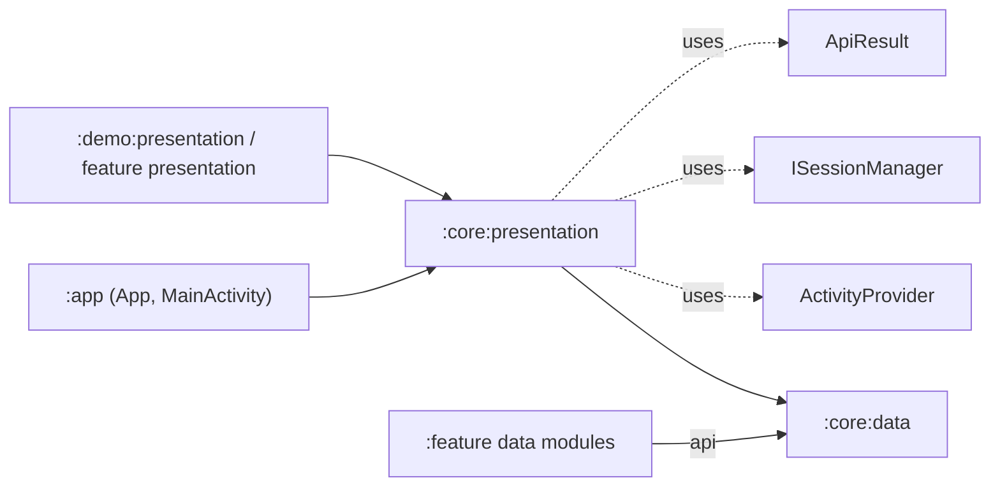

# core/presentation module overview

`:core:presentation` (namespace `com.core.presentation`) is the shared **UI layer**: the application and activity base classes, the screen
architecture (contract + `BaseViewModel`), the Navigation3 integration, and a full Compose **design system** (theme tokens and components).
Feature presentation modules build screens on top of it. The app module only subclasses `CoreApp` and `BaseActivity`.

## Package map

| Package (`com.core.presentation.*`) | Responsibility | Page |
|---|---|---|
| (root) `CoreApp` | `Application` base that initializes core/data's `ActivityProvider`. | [app-and-activity](app-and-activity.md) |
| `base.activity` | `BaseActivity`: the single-activity host (edge-to-edge, Theme, NavDisplay, bottom nav, session hooks). | [app-and-activity](app-and-activity.md) |
| `base.viewmodel`, `base.model`, `base.utils`, `base.screen` | `IBaseContract`, `BaseViewModel`, `UiResult`, `UiResult` extensions, legacy `BaseFlow`. | [base-architecture](base-architecture.md) |
| `coroutines` | `CoroutinesUseCaseRunner` (`ApiResult` → `UiResult` / Paging), `zipWithPreviousCount`. | [coroutines](coroutines.md) |
| `navigation3` | **Active** navigation: destinations, entries, graphs, factory, manager, scenes, graph-scoped ViewModels. | [navigation3](navigation3.md) |
| `navigation` | **Legacy, unused** Navigation Compose stack. | [navigation-legacy](navigation-legacy.md) |
| `ui.theme` | `Theme`, CompositionLocals, colors, palettes, dimensions, typographies. | [theme](theme.md), [theme-tokens](theme-tokens.md) |
| `ui.components.button`, `badge`, `alert`, `amount` | Action and feedback components. | [components-actions](components-actions.md) |
| `ui.components.topnavbar`, `toolbar`, `bottomnavbar`, `tab`, `stepper` | Navigation chrome. | [components-navigation](components-navigation.md) |
| `ui.components.container`, `bottomsheet`, `list` | Layout components (container, paging and list helpers commented out). | [components-layout](components-layout.md) |
| `ui.components.form` | Form state, validators and all field components. | [forms](forms.md), [form-fields](form-fields.md) |
| `ui.utils` | Accessibility, indication, lifecycle, modifier, density and keyboard helpers. | [ui-utils](ui-utils.md) |

## Architecture conventions

1. **Single activity, Compose only.** `MainActivity : BaseActivity : ComponentActivity`. There are no Fragments and no XML layouts.
2. **MVI screen contract.** `XContract` with `ViewState`/`ViewEvent`/`ViewEffect`, and `BaseViewModel` exposing `viewState: StateFlow` and `effect: Flow`. The UI calls `handleUiEvents`.
3. **Navigation3 by contribution.** Features provide `INavigationGraph` + `Set<INavigationEntry>` with `@IntoMap @ClassKey(Graph::class)` in **`ActivityRetainedComponent`**.
   Entries render screens and navigate through `INavigationGraphManager`. ViewModels are scoped to the graph.
4. **Results.** Data calls return core/data `ApiResult`, mapped to `UiResult` by `CoroutinesUseCaseRunner`.
5. **Design system.** Every component reads tokens from `LocalPalette`, `LocalDimensions`, `LocalTypographies` (and `LocalColors`) provided by `Theme`. Style/size/family
   variants are sealed interfaces with internal `remember*Style` resolvers, and many have a `Custom` escape hatch.
6. **Accessibility first.** Components take explicit `AccessibilityState.*` parameters and set semantics (traversal groups, collection info, state descriptions).

## Dependency graph

Classes used from core/data: `ActivityProvider` (CoreApp), `ISessionManager` and `SessionCommand` (BaseActivity), and `ApiResult` (CoroutinesUseCaseRunner).

## Build setup

> Full plugin reference: [Plugin: core.presentation](../core-dependencies/plugin-core-presentation.md). Feature modules use
> [Plugin: feature.presentation](../core-dependencies/plugin-feature-presentation.md). See also the [dependency visibility matrix](../core-dependencies/dependency-visibility.md).

`core/presentation/build.gradle.kts` applies `alias(coreLibs.plugins.core.presentation)` and sets `namespace = "com.core.presentation"`. That's all.
The plugin is `com.core.dependencies.plugins.CorePresentationPlugin` (included build `core/dependencies`):

**Plugins:** `android-library`, `kotlin-compose`, `kotlin-serializable`, `google-ksp`, `google-hilt`, `detekt`.
**Android:** `defaultConfiguration` (compileSdk 37, minSdk 26, Java 21, `testFixtures.enable = true`), `configureBuildTypes` (minified release with `proguard-rules.pro`),
`configurePackaging`, and `buildFeatures.compose = true`. Unlike core/data, `configureTests()` **isn't** applied (no Robolectric JVM-args or resource configuration).

**Dependencies:**

| Configuration | Dependency |
|---|---|
| `implementation` | `project(":core:data")` (**not** re-exported) |
| `implementation` | `kotlin("reflect")`, Compose BoM (platform), `hilt-android` |
| `api` | `kotlinx-serialization-json`, `compose-foundation`, `compose-preview` (ui-tooling-preview), `compose-material3`, `lifecycle-viewModel`, `navigation` (Navigation Compose), `navigation-hilt` (hilt-navigation-compose), `navigation3-runtime`, `navigation3-ui`, `paging`, `browser` (Custom Tabs) |
| `debugImplementation` (`debugApi` helper) | `compose-preview-debug` (ui-tooling) |
| `ksp` | `kotlin-metadata`, `hilt-compiler` |
| `testFixturesApi` | bundle `test-unit` (coroutines-test, Robolectric, hilt-testing, mockk) |
| `kspTest` | `hilt-compiler` |
| `detektPlugins` | `detekt-ktlint`, `detekt-library` |

Exact versions are in `core/dependencies/gradle/libs.versions.toml`.

## How other modules consume it

- **`FeaturePresentationPlugin`** (feature presentation modules such as `:demo:presentation`): `implementation(project(":core:presentation"))`, Hilt + KSP, Compose, and
  `testImplementation(testFixtures(project(":core:presentation")))`. Because core/presentation only `implementation`s core/data, **feature presentation modules don't see
  core/data types** (`ApiResult`, `ISessionManager`, …) unless they also depend on a feature data module (which `api`s core/data) or on core/data directly. All `api` libraries above
  (Material3, Navigation3, Paging, serialization, …) are visible to features.
- **`AppPlugin`** (`:app`): `implementation(project(":core:presentation"))` + Hilt. The app provides `App : CoreApp()` (`@HiltAndroidApp`) and `MainActivity : BaseActivity()`.

## Manifest and resources

- `src/main/AndroidManifest.xml` is **empty** (no permissions, components or meta-data).
- `res/drawable`: `ic_back`, `ic_close`, `ic_error`, `ic_info`, `ic_password_hide`, `ic_password_show`, `ic_success`, `ic_warning` (vector icons used by components: back/close by
  TopNavBar and BottomSheet, the status icons by `BottomSheetStyle`, and password icons by Password/OTP fields and, incorrectly, Alert).
- `res/font`: `inter`, `inter_medium`, `inter_semibold`, `inter_bold`, `inter_extrabold`, `inter_black` are **downloadable font** XMLs (Google Fonts provider
  `com.google.android.gms.fonts`, query `Inter` / `Inter:wght<N>`, certs `@array/com_google_android_gms_fonts_certs`). See [theme](theme.md).
- `res/values/font_certs.xml` contains the Google Fonts provider certificates (dev + prod arrays). `res/values/preloaded_fonts.xml` is the `preloaded_fonts` array listing all six fonts. It isn't
  referenced by a `<meta-data android:name="preloaded_fonts">` in this module's (empty) manifest, so preloading only happens if the app manifest declares it.
- `res/values/strings.xml`: `ok`, `cancel`, `accessibility_Back`, `accessibility_close`, `show_password`, `hide_password`, `max_chars` ("%s of %s"),
  `accessibility_multiselect_no_limit`, `accessibility_multiselect_single_selected`, `accessibility_multiselect_single_unselected`, `accessibility_multiselect_limit_status`,
  `accessibility_multiselect_limit_reached`, `accessibility_step`, `accessibility_amount_empty`, `accessibility_select_date`, `accessibility_select_ranges_dates`,
  `accessibility_from`, `accessibility_to`. English only, with no other locales.

## ProGuard / R8

`proguard-rules.pro` has only the default commented template, and `consumer-rules.pro` is empty. Navigation3 entries resolve generic type arguments by reflection
(`INavigationEntry.extractTypeArgument`), and destinations are resolved by `KClass`/`qualifiedName`. If the app enables minification, keep the generic signatures of
`INavigationEntry` subclasses and the destination class names (`-keepattributes Signature` and keep rules for `INavigationEntry`/`INavigationDestination` subclasses). This hasn't been verified in a minified build.

## Known issues summary

See the individual pages. Highlights: `BaseActivity` isn't a `FragmentActivity` (core/data activity results and permissions don't work), bottom-nav tab taps aren't wired,
Navigation3 ViewModels are created without a Hilt factory, `loadInitData` isn't called by Navigation3, Checkbox/Toggle ignore taps without `onValueChange`, date fields don't
show validation errors, `CurrencyType.Symbol` crashes `AmountFieldComponent`, three layout files are commented out, and `Theme` disables system font scaling.

## Related pages

- [Quickstart](../quickstart.md)
- [core-data overview](../core-data/overview.md)
- [Navigation 3](navigation3.md)
- [Recipes](recipes.md)
- [Testing](testing.md)
